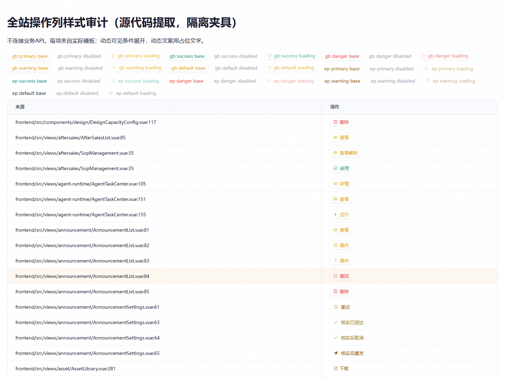

# 全站操作列按钮样式与颜色检查

检查日期：2026-10-02。源码与最近部署基点：`6d8150654714cee9973b19608fc4540ae809122b`。

## 结论

**尚未统一。** 共享换行布局已全部接入；颜色映射、link按钮外观、warning语义和个别页面覆盖存在差异。本轮只检查并记录，没有修改应用源码、提交或部署。

## 覆盖与方法

- 扫描主站全部364个Vue文件。定位89个页面及子组件中的119个标准操作/处理列，直接声明272个按钮；另外追踪批次导出共享组件的3处接入，补查无标题打印列及数据字段内交互。
- PM独立前端另有1个任务表操作列，使用自己的原生按钮样式与token。
- 标准操作列272个按钮：203个GlassButton、69个Element Plus；269个为link，3个为solid/plain；没有显式small尺寸，1处inline颜色覆盖。
- 浏览器加载真实共享组件和主站全局样式，以源码提取的展示属性渲染隔离夹具，展开动态tone分支及复用导出，得到282个展示样例；加上默认/hover/active/focus/disabled/loading比较矩阵及PM，收集370项computed-style观测。桌面1440px和手机390px截图已保存，无pageerror。
- 夹具不调用业务API，动态权限/显示条件展开、动态文案用占位文字；不是逐个线上路由带生产数据的人工验收，也没有执行生产按钮业务动作。

## 已确认的不一致

| 问题 | 实际证据 | 影响及处理方向 |
| --- | --- | --- |
| 常规link文字颜色分成三套 | GlassButton缺省 `#E0A50B`；Element Plus primary `#9A6F07`；无type的Element Plus `#252A33` | 查看/详情等常规操作在两套组件间色深不同。亮金对白底对比约2.20:1，深金约4.52:1，应统一普通link深色token |
| link外观不一致 | 比较矩阵中GlassButton高21px、默认带阴影；Element Plus高23px、无阴影；均13px文字、12px圆角 | 同一行的点击区域和浮起感不同；DESIGN还要求操作列link无圆角，应在操作列统一几何与阴影规则 |
| GlassButton不支持调用方使用的warning tone | `CommissionBatch.vue:87`“发送确认”、`ProcessManage.vue:68`“禁用”传warning；组件只定义success/danger，实际仍为亮金/主色hover | warning语义失效。应实现warning文字语义，并明确禁用动作统一映射 |
| 物流删除颜色脱离按钮语义 | `TrackingList.vue:169` inline `var(--el-color-danger)`，实测 `#A93226`；普通danger为 `#E5484D`；hover文字不变，背景却是主色浅金 | 危险按钮的文字和hover背景属于不同色族，应使用统一danger tone |
| 操作列混用solid/plain | `ProductionOrderPrint.vue:122`“打印整单”为solid；`SafetyConfig.vue:185-186`“AI/生产下单”为plain；无标题类别打印列`:79`另有solid按钮 | 标准操作列3个例外，无标题打印列另1个例外；应统一link，或给确需强调的业务例外登记明确理由 |
| 图标接入不齐 | 标准操作列64个按钮、分布32个模板，没有显式业务图标（CSV逐项列出） | 与图标+文字规范不一致；需按真实场景确认图标或紧凑删除等合理例外，不能直接将64项都认定为业务缺陷 |
| 文档与当前代码冲突 | DESIGN仍写Ant Design蓝色、主站/PM相同按钮token；已部署主站为科技轻快色，PM仍旧色 | 修复时同步文档，避免下一轮按不同基准开发 |
| PM与主站同语义颜色不同 | PM任务删除 `#D9363E`、12px字、约26.8px高、3px圆角；主站danger为 `#E5484D` | PM有独立设计系统；若“全站统一”包含PM，需明确共用语义色和操作列尺度 |

具体示例：售后查看 `frontend/src/views/aftersales/AfterSalesList.vue:85` 为GlassButton；色块配比详情 `frontend/src/views/color/BlendView.vue:81` 为Element Plus primary。来源和属性以CSV为准。

## 已一致的部分与验证证据

- 119个标准操作列全部带 `table-action-column`，共享换行布局接入检查通过：`node --test frontend/tests/tableActions.test.mjs`，1/1。这个测试只检查布局，不证明颜色与图标统一。
- 两套共享danger/success文字按钮的正常及hover色族相同（物流inline例外除外）。10个禁用比较按钮的默认/hover灰字一致，10个loading比较按钮保留原色及背景。
- 没有发现标准操作列显式 `size="small"`。当前核验覆盖源码、CSS和隔离浏览器展示；未新跑生产构建，因为未修改应用源码。

## 完整清单与截图

- [逐项按钮清单（276行，含272直接声明、3处复用和1个PM操作）](assets/2026-10-02-action-column-inventory.csv)
- [桌面对比](assets/2026-10-02-action-column-desktop.png) · [手机对比](assets/2026-10-02-action-column-mobile.png)

原始AST清单、隔离夹具、浏览器370项样式数据和检查stdout保留于主目录 `tmp/action-column-audit/`。临时浏览器和本轮4333开发服务已关闭，原有3000服务未处理。
