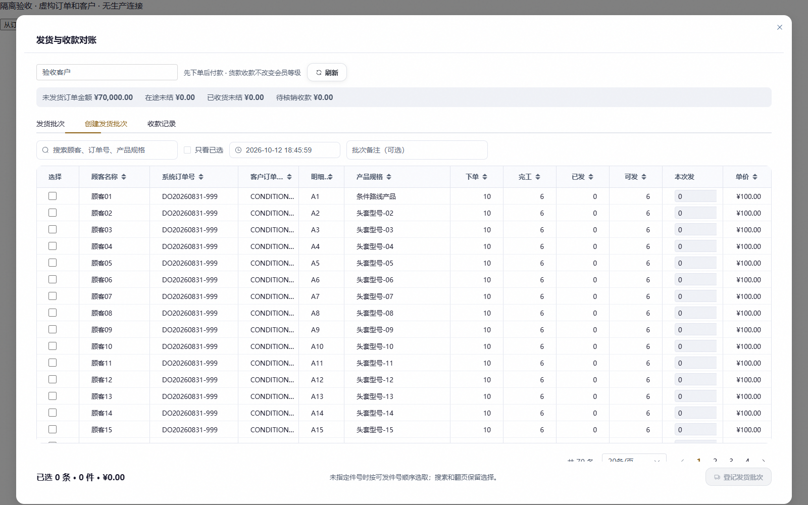
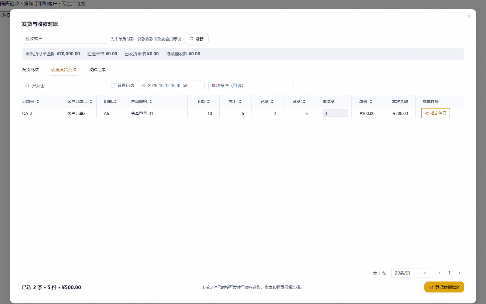
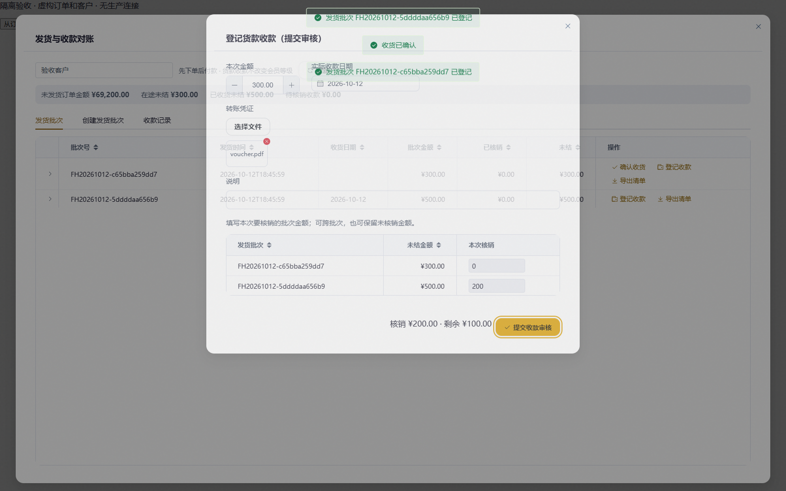
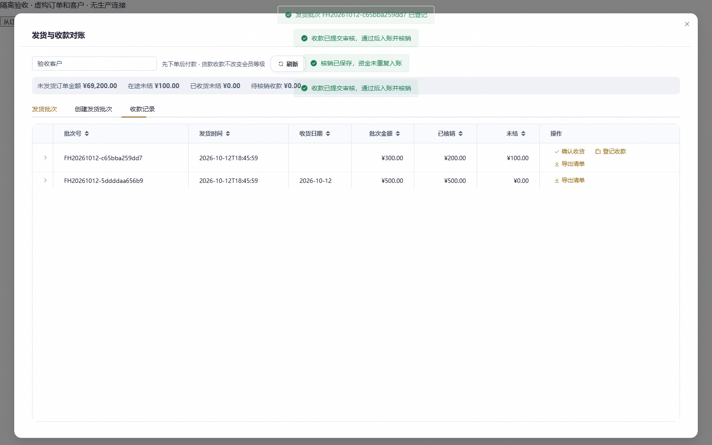

# 内贸逐件分批交付与货款核销验收

交付分支：`codex/domestic-shipment-settlement`。本地实现及隔离验收，未合并、未推送、未部署、未执行共享数据库迁移。

## 结果

- 支持同客户跨订单组成批次，同一订单明细按具体件分数量发货。
- 顾客名称、订单和产品搜索；翻页及搜索保留选择；桌面实测行高33px，底部汇总始终可见。
- 客户收货登记、凭证收款申请、审核后一次入账；一批多次收款、一款跨批核销、后续追加同批核销。
- 发货和核销保存稳定身份及金额快照；已发件报工/明细保护；终止只退未交付金额；普通货款不影响会员。

## 证据

Headless Edge运行真实Vue组件，连接本地隔离SQLite HTTP服务，测试3张订单70条明细。未 mock 发货、收款、核销接口；只有登录角色与业务数据使用本地虚构样本。

完整路径：先跨两张订单发5件，再从同一明细指定另3件；第一笔收款300元先核销200元、之后追加100元；第二笔400元跨两批核销。实际查询结果是8件交付、2笔收款账行；已收货未结0元、在途未结100元、待核销0元。CSV实际下载并读回，含顾客名称及具体件号。无pageerror。

详细记录：[机器验收结果](domestic-delivery-evidence/verification.json)、[导出文件](domestic-delivery-evidence/shipment-export.csv)、[后端日志](domestic-delivery-evidence/backend-tests.txt)。

## 检查与限制

- 相关后端回归233项通过，覆盖交付、原订单/报工/审核、订单导出、经营资金。新增交付14项单独复验通过，含迁移SQLite演练、时区跨日、资金角色、旧快照重放、明确死锁回滚重试及不确定连接错误禁止自动重试。
- Node选择逻辑2项通过；Vue生产构建通过；Alembic单一head为186。
- 本任务增量约定检查0项问题。全仓 `check_conventions.py --strict` 仍被原发票页面17项UI基线告警阻断，两个发票文件相对HEAD无修改；没有重写基线或修改无关文件。[检查日志](domestic-delivery-evidence/conventions.txt)
- 独立审查所发现的接口契约、锁序、权限、幂等和追加核销问题已修复。MySQL 1213仅允许一次明确回滚后的同键重试；其他连接/提交错误不自动重发。本地SQLite及SQL锁意图检查不能证明真实共享MySQL的并发压力。
- `git_sweep.py --no-fetch` 已运行，是本地Git快照，未执行远端写入或清理他人分支。
- 尚未做生产迁移/生产客户期初对账；历史已发货/收款不猜造关系。

## 复现

后端使用项目现有Python环境与隔离测试fixture，无需生产配置。运行 `scripts/qa_domestic_delivery.py` 创建新的本地临时SQLite库并在127.0.0.1:8767提供API。

将 `scripts/domestic-delivery-qa/` 的三个文件复制到 `frontend/tmp/domestic-delivery-qa/`，从frontend运行 `node node_modules/vite/bin/vite.js --config tmp/domestic-delivery-qa/vite.config.mjs`，仅将API代理到本地8767。安装本地临时playwright后，从仓库根运行 `node scripts/verify_domestic_delivery.mjs`。脚本使用已安装Edge，不需要下载Chromium。验证脚本每次应使用新启动的隔离库，避免重复样本污染计数。
