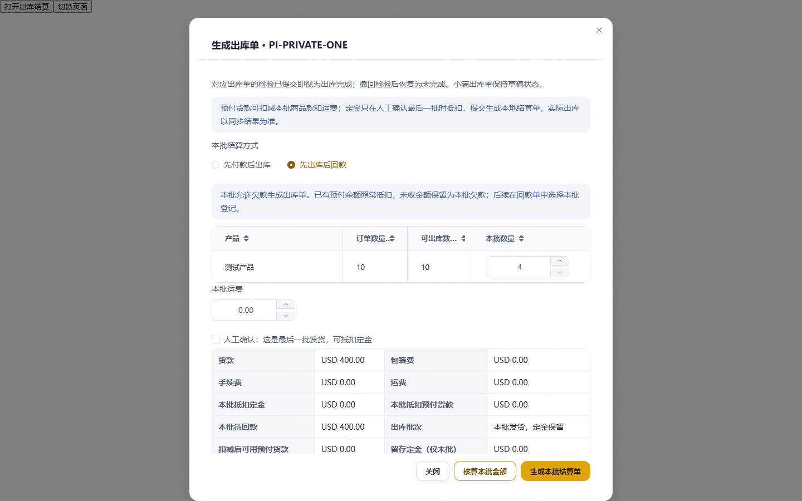
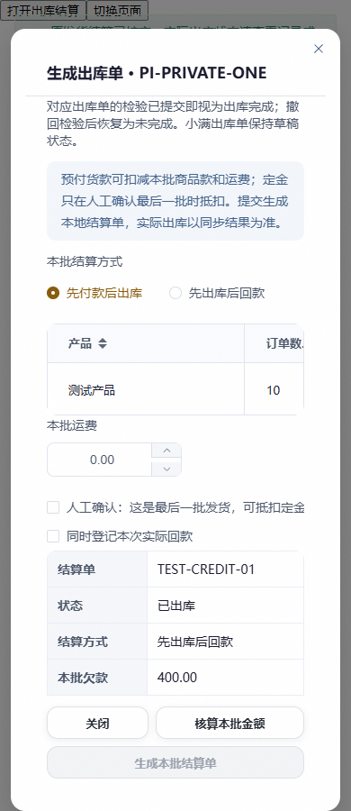
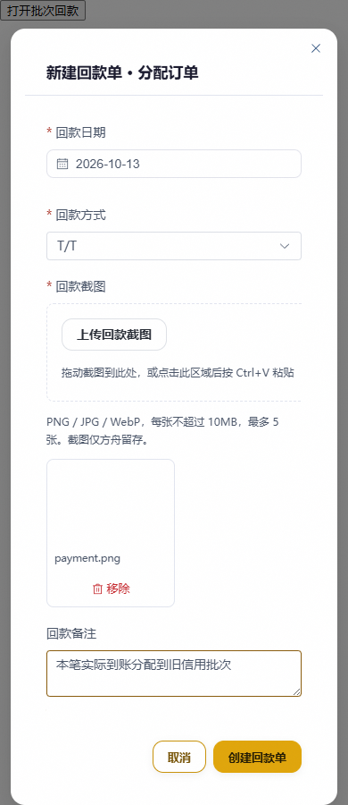

# 预售按批次先出库后回款：本地验收

日期：2026-10-13。分支：codex/presale-credit-batches。基点：c15b1d2c。独立 worktree 保存本次代码和文档；主目录已有修改未纳入本次任务。未合并、未推送、未部署，没有真实小满单据、到账或共享库写入。

## 已实现

预售发货批次可选择“先付款后出库”或“先出库后回款”，默认及历史缺字段继续先付款。已有资金仍按冻结计划引用，先出库批的未收部分单独保留为欠款；后续可分次选择原批次回款。款项未生效只占登记额度，不提前清欠。后补款、未发送补款作废均保留原物理出库状态及身份；出库结果未知不重复 POST。

复用既有快照、资金应用、回款与审计表，无 schema 迁移。记录信用补款曾生效的 credit_effective 事实；原真实资金失效仍须核对，不能把撤销生效改成普通欠款。共享预付款可以同时引用到多个批次，不受单批补款日志查询限制。

独立审查发现并修复运费组件等待目标绑定的阻塞：仅允许正确的 waiting_target 运费款在没有原订单ID、远端回款ID、token或lease时绑定已核验目标。其他身份、资金与权限保护保持。最终独立复审未发现明确阻断问题。

## 验证结果

| 验证 | 实际结果与范围 |
| --- | --- |
| 受影响后端回归 | 312 passed：预售、资金、检验、批次回款、回款管理/恢复/协议；内存 SQLite，所有供应商观察均为显式测试数据 |
| 最终后端专项 | 63 passed：信用批14项加现有runtime回归；与前述回归重叠，不相加；覆盖共享预款、撤生效、部分收款、未发送补款作废、运费延迟绑定、出库超时防重及旧版报价余额读取 |
| 真实 MySQL | 6 passed：独立 MySQL 8.4.6、真实 JWT/API、REPEATABLE READ；同键创建及补款唯一，不同键竞争409，后补款保留已出库状态，陈旧快照下当前资金栅栏仍读到已生效历史事实；没有外部 POST |
| Node 回归 | 27 passed：批次选择与金额/版本、资金用途、原提交冻结及恢复、结算状态、实际出库确认 |
| 浏览器关键路径 | 真实 Vue/Element Plus/Chrome，1440/390/320 宽度，生产公共样式、合成 API；默认先款、切换后重新报价、无新回款创建信用批、已出库仍显示欠款、旧批选择、刷新保持目标、回款提交正确批次/版本均通过，无 pageerror |
| 前端生产构建 | npm run build 通过；现有混合导入和较大 chunk 警告 |
| diff / 约定检查 | git diff --check 通过。严格 check_conventions 被17项已有 UI 债务阻断：InvoiceAccessoryTable/InvoiceHairTable固定列宽及后者deep覆盖基线；主目录相同17项，两个文件均无本次修改，没有更新基线掩盖错误 |
| Git 巡检 | git_sweep.py --no-fetch 已执行，仅本地远端快照。发现已有186迁移编号分叉；本次不增加迁移，不处理其他代理的分支和工作成果 |

后端入口：backend/tests/test_presale_credit.py、backend/tests/portal_mysql/test_mysql_presale_credit.py。MySQL使用项目 opt-in fixture 指定 mysqld 与全新临时目录，拒绝 backend/.env 和非本测试拥有的连接；仅补齐测试所需的既有 AccountUnlockAudit 模型表。测试依赖 reportlab 安装在本 worktree 的 tmp/test-deps，不修改主目录 Python 环境。供应商证据均为合成数据。

浏览器入口：frontend/tests/presaleCredit.browser.mjs，参数依次为 Playwright 模块绝对目录、Vite URL、证据目录。新回款测试使用 presaleCreditReceiptHarness.html 引入主站公共样式；出库测试使用既有 shipmentSubmissionHarness.html。构建和测试日志位于 tmp/credit-*.log，浏览器汇总为 [results.json](assets/presale-credit-2026-10-13/results.json)。

临时产物：MySQL测试进程已退出并只读核验无本任务 mysqld 残留。清理 tmp/credit-mysql 至 credit-mysql-6 目录时，工具自动审批拒绝，返回 blocked by policy，没有更详细原因；目录保留，未通过其他入口删除。最终运行元数据另存 tmp/credit-mysql-runtime.json，验证日志和截图保留。

## 页面验收

| Before | After | Why |
| --- | --- | --- |
| 批次统一先款 | 明确选择本批结算方式，默认先款 | 仅放行用户选中的批次，下一批重新默认先款 |
| 只有未登记余额 | 并列欠款、已登记待生效、未登记货款/运费 | 待同步款不能被误认为实际清欠 |
| 回款仅当前批 | 历史信用批也可选，多候选明确选择，刷新保留目标 | 避免把实际到账错挂最新批次 |

没有新增自定义动效；沿用现有组件和减少动态样式，表单/金额不延迟显示。桌面与窄屏弹窗、滚动内容和操作按钮已实际验证。

## 实际边界

本次完成本地实现和验证。未联测正式小满租户的完整“先出库、后登记回款”顺序。官方 [出库接口](https://open.xiaoman.cn/api-3478296) 与 [回款接口](https://open.xiaoman.cn/api-3478278) 独立，公开文档未列先付款前置条件；契约判断不能替代具体租户的真实联测。未来如供应商拒绝或结果未知，保留原任务、欠款和错误，沿用原单回读，不虚构收款或盲重试。

沿用现有回款分配约束：同一笔到账对每个订单只选择一个批次，本轮不新增同订单跨多个批次分摊。任何进一步合并、推送、部署、真实租户联测都需覆盖具体动作的授权。
