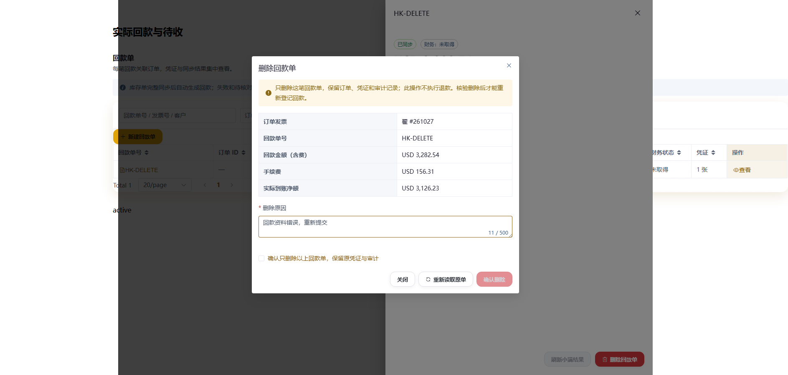
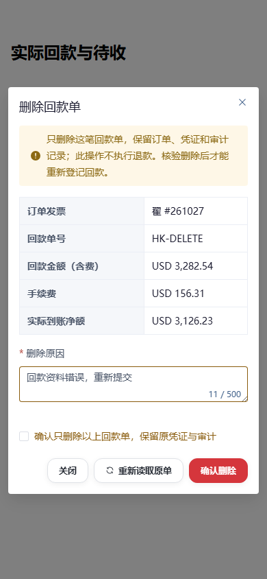

# 单笔回款删除入口

实现阶段及验证记录；最终Git交付状态见 `docs/handoff.md` 最新交付条目。

2026-10-14，本地实现及验证完成；未合并、推送或部署，未修改生产角色权限或再次操作生产回款。

订单发票「实际回款与待收」以及「回款单 → 查看」详情底部增加「删除回款单」。业务员需既有 `receipt:delete` 动作权限，且原订单在本人数据范围；`receipt:write/admin` 不隐含删除权，不自动授予权限。回款页仍遵守原查看权限。

点击入口，先读取原单及远端状态，展示编号、含费金额、手续费和净额。填写原因、勾选确认后只删除这一笔回款；订单、出库、原凭证、金额及审计保留，不执行退款。未发送的普通款作废；已同步款经小满删除核验后归档。刷新资金汇总，再用「补登记回款」重新提交。

原删除请求一旦记录，出现超时或回读失败时只显示「删除待核验」，用「继续核验删除」查询原单；不会重复发送远端删除，也不提前释放额度。小满原单仍存在时继续冻结，预售、汇总批次、未释放发货资金分配和正在发送的款项不支持单笔删除。小满软删除保留详情时，必须双轮完整有效/删除窗口一致，原ID仅在已删除列表，并核对原关联；明确 Not Found 则须完整全局有效索引无原ID。

持久状态保存于原 `ReceiptLog` 的 `delete_started` 审计，发送前同事务冻结原 `Receipt` 为 `uncertain/blocked`；无需迁移。原自动生成意图保持 converted，删除不会导致第二次自动建款。权限及订单、回款、自动意图在外部读取前后重新核对；外部证据与删除请求均不持有业务锁。待核验期间，原回款编辑、管理员恢复、整单删除和后台回读/绑定不能覆盖冻结状态。

删除后若共享索引尚未反映原ID移除，资金汇总仍按现有规则冻结，系统后台完成索引重建后再刷新。没有手工改索引校验和、水位或绕过余额核验。

## 验证证据

- 隔离 SQLite、全部小满请求替身：订单/回款删除、备注修正、回款管理、恢复与协议联合回归 **220 passed**。最后补充审计只保存财务事实、不保存提供方私有文件URL的回归，删除专项及证据文件 **39 passed**；未使用共享生产库执行写入型测试。
- Node 回款状态/表单回归 **11 passed**。Playwright **7 个场景通过**：独立组件、键盘确认、订单内入口、完整回款列表/详情入口、390px手机未知结果后继续核验、撤回权限、迟到预览切换回款。所有业务API请求均被本地替身拦截，零浏览器运行错误。
- 最终前端 `npm run build` 成功；保留既有动态/静态混合引用及大包提示，无构建错误。约定检查、diff检查通过；Git巡检使用 `--no-fetch`，仅本地快照，不授权整合其他分支。
- 独立 agent 审查发现并复现后台已排队回读可覆盖删除冻结的P2；在入口、锁内写回、异常恢复及统一绑定层增加删除围栏，补回归；原复现场景由独立 agent 再次运行通过，复审无阻断。
- UI及动效检查沿用 `DESIGN.md`、Emil标准、共享按钮和对话框；无新增动画，手机减少动态模式、视口宽度及键盘确认均有实际验证。

| 原行为 | 当前行为 | 对用户的影响 |
| --- | --- | --- |
| 只能整单删除或管理员核实远端变更 | 本人普通回款有独立删除入口 | 单笔录入错误可以直接处理 |
| 删除异常依赖人工诊断 | 原单显示继续核验，权限与归属仍实时检查 | 业务员可自行查询原删除结果 |
| 后台回读可能恢复旧款状态 | 删除标记阻止后台和其他入口覆盖冻结 | 未核实删除前不会出现重复登记 |

以下为本地接口替身界面，不代表生产已上线。

恢复与验证脚本保留于 `frontend/tests/receiptDeleteHarness.html`、`receiptDelete.browser.mjs`、`backend/tests/test_receipt_delete.py`。原始截图及浏览器结果、Git巡检保留在本任务 `tmp/receipt-delete-ui/` 与 `tmp/git-sweep.html`；未合并的任务worktree保留供继续交付。

## 内网 HTTP 补登记回款无响应

「翟 #261027」所属业务员当前已有 `receipt:write`；生产服务只读核验显示订单访问及登记权限允许，资金汇总无阻塞。本次不修改授权，不新建生产回款。

真实 LAN HTTP 浏览器中 `isSecureContext=false`、`crypto.randomUUID` 不存在、`crypto.getRandomValues` 可用。点击补登记时弹窗初始化抛出 `crypto.randomUUID is not a function`，未发起登记请求；同环境下管理员同样失败。管理员在其他环境可用不能据此判定角色缺权。

`InvoiceReceiptPaymentDialog.vue` 改用安全随机字节生成 UUIDv4，初始化一次并复用于同一弹窗内失败重试。`receiptRegistrationHttp.browser.mjs` 在实际 LAN HTTP 下测试普通业务员及管理员：打开弹窗、填写金额/方式、上传合成凭证，首次登记模拟503，资料保留，重试模拟成功；断言 UUIDv4 格式与两次完整payload一致，零页面异常。所有业务API拦截为本地替身，不提交实际回款。红灯复现与修复后结果保留在 `tmp/receipt-register-http/before.json`、`after.json`，独立 agent 窄范围只读复审无阻断。

此修复与删除入口共同保留在本地任务分支，未部署；生产现有 HTTP 页面仍需发布修复后才能恢复此入口。
