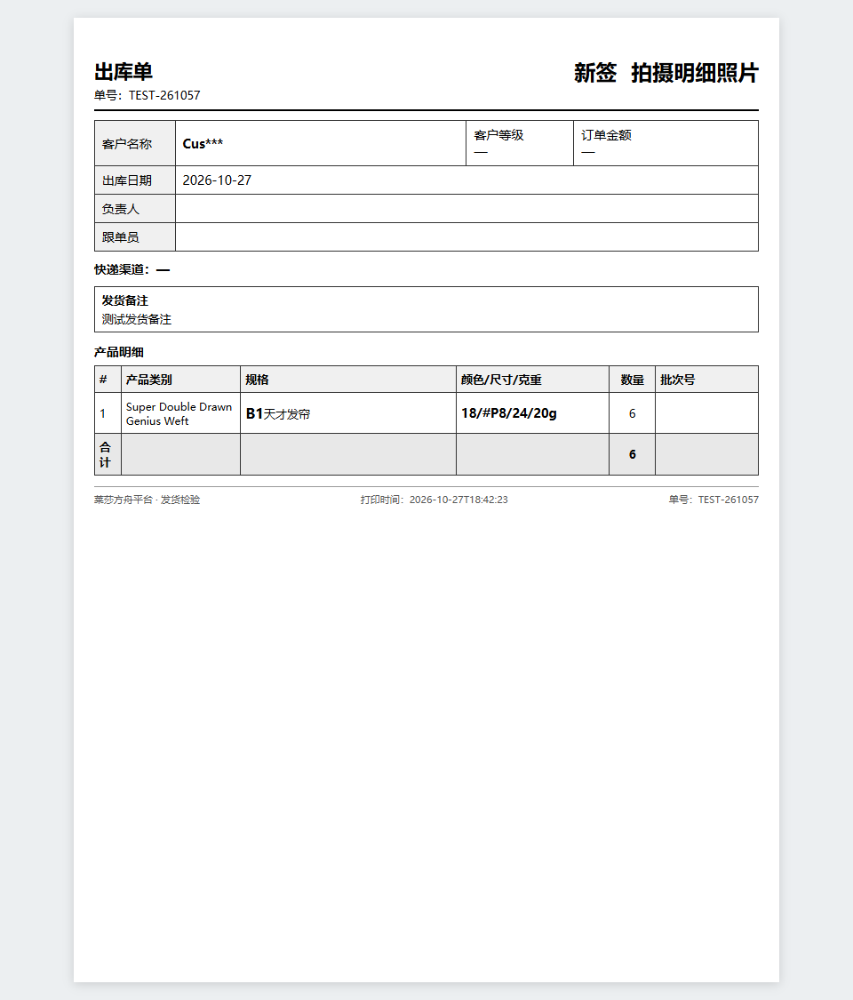
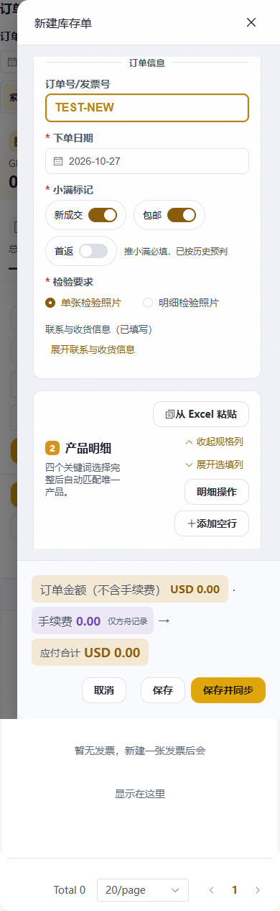

# 订单检验要求与出库打印标记

状态：实现与验证完成，用户已授权提交、合入main并推送origin；最终交付以Git引用回读为准，未部署。工作分支 `codex/invoice-inspection-requirement`，基点 `e6b919c4`；主目录其他任务内容按SHA256备份保护。

## 行为

- 新旧订单录入界面均在“小满标记”下增加必选“检验要求”：单张检验照片／明细检验照片。以现有“新成交”作为新签属性；未手动选择时普通默认单张、新成交默认明细，手动选择后保持独立，保存和重开保留。
- 出库单右上角分别显示“新签”“拍摄明细照片”，HTML 为24px、800字重；Word 为18pt加粗并右对齐。单张选项不显示照片标记，两项独立。预览、快捷打印与Word共用打印资料。
- 打印按真实关联订单ID和客户读取已保存的本地要求；合并出库按任一订单需要取并集，待小满同步的已保存要求可打印。金额仍按原有已同步数据口径，未改价格、库存、检验提交规则或小满推单字段。
- 历史新成交字段为空时复用明确成功推单日志判断新签；显式0优先，不根据客户今天的订单历史猜测。

## 数据和恢复

迁移 `208_invoice_inspection_photos` 接 `207_inkboard`，新增 `ark_invoices.inspection_requirement` 非空字段。历史明确新成交1填detail，其余（含NULL）single；不动原字段或单据明细。降级保留仓库要求数据，生产只能随正式部署入口迁移；本轮仅在隔离SQLite演练。

新字段进入编辑内容版本和新关联同步快照。旧持久任务只有照片要求仍为确定性迁移默认、其余旧内容hash一致时可继续恢复；旧幂等命令仅在未提交新字段且其余命令、订单和操作者完全一致时接受原hash。避免升级后误拒旧任务或重推已成功订单。

## 验证

- 后端：`test_invoice_inspection_requirement.py test_invoice_linked_sync.py test_invoice_merchandiser.py test_shipping_customer_grade.py test_shipping_print_order.py test_shipping_print_spec.py test_shipping_print_owner.py test_invoice_order_notifications.py`，共117项通过；13条既有python-jose UTC弃用警告。
- 前端：`invoiceInspectionRequirement.test.mjs shippingPrintDocs.test.mjs invoiceEntryUx.test.mjs invoiceLegacyEntry.test.mjs`，共25项通过。
- `npm run build` 通过（3590模块）；保留现有chunk体积/混合导入提示。
- Edge隔离页面验证使用真实InvoiceManage与内存API适配器，拦截所有业务网络请求：1440px、390px，自动默认、手改、键盘单选、两种值保存重开、四种独立打印组合及A4右上边界均通过，无页面异常。未执行真实业务订单写入或实物打印。
- SQLite迁移验证存量1/0/NULL回填、备注保留、降级数据保留及单一Alembic head；未连接共享/生产库执行迁移。
- 增量约定、差异空白检查通过。独立审查指出的历史NULL、旧任务快照及旧命令hash恢复边界已修复并复核通过。
- Git巡检 `python scripts/git_sweep.py --no-fetch` 只反映本地引用快照，不授权或执行远端操作。

## 预览

