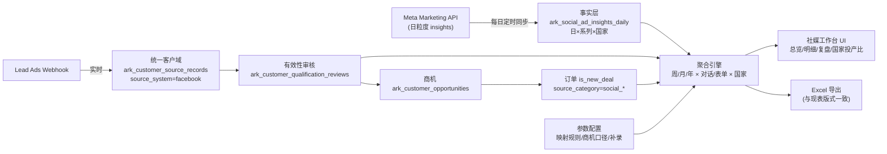

# 社媒工作台（Facebook 投放数据自动化）方案设计

> - 日期：2026-09-18
> - 需求方：社媒开发团队（现表维护人：明鸿）
> - 现状依据：`FB投流成本核算-明鸿.xlsx`（按月、按广告系列的投流核算）、`FB平台数据复盘-明鸿.xlsx`（年/月/周、按广告类型的复盘）
> - 技术依据：本仓库（方舟平台，FastAPI + Vue3）；Meta 接入约束见 `docs/requirements/2026-08-13-meta-official-api-sales-automation-assessment.md`
> - 原型：`tmp/social-media-workbench/prototype.html`

## 一、现状与痛点

### 1.1 两张表现有结构

**FB投流成本核算**（每月一个 sheet，按广告系列一行）：

| 列 | 来源 |
|---|---|
| 广告系列名称、投放时长、已花费、展现次数、千展费用、覆盖人数、链接点击量、CTR、CPC、商机数、商机成本 | FB 广告后台可导出（手工复制） |
| 有效商机数、有效商机成本、新签数、新签成本、新签率 | 手工统计录入 |
| 国家投产比块（国家 × 已花费/总有效商机/有效互动商机/有效表单商机/新签…） | 手工按国家拆分汇总 |

**FB平台数据复盘**（年/月/周三个 sheet，按「对话/表单」两种广告类型各一行）：

- 总花费、展示次数、CPM、CTR、CPC、有效商机数、有效率、有效商机成本、新签数、新签成本、有效商机转化率、总有效商机、总有效商机成本
- 由月度表明细手工汇总而来

### 1.2 痛点

1. **重复搬运**：花费/展现/点击/商机等字段每期从 FB 后台手工复制，周/月/年三层再手工汇总。
2. **口径靠人记**：CPM、CTR、商机成本、有效率、转化率全是派生指标，表中存在 `$0.34/次`、`/`、`\` 等手工痕迹，易错且无法回溯。
3. **系列命名即维度**：`9.3-表单-加、德、英、荷` 这种命名承载了日期/广告类型/国家三个维度，但没有结构化，汇总全靠人眼解析。
4. **有效商机/新签割裂**：有效性、新签数在业务系统里有据可查（统一客户域、订单 `is_new_deal`），但要人工跨表对齐。

### 1.3 目标

- 花费侧数据 **零手工录入**：Meta Marketing API 每日自动同步。
- 派生指标 **零手工计算**：全部由系统按统一口径计算。
- 周/月/年复盘、国家投产比 **零手工汇总**：由日粒度事实数据实时聚合，可一键导出与现表版式一致的 Excel。
- 有效商机/新签 **逐步零录入**：第一阶段保留按月补录入口；归因闭环打通后由方舟统一客户域自动回填。
- 仍需人工的只剩：一次性授权配置、低频的命名映射规则维护、归因未闭环前的有效性月度确认。

## 二、总体方案

### 2.1 数据流



### 2.2 关键设计决策

1. **事实层只存最细粒度**：`日 × 广告系列 × 国家` 一行一条，原始载荷留 `raw_json` 可回溯。所有汇总（周/月/年、对话/表单、国家投产比）都是查询时聚合，不写中间表，口径修改零迁移成本。
2. **广告类型/国家维度结构化**：系列命名规则参数化为映射规则表（关键词 → 广告类型），新系列首次同步时自动匹配，匹配不上进「待分类」队列由人工点选一次，系统记住。
3. **商机口径参数化**：不同广告类型的「商机」对应不同 Meta action：
   - 表单 → `actions` 中 `action_type=lead`
   - 对话/互动 → `onsite_conversion.messaging_conversation_started_7d`
   - 吸粉 → `page_engagement`/`like`（不计商机，只计花费与触达，与现表「含吸粉」备注口径一致）
   口径写进配置而非代码，运营可调。
4. **有效/新签走归因链，不建平行台账**：Lead Ads 线索经 Webhook 落 `ark_customer_source_records`（`source_system='facebook'`，表单原始载荷进 `payload_json`），投影进统一客户域，有效性取 `ark_customer_qualification_reviews` 结论，新签取 `ark_customer_orders.is_new_deal` 且 `source_category ∈ (social_owned, social_assigned)`；归因登记 `ark_customer_acquisition_attributions` 新增 `origin_type='meta_ads'`。对话类商机复用 WhatsApp/Messenger 侧已有同步链路。
5. **过渡期手工补录受控**：归因未闭环前，有效商机数/新签数通过「月度补录」入口按 `月 × 广告类型 × 国家` 录入（`ark_social_metric_overrides`），有操作人留痕；闭环后该入口自动降级为只读对比。
6. **导出兼容现表**：一键导出与两张现表版式一致的 Excel（openpyxl 模板），保证对老板/财务的交付物不断档。

## 三、技术落点（基于方舟现状）

### 3.1 后端：`backend/app/social_media/`

```text
backend/app/social_media/
├── router.py           # /api/social-media/*，统一 ok 信封 + require_permission
├── models.py           # 5 张 ark_social_* 表
├── schemas.py
├── service.py          # 聚合口径、周报/月报/年报/国家投产比计算
├── meta_client.py      # httpx 调 Graph API：campaigns + insights + breakdowns
├── importer.py         # 历史 Excel 导入（Phase 1 直接可用）
└── scheduler.py        # 每日同步 job
```

- router 在 `app/routers.py` 注册 `prefix="/api/social-media"`。
- 定时任务挂 `app/schedulers/registry.py::_register_jobs()`：`sync_social_ads_daily`（建议每天 06:30，补拉前 3 天防 Meta 数据回填延迟），独立开关 `SOCIAL_ADS_SYNC_ENABLED`，失败自动进运行中心 + 钉钉告警（现有机制）。
- Meta token/广告账户 ID 走 `app/core/config.py` Settings + `backend/.env`；token 不入库明文、不进日志、不出现在前端。

### 3.2 数据表（Alembic 迁移，建前查所有分支最新编号）

| 表 | 关键字段 | 说明 |
|---|---|---|
| `ark_social_ad_accounts` | platform, account_id, name, status, last_synced_at | 广告账户登记与同步状态 |
| `ark_social_ad_campaigns` | campaign_id, name, ad_type, target_countries, first/last_seen | 系列主档；ad_type 由映射规则或人工标注 |
| `ark_social_ad_insights_daily` | campaign_id, date, country, spend, impressions, reach, clicks, link_clicks, cpm, ctr, cpc, leads, conversations, raw_json | **事实层**：日×系列×国家 |
| `ark_social_ad_mapping_rules` | match_keyword, ad_type, priority, enabled | 命名→类型映射（表单/对话/互动/吸粉） |
| `ark_social_metric_overrides` | period_month, ad_type, country, valid_leads, new_deals, note, updated_by | 过渡期手工补录，留痕 |

### 3.3 Meta API 取数口径

- 端点：`GET /{ad-account-id}/insights`，`level=campaign`，`time_increment=1`（日粒度）
- 字段：`spend, impressions, reach, clicks, inline_link_clicks, cpm, ctr, cpc, actions, action_values`
- 国家拆分：单独请求 `breakdowns=country`（支撑国家投产比的「已花费/展示/点击」按国拆分）
- 权限：`ads_read`（只读够用）/ `ads_management`；Lead Ads 线索需 `leads_retrieval` + `pages_manage_metadata`（Webhook）
- 前置条件：Meta Business Portfolio + Meta App + 系统用户长期 token。只接自有资产可用 Standard Access 免 App Review（详见 0813 评估文档第四节）。**本方案 Phase 1 不依赖任何 Meta 权限，可先落地。**

### 3.4 前端：`frontend/src/views/social_media/`

- 新建 `views/social_media/`（`AdWorkbench.vue` 等 + `composables/`），`api/clients.js` 注册 `socialMediaClient`，`api/socialMedia.js` 照 contract 模式。
- `config/navigation.js` 在「客户经营」分组（`customerOperations`，已有今日工作台/获客任务/背调中心）加一条 `/social-media/workbench`，权限码 `social_media:read`。
- 五个视图（与原型一致）：数据总览、广告系列明细、周期复盘（周/月/年）、国家投产比、同步与参数。

## 四、功能与页面设计

### 4.1 数据总览（Dashboard）

- KPI 卡：本月花费、商机数、有效商机、有效商机成本、新签、新签成本、有效商机转化率（对标现表合计行）。
- 趋势图：周粒度的花费 vs 有效商机成本双轴。
- 漏斗：展示 → 点击 → 商机 → 有效商机 → 新签。
- 同步状态卡：账户、最近同步时间、数据覆盖到哪天、失败告警。

### 4.2 广告系列明细（对应「FB投流成本核算」）

- 月份/广告类型/国家筛选；表格列与现表一致（系列、时长、花费、展现、CPM、覆盖、点击、CTR、CPC、商机、商机成本、有效、有效成本、新签、新签成本、新签率），含合计行。
- 每行标记数据来源：`API 自动` / `Excel 导入` / `含手工补录`。
- 未识别类型的系列高亮「待分类」，点击直接维护映射。

### 4.3 周期复盘（对应「FB平台数据复盘」）

- 周/月/年三个 tab；每周（月、年）按「对话/表单」两行展开，列与现复盘表一致。
- 吸粉类花费单独标注「含吸粉」，与现表备注口径一致。
- 一键导出 Excel。

### 4.4 国家投产比

- 按国家行：已花费（API country breakdown）、总有效商机、有效互动商机、有效表单商机、有效商机成本、新签数、新签成本、有效商机转化率。
- 花费异常国家（如有花费无商机）自动标红。

### 4.5 同步与参数

- Meta 账号连接状态、手动触发同步、同步日志（成功/失败/行数）。
- 映射规则编辑器：关键词 → 广告类型，优先级排序，即改即生效（重算分类）。
- 商机口径配置：每种广告类型计为「商机」的 Meta action 映射。
- 月度补录入口：有效商机数/新签数（按月×类型×国家），归因闭环后自动转只读。

## 五、分期路线

| 阶段 | 范围 | 依赖 | 预期效果 |
|---|---|---|---|
| Phase 1（1–2 周） | Excel 历史导入 + 明细/复盘/国家投产比视图 + Excel 导出 + 手工补录 | 无外部依赖 | 汇总计算零手工；历史数据可查询可追溯 |
| Phase 2（1–2 周） | Meta Marketing API 每日同步 + 映射规则 + 同步监控告警 | Meta App + `ads_read`（自有资产 Standard Access） | 花费侧零录入，每日自动更新 |
| Phase 3（2–4 周） | Lead Ads Webhook 入统一客户域 + 有效性/新签归因自动回填 | `leads_retrieval`、归因 `origin_type=meta_ads` | 有效商机/新签零录入，全漏斗自动闭环 |

## 六、验收口径

- 同一月份「广告系列明细」合计行与 FB 广告后台导出数值一致（允许 ±1 天归因窗口差异，需在页面注明口径）。
- 周期复盘任一周/月行 = 明细按维度聚合结果，无手工改数通道（补录除外且留痕）。
- 导出的两张 Excel 与现表版式逐列一致。
- 同步失败次日 09:00 前有钉钉告警；补拉机制保证 Meta 延迟回填（最长 3 天）后数据自动修正。

## 七、风险与边界

- Meta 数据有最长 28 天归因窗口回填，日粒度数据会变动：同步任务每次回刷近 28 天，页面标注「数据截至」。
- 对话类商机的「有效性」依赖会话侧标注流程，Phase 3 前维持补录。
- Token 到期/权限降级：运行中心告警 + 页面显著提示，不静默失败。
- 不建独立的「社媒客户台账」，线索一律进统一客户域，避免双头维护（与 0813 评估的模块边界一致）。
