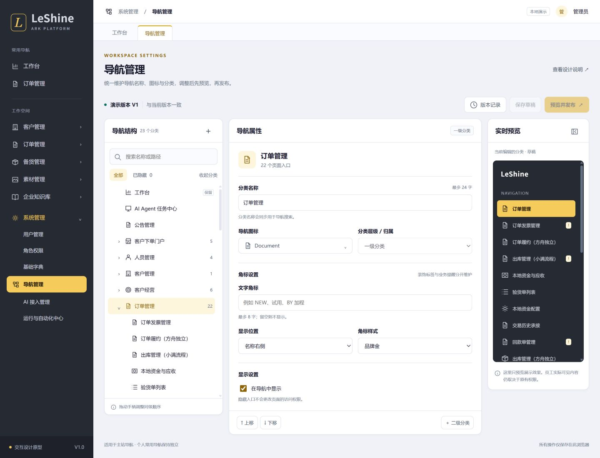

# 导航管理 · 产品与交互设计

日期：2026-11-03　状态：设计提案 / 可交互原型，尚未实现到业务系统。

开发后续：[真实功能实现与隔离验收](implementation.md)。本页保留原始设计，生产上线状态以实现记录及交接文档为准。

## 1. 目标与范围

在「系统管理 → 导航管理」维护全平台主站的导航展示与组织结构，让管理员无需改代码即可调整名称、图标、角标、分类、排序和显示状态。提供编辑、预览、发布、恢复的完整闭环。配置为组织级，作用于所有主站用户；个人常用导航仍归个人维护。

本次交付 [高保真交互原型](prototype.html)、本设计文档、[验收记录](validation.md)。原型基于本地源码生成导航样本，所有修改仅在当前浏览器本地演示，不调用业务 API。按钮“发布”仅模拟版本切换，不代表生产发布。



[移动端布局](preview-mobile.jpg) · [发布前差异确认](preview-publish.jpg)

范围包括：一级分类、可选二级分类、已注册页面入口、既有外部入口。二级分类是新增组织能力；不强制将现有页面再包一层。第一版不支持任意新 URL、动态页面组件、修改权限规则、修改业务计数、跨子站全局配置、按角色各做一套菜单或定时发布。

## 2. 已核对的现状

| 来源 | 已存在行为 | 对设计的影响 |
|---|---|---|
| `frontend/src/config/navigation.js` | `MENU_GROUPS` 定义一级分类；`NAV_ENTRIES` 同时定义路由、菜单、权限、交易阶段限制；含独立一级页面与外链 | 保留代码中的路由与访问策略，新增独立展示覆盖层 |
| `frontend/src/views/layout/SidebarNavigation.vue` | 深灰侧栏、导航搜索、常用导航；分类 `iconBadge`、内贸待审核数量、单据异常提醒 | 区分文字角标与受保护业务提醒，折叠态也必须验证 |
| `navigationSearch.js` / `favoriteNavigationState.js` | 路由、菜单、原分类权限同时过滤；常用项以稳定名称/路径解析 | 移动分类不能解除旧权限限制；搜索与常用必须复用同一解析结果 |
| `backend/app/system/navigation_access.py` | 常用导航新增校验依赖构建生成的权限清单及实时用户权限 | 不能只改前端树；实施时同步清单和服务端显隐校验 |
| `navigationTabs.js` / `router/index.js` | 页签与浏览器标题来自 route meta | 导航别名默认只影响导航；页面标题可明确选择同步 |
| `DESIGN.md` / `tokens.css` | 240px 深灰侧栏、金色按钮、浅灰工作区、标准表单与弹层 | 沿用主站风格与组件，不新增视觉体系 |

以上是工作区源码快照，不代表已核对生产菜单。原型中“导航管理”为设计新增入口；其余导航名称来自源码。数量由原型快照动态计算，状态、版本和角标样例均为演示。

## 3. 信息模型与维护规则

### 层级

```text
主导航
├─ 工作台（一级页面，保留）
├─ 订单管理（一级分类）
│  ├─ 订单履约（现有页面，可以直接归一级分类）
│  └─ 财务协同（可选二级分类）
│     ├─ 回款管理（现有页面）
│     └─ 结汇管理（现有页面）
└─ 系统管理（受保护分类）
   └─ 导航管理（受保护页面）
```

分类最多两级，实际菜单最多“一级分类 → 二级分类 → 页面”三层。页面不能有子项，不能出现循环。现有一级页面保留；外链必须位于分类下。新增分类默认无页面、可编辑，但空分类对终端用户自动隐藏。

| 对象 | 可以维护 | 不可维护 |
|---|---|---|
| 分类 | 名称、白名单图标、文字角标、角标位置/语义色、排序、显示；自建分类可改父级 | 访问权限表达式、任意深度、循环挂载 |
| 页面入口 | 导航别名、图标、归属分类、排序、文字角标、显示状态；可选同步页面标题 | 路由 name/path/component、权限、交易阶段、异常来源 |
| 业务角标 | 查看来源与规则 | 手填待审数、用宣传标签覆盖异常、任意绑定 SQL/API |
| 自建分类 | 改名、移动、删除空分类 | 删除其下真实页面或业务数据 |

名称去首尾空格，1–24 个 Unicode 字符；同一父节点下规范化名称不重复；名称仅显示纯文本。文字角标 1–8 字符，可选名称右侧或图标右上角（承接“BY 加程”）；颜色使用金/蓝/中性三种语义令牌，不提供任意色值。名称超宽截断并提供完整提示和无障碍名称。

“业务角标”继续使用当前注册源：`domesticReviews` 为待审核数；`anomalyDomain` 为单据异常。零数量不显示；请求失败表示暂不可用，不冒充零。异常状态在存在可信旧结果时按既有规则保留并标记待核验。异常优先于计数，计数优先于文字角标；同位置发生冲突时隐藏装饰角标，完整信息置于提示中。受保护提醒不能被文字配置覆盖。

图标从 Element Plus 已注册图标集中选择，按中文名/英文标识检索，不接收 HTML/SVG 上传。原型以本地描边 SVG 表达相同图标语义，生产实现必须使用真实组件。

### 显示、权限与保护

- 显示开关仅决定入口可见性，不授予或撤销访问权限；已有链接在用户有权限时仍可访问。关闭分类时显示受影响入口数；内部子项配置保留，重新显示时恢复。
- 展示资格 = 原路由规则 ∩ 原菜单规则 ∩ 原分类访问规则 ∩ 交易阶段限制 ∩ 本配置与祖先显示状态。原分类访问约束成为不可编辑的来源策略，跨分类移动后仍保留，避免移动导致提权。
- 新展示分类依据其有权且可见的后代自动出现，不额外复制旧分类的权限集合；否则新迁入入口可能被错误挡住。
- 系统管理分类与导航管理入口保留、不可隐藏/移走/删除，工作台保留顶级位置；名称、图标可调整。管理员可使用固定 `/system/navigation` 进入修复，仍需鉴权。
- 内置分类不能删除，可隐藏非保护分类；自建分类仅在空时可删，非空先迁移后代。隐藏源于技术约束的详情页、公开页、全屏页不能从注册目录中“重新显示”。

## 4. 页面与交互

桌面采用「导航结构 / 属性编辑 / 实时预览」三栏，外层保留系统侧栏。页头仅保留版本记录、保存草稿、预览并发布；不使用无业务价值的统计卡。

1. **找导航**：左栏按名称/原名称/路径搜索，保留命中项祖先。可筛选全部或隐藏；搜索期间禁用位置重排，避免不完整集合下错排。点选分类或入口后，编辑区和预览同时定位。
2. **改展示**：编辑名称、图标、角标、显示状态，即时更新草稿预览；顶部标出未保存。切换节点不丢编辑内容。字段错误就地展示，不能保存或发布。
3. **调结构**：新增一级分类；在一级分类下新增二级分类；页面通过所属分类下拉移动。同级支持拖拽手柄及上移/下移按钮，键盘有同等能力；跨级移动使用明确目标选择，避免拖错。
4. **加入口**：从已注册但从导航中移除的入口选择并放回分类；不能复制同一路由为多个节点。本提案不引入任意外链创建。原型已有入口均在树中，可从“归属分类”直接迁移。
5. **看效果**：预览按当前节点的一级分类定位，支持展开/折叠侧栏样式；真实实现提供“本人实际权限”和“指定角色权限集合”两类模拟。指定角色仅用于预览，不冒充真实用户权限；操作/保存本身仍用当前管理员权限。
6. **发布**：展示当前版本→候选版本、逐项修改前后、隐藏影响、空分类提示，确认后原子切换全局版本。保存草稿不改变员工侧栏。
7. **恢复**：历史版本查看摘要和操作者，恢复操作先复制成新草稿，经当前目录重新校验后正常发布；不覆写历史版本，不即时回滚线上。

### 状态与反馈

| 状态 | 界面与处理 |
|---|---|
| 无改动 | 保存、发布禁用，显示当前版本 |
| 草稿已保存 | 保留“尚未发布”，允许继续编辑；刷新恢复草稿 |
| 未保存离开 | 提示保存/放弃/继续编辑；切节点不算离开 |
| 保存/发布中 | 禁用重复提交，保留输入；展示动作文字 |
| 校验失败 | 定位首个错误节点与字段，保留输入 |
| 版本冲突 409 | 提示更新者和时间，保留本地改动供比较；不静默最后写入覆盖 |
| 网络失败或超时 | 保留输入；按幂等请求标识查询结果后再重试 |
| 没有匹配结果 | 显示清空筛选入口，不清空导航配置 |
| 无可见子项 | 管理树保留节点与原因；用户侧栏隐藏空分类 |
| 只读/权限撤销 | 能读者可看但无编辑按钮；已打开页面收到 403 后保留未提交输入，停止提交 |
| 注册目录变化 | 新入口追加代码默认位置；下线入口成为不可发布的待处理引用，清理仅删除配置引用 |

小于 1180px 时预览移到下方；小于 760px 时系统侧栏收起，结构、属性、预览顺序单栏。弹层正文可滚动，头尾保留，宽高不超出视口。所有表单有 label，图标按钮有 aria-label；对话框管理焦点、Esc 关闭和焦点回退。排序不做位移动画，减少动态偏好下关闭非必要过渡。

## 5. 保存、版本与生效策略（待实现）

第一版采用单份组织共享草稿，编辑显式保存。草稿基于 `base_version` 与 `draft_revision` 乐观锁；两人打开同一草稿时，后保存者得到 409，不覆盖先保存者。无自动占锁、无长时间独占会话。

发布事务重新校验注册目录 hash、权限、结构、字段与受保护节点；CAS 更新当前版本指针，同时记录不可变快照及审计。发布接口使用请求幂等键；相同请求返回同一发布结果。审计记录操作者、北京时间、旧/新版本和字段差异。

客户端登录/刷新时拉取当前已发布配置；回到窗口前台或低频版本检查发现更新后重建导航。目标为在线活跃用户 60 秒内生效，离线用户下次联网更新。当前正在填写的业务页不刷新、不关闭；只有侧栏与可选标题同步变化。页签缓存 key 不变。

已有有效版本时，暂时拉取失败保留该版本并提示；首次加载失败时使用随构建携带的默认展示配置，仍执行全部原访问限制。这个默认层是配置体系的明确恢复机制，不能绕过路由或接口权限。恢复入口一直存在。

## 6. 实施设计（提案，不是已建接口）

### 数据与代码边界

`navigation.js` 继续是路由注册及默认菜单/访问策略唯一来源。数据库只存展示覆盖，不存可执行组件、不允许改权限表达式。建议在已有 `app/system/` 领域扩展 `navigation_config_*` 服务，不进入冻结共享层。

节点以稳定 `node_id` 关联；内置页面使用独立 `entry_key` 映射既有 route name，外链登记稳定 key，迁移时承接旧 path 常用收藏；分类以 `group_key` 稳定标识，自建分类生成 UUID。改名不能改变 key。现有个人收藏不能按新标题重建或丢失。

建议数据：`ark_navigation_configs` 存当前版本指针和共享草稿/CAS 字段；`ark_navigation_versions` 存不可变 JSON 展示快照、目录 hash、作者、发布时间、差异摘要；沿用可用审计基础设施。JSON 中节点包含 `id/kind/entry_key/parent_id/label/icon_key/order/visible/title_sync/text_badge`。业务角标/路由/权限/阶段读取注册目录，不能通过提交 JSON 注入。具体表名、索引、迁移编号在实现阶段按全分支检查后确定。

| 拟定接口（`/api/system` 下） | 权限 | 契约要点 |
|---|---|---|
| `GET /navigation-config/effective` | 登录用户 | 返回当前用户可见投影、版本；不暴露无权路由或计数 |
| `GET /navigation-config/catalog` | `navigation:read` | 可管理目录、来源策略说明、图标白名单、目录 hash |
| `GET /navigation-config/draft` | `navigation:read` | 草稿、draft_revision、base_version |
| `PUT /navigation-config/draft` | `navigation:write` | 版本前置条件，字段白名单，422/409 |
| `POST /navigation-config/preview` | `navigation:read` | 模拟身份投影；只读预览不获取未授权业务计数 |
| `POST /navigation-config/publish` | `navigation:admin` | 草稿 revision + base_version + hash + 幂等键 |
| `GET /navigation-config/versions` | `navigation:read` | 版本列表/详情/差异 |
| `POST /navigation-config/versions/{id}/restore-draft` | `navigation:write` | 恢复为新草稿，校验现行目录，不切线上 |

权限种子采用既有 upsert 机制；write/admin 角色需同时分配 read，admin 不自动代表所有非 super_admin 权限。系统管理来源权限清单需显式纳入 navigation:read。所有接口使用 `ok()` 信封、实时鉴权，拒绝不可编辑字段。

### 必须连通的调用方

- 统一 `resolvedNavigation` 解析结果供 SidebarNavigation、常用导航、快速导航、搜索与移动端抽屉消费。
- 更新 `accessibleNavigationSections` 为支持两级分类的递归投影；保留源权限与阶段限制。
- 构建时更新导航访问 manifest，加入来源策略与稳定 key，前后端 parity 测试；动态展示位置不能改变来源访问限制。
- 明确 title_sync：默认关闭；开启仅更新相应入口页面的显示标题、已开页签及 document.title，不改变 route identity；详情页有独立业务标题时保持原业务标题。
- 菜单隐藏项在搜索/常用/快捷导航中一致隐藏，个人收藏记录保留；重显时恢复位置。
- 上线转换默认覆盖应与现有菜单完全一致；新建功能及配置未发布前不改变任何现有员工导航。

## 7. 验收标准

1. 分类/入口改名、图标及文字角标可保存并发布；刷新后同用户和另一个有权用户看到新版本。
2. 新建一级分类、二级分类，将已有页面移动进去；侧栏、搜索、常用导航一致，旧业务 URL 仍可访问。
3. 排序支持鼠标及键盘；筛选时不允许对不完整结果集排序；无重复节点、孤儿、循环或超深层级。
4. 空名称、超长名称/角标、同级重名、未知图标、非法父节点均被前后端拒绝。
5. 移动原受限页面后，无原权限者仍不能看到或访问；交易阶段未知仍按原约束隐藏；外部链接不能注入新协议/地址。
6. 隐藏分类只影响入口；受保护入口不可隐藏删除。自建非空分类删除时明确阻止并指出子项。
7. 文字角标不覆盖真实待审/异常；零值、不可用、无权三种状态不混淆。
8. 保存草稿不影响在线版；发布只产生一个完整版本；并发/重复点击/超时重试不丢更新、不重复发布。
9. 历史恢复先生成草稿；引用已下线页面时不能直接发布；新部署增加页面有可预期默认位置。
10. 折叠侧栏、窄屏、长中文名、键盘/屏幕阅读器、减少动态模式完整可用；当前业务表单不丢失。

## 8. 原型覆盖与边界

可操作：源码导航快照树、搜索与隐藏筛选、属性编辑、图标选择、文字角标样式/位置、业务角标只读说明、同级上移/下移及拖拽、页面分类迁移、创建一/二级分类、删除空自建分类、实时预览、折叠预览、浏览器本地草稿保存、变更对比、模拟发布、版本恢复为草稿、窄屏布局。

文档定义但原型不连接：真实组织权限/指定角色预览、真实计数、多人冲突、服务端草稿、跨用户生效、生产审计、目录升级协调。预览中的业务角标明确为样例。原型不要用来验证真实授权或生产发布。
