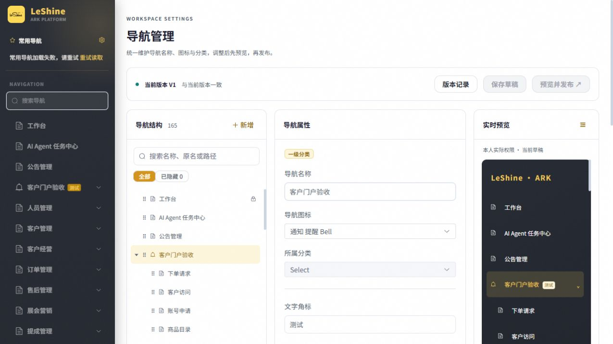

# 导航管理实现与验收

2026-11-03。工作区 `D:/MyProgram/commission-system-codex-navigation-management`，分支 `codex/navigation-management`，基于 `a8707d8f`。状态：代码已实现，本地隔离验证；未提交、合并、推送或部署。

## 已实现

- 系统管理新增导航管理入口及 read/write/admin 权限种子。管理页包含结构树、名称/图标/角标编辑、显示设置、一级/二级分类创建、同级鼠标/键盘排序、页面分类移动、空自建分类删除、搜索与隐藏筛选。
- 组织共享草稿、修订号 CAS、发布前逐字段差异、发布幂等请求、不可变版本快照、操作审计、历史恢复为草稿。V0 表示当前构建默认导航，可在首次误发布后恢复。
- 侧栏、搜索、个人常用、快捷导航与窄屏导航复用发布后的展示投影。仍先验证源路由、菜单、原分类权限及交易阶段，再套用名称/分类/显示覆盖。改分类不提权，隐藏不改变 URL 访问权限。
- 最多两级分类；系统管理、导航管理与工作台受保护。业务待审/异常继续读取原来源并优先于装饰角标。titleSync 同步壳顶栏、页签和浏览器标题，缓存键保持原路由身份。
- 发布事件、前台唤醒及 60 秒检查刷新配置；账号切换清空会话展示缓存。失败保留会话内上次有效配置；首次失败使用构建默认展示，始终保留源权限过滤。
- 构建从 `navigation.js` 同时生成访问 manifest 和展示 catalog，后端核验源 SHA-256；不允许从 API 注入路由、权限、组件或角标数据源。

数据库迁移 `248_navigation_config` 接 `247_sales_return_freight`，只新增三个配置/版本/审计表。迁移与权限种子需后续授权部署后才能用于真实员工环境。没有复制 `.env`、连接共享库或执行生产迁移。

## 实际验证

- 后端隔离 SQLite 覆盖草稿/发布/恢复、旧修订冲突、请求键幂等、内置与恢复入口保护、非法结构/字段/图标、外链、目录新增、删除约束、北京时间边界及迁移升降级。
- 前端回归覆盖源权限交集、跨分类移动不提权、两级分类搜索/常用同步、隐藏祖先、交易阶段、目录与访问清单一致、编辑校验、排序、变更对比、发布超时幂等键和 409 本地输入保留。
- 浏览器使用真实 Vue 组件和真实配置 service，数据库为独立内存 SQLite，登录身份在 fixture 中模拟超级管理员。实测换名/图标/角标、保存、发布并即时更新侧栏；恢复 V0 仅改草稿，再发布才更新侧栏；新增一二级分类、移动/隐藏页面、刷新保留、折叠预览。
- 390×844 真实 CSS 视口下，表单可编辑，发布差异弹窗的操作按钮可达，表格可横向滚动。初次 fixture 固定侧栏覆盖移动布局，已修正 fixture 的窄屏隐藏；真实 MainLayout 本来就按窄屏使用抽屉。
- 浏览器曾因开发 HMR 导致测试客户端默认地址恢复而出现 500；新标签完整加载恢复正常，隔离 API 同时全部为 200。未将该现象算作生产故障。
- 独立审查发现 MySQL REPEATABLE READ 下首次并发初始化可能从旧快照读不到胜者行；已改成锁定当前读并补模拟竞争回归。未将 SQLite 测试声称为真实 MySQL 并发实测。

最终结果：后端 `test_navigation_config.py` 与 `test_navigation_preferences.py` 共 **41 passed**；前端目录、导航运行层、原导航/常用/快捷/阶段与编辑器回归共 **35 passed**。`npm run build` 成功（39.34s，manifest 140 个内部入口）；保留既有 auth 混合导入、大包提示与 JWT 第三方弃用警告。新增页面及递归菜单编译通过。

`python scripts/check_conventions.py --strict` exit 0（红0、黄5）；5条黄项是扫描器未识别路由的 `_navigation_user(permission)` 依赖工厂。源码该工厂内部实际包含 `Depends(require_permission(permission))` 并查询实时角色权限，已由独立审查核对；不通过豁免注释或放宽检查隐藏此提示。`git diff --check` 通过，只有 Git 行尾转换提示。

`python scripts/git_sweep.py --no-fetch` 生成本地引用快照；不获取远端实时状态，不自动处理其他分支。构建与巡检日志保留 `tmp/navigation-fixture/`；迁移按项目规则加入暂存区，其余修改保留未提交供审阅。

## 本地复现隔离 UI

前端 fixture 为 `frontend/tests/fixtures/navigation-management/`，后端为 `backend/tests/fixtures/navigation_management_server.py`。先从工作区根目录执行：

```powershell
$env:PYTHONPATH = "$PWD/backend"
python -m uvicorn navigation_management_server:app --app-dir backend/tests/fixtures --host 127.0.0.1 --port 8891
```

另一终端在 `frontend` 执行 `npm run dev -- --host 127.0.0.1 --port 8890 --strictPort`，打开 `http://127.0.0.1:8890/tests/fixtures/navigation-management/index.html#/system/navigation`。

该 fixture 不加载主应用认证或真实库，不能用于验证生产身份授权。真实权限限制另由源码策略与回归检查覆盖。内存库进程停止后演示数据消失；发布页面按钮在真实部署环境会全员生效。

## 设计边界

本版预览本人当前权限，不提供另选角色的模拟。图标从已注册 Element Plus 图标库检索；新导航页面仍需要代码注册，新分类可直接维护；外部入口仅维护既有登记项。单个版本含完整快照，版本记录目前一次加载；没有定时发布或多套角色菜单。



[390px 表单截图](implementation-mobile.jpg)
