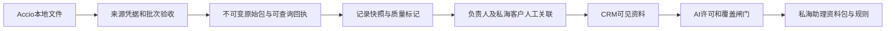

# 阿里询盘与 TM 文件推送接口设计

版本0.1，2026-11-05，供方舟与 Accio Work 对接评审。本设计覆盖完整分期；P1 接收层已Git交付、默认关闭，见[P1实现说明](implementation.md)。P2 人工经营闭环、v1.1 接入和规则闸门已本地实现，见[P2实现与验收](p2-implementation.md)；自动消费和真实采集能力仍待独立放行。

建议先落地「独立接收、保留快照、回执可查」，再按身份、授权和覆盖质量逐项接入私海助理。原始 v1 文件可以作为接收层输入，进入业务判断需经过附加校验。字段与 HTTP 契约见[接口契约](contract.md)。

## 1. 输入依据与样例核验

用户提供的《方舟推送对接要求建议.md》明确是 Accio 侧建议，文件中的 P0/P1 操作要求作为上游约束和待确认事项。JSON 为本地生成的 `ark_alibaba_feed_v1`，设计核验阶段未上传；后续实现仅在隔离测试库验证上传与入库，没有开启真实采集或生产推送。

| 样例实测 | 结果与含义 |
|---|---|
| 原文件 | 405,437字节，SHA256 `7f488cbcd60a4800c88766901b6a836eac227cd88279d7f23a63c973445a3d34` |
| 运行 | `accio-20261105-051527-e411e1eb`，status=ok，delivery=file_only_p0 |
| 窗口 | 11-04 05:00 至11-05 05:00，Asia/Shanghai，前闭后开，按商机创建时间纳入 |
| 商机 | 49条，22 inquiry、27 tm，ID在本包内无重复 |
| 买家统计 | 上游报47人，缺稳定buyer_id，方舟不能独立验证跨记录去重人数 |
| 负责人 | 20组，分组总计49，本包无空负责人；仍须覆盖空、重名和未映射场景 |
| 回复状态 | replied=42、pending=6、unreplied=1，保留平台原始含义 |
| 消息 | 1,520条，buyer=653、seller=750、bot=117，时间范围2023-01-29至2026-11-05 |
| 时间精度 | 19条商机精确到分钟，30条只有日期；30条日期区间跨越窗口起点05:00，无法独立证明窗内 |
| 消息顺序 | 48条商机的消息数组按时间倒序，1条全部同分钟；12条商机最新一分钟含多条消息 |
| Rina | 1条 inquiry、4条消息、平台标replied。这仅是本次窗口的一条记录 |

创建时间窗口与消息历史范围分别保存。今天收到旧消息不得标成今天的新沟通。上游 `validation.window_match=true` 是声明，方舟保存独立验证结论。

## 2. 与现有功能的关系

| 当前拥有的能力 | 本设计的使用方式 |
|---|---|
| `integration/auth.py` 的可撤销 Integration App token、当前用户权限复核和命名空间 | 复用认证机制，新增 feed 专用scope和凭据到来源账号的服务端绑定。现有发行流程含invoice:write固定逻辑，须扩展并验证，不能直接发出任意feed凭据 |
| `customer/projection_alibaba.py` | 只参考其时间和输入验证。它要求conversation_id、稳定message_id等，并创建客户上下文与机会，当前文件不能直接调用该投影 |
| `customer/projection_service.py` | 已有已规范化来源的投影/同步租约，当前没有接收这个批文件的HTTP契约。旧经营功能已冻结，本次不扩其事项、机会或审批流 |
| `ArkUserExternalBinding`、`insight/external_binding_service.py` | 有稳定平台员工ID时复用现有外部身份映射；显示名暂经人工确认的来源别名表解析 |
| 私海助理的 `private_scope`、人工关联、来源依赖及隐藏机制 | 复用范围与交互原则。新增TM来源依赖及关联类型，WhatsApp关联表继续只服务WhatsApp |
| `client_desk/sources.py`、`rules.py`、`timeline.py` | 当前是WA专用读取，R1文案写WhatsApp。接入需显式增加channel、TM可见性/出境授权、快照引用与质量检查；不把TM伪装成WA事件 |

拟建领域为 `backend/app/alibaba_feed/`，router在统一入口登记，部署沿用办公室/北京现有应用，不新增独立Runner。collector只提交已经取得的文件，方舟不借此操作国际站。

## 3. 分层与交付顺序

* P0离线对照。对当前文件验证字段、计数、时间精度和身份缺口，形成映射表与采集能力说明。样例正文保存在原位置，仓库只保留脱敏示例和摘要。
* P1接收。实现专用鉴权、POST批次、GET回执、异步本地规范化、失败告警与质量报告。能够接收ok/partial/failed，保持私海助理关闭。
* P1关联与查阅。配置来源账号及负责人，人工关联本人私海；页面显示原文快照、质量与同步时间，待确认映射进入待处理队列。
* P2经营应用。先按授权与关联闸门允许用户显式选择v1资料做单客户人工重新分析，标明历史快照与覆盖缺口，计入每日三次手动额度，结果不进入自动早报。v1.1具备稳定身份、有效覆盖和顺序后，再逐项放行自动规则、例行资料包与自动完成。实际推送、生产发布和模型外发在对应阶段另按明确授权执行。

## 4. 来源身份、用户和客户

认证后由服务器确定唯一 `source_account_uid`，代表经核验的国际站店铺/账号。v1缺该字段，需凭据配置补足可信来源。若当前任务实际混合多个店铺，必须在上游分包或补逐记录可信店铺键，不能整体假定为同一店铺。

每个来源配置绑定一个Integration App，token轮换保持同一App身份。App的owner是负责接入的操作人，业务员归属由另外的负责人映射确定。凭据只可写该来源并查询该来源回执，payload里的账户、员工或company_id不授予访问权。

负责人路由分两种键。

* v1.1有员工稳定ID。使用provider=alibaba_icbu的有效外部绑定，记录映射版本。
* v1仅有显示名。按来源账号维护经人工确认的别名→方舟用户映射，保留原名、审核人和版本。禁止模糊相似匹配自动授权。null、未配置、重名或多人匹配均归为待映射。Service LeShine一类名称不得默认指向管理员或某位销售。

负责人映射只说明由谁处理资料。客户归属仍须通过OKKI镜像+overlay的本人私海范围。买家姓名、国家和产品可用于人工检索，不作为客户自动合并依据。

v1按来源×type×inquiry_id人工关联客户，不能跨记录拼接同一个买家的历史。v1.1取得稳定buyer_id/conversation_id后，可在来源命名空间内按该稳定身份关联；所有升级关联要检查冲突并保留审计。多人共同归属仍存各人的关联与AI状态。

负责人变更、客户转出、撤销关联、账号解绑或撤回授权时，旧用户下的TM正文和派生建议即时在读取闸门隐藏。新负责人不会自动继承旧负责人的个人备注、画像或评分。

## 5. 权限与资料使用

来源配置包含ingest_enabled、consent_state、crm_shared、ai_egress_allowed、consent_version和collection_generation。collection_generation用于真实来源重新绑定，token正常轮换不改变来源代次。字段由方舟管理侧维护，上传方不能修改。

| 动作 | 必须同时满足 |
|---|---|
| 接收 | 有效App、有效拥有者、feed write scope、绑定来源未停用、来源允许接收 |
| 查询回执 | feed read scope及相同来源，只返回状态/计数/错误位置，不返回正文 |
| 业务员查看正文 | 来源授权active且CRM共享，当前用户拥有页面权限，负责人路由有效，且关联客户仍在本人私海；未关联资料仅向获授该来源/负责人资料范围的处理人开放 |
| 进入模型 | 上述读取条件成立，另有AI外发许可、已登记供应商、合格客户关联、可使用的内容版本与质量；保留全部来源依赖 |

来源管理权限不自动授予正文或AI外发范围。采集token不具备反向读取客户聊天、修改OKKI或发送消息的权限。bot、seller的字符串值也不能证明某位业务员亲自发送。

资料包中TM原文、产品、买家和负责人文本作为不可信外部资料，围栏转义后只供模型阅读。正文包含的URL、图片或附件引用不自动下载。日志只记批次ID、来源ID、计数、耗时和错误码。

## 6. 快照与规则资格

v1中的 `messages.ref` 只作为本次记录快照内的位置引用。数组下一次多一条消息时旧序号可能移动。任何编号跨快照的稳定性都须有上游契约和复现实测支持，不能由样例推断。

v1采用不可变记录快照，内部证据键为 `AF-{item_version_id}-{message_position}`。正文保持原有顺序，展示同时注明分钟精度；同一分钟的顺序未知时，不构造精确先后。重复文本可能是真实重复发送，文本hash不能把它们合并成一条消息。

v1人工分析结果必须保留 `manual_only_v1` 来源策略及其全部依赖。例行构包不能继承含该依赖的brief_md、brief_prev_md或建议，使用仍合格的前版或无前版分析。混合了v1与其他来源的整份摘要按同一限制处理，不能通过改写、摘要或更换轮次消除限制。

| 私海用途 | v1的边界 | v1.1放行条件 |
|---|---|---|
| 展示平台回复状态 | 可显示replied/pending/unreplied/unknown及快照时间 | 仍保留原状态，不覆盖为本地推断 |
| R1待回复、R7等客户回 | 缺少可靠最新覆盖、稳定顺序和bot身份时，只展示平台快照提示，不生成确定性待回提醒 | 已关联私海客户，当前授权有效，latest_complete、可靠观察时间/顺序及角色语义可核验，资料未过时 |
| 自动已跟进 | v1不凭seller或bot自动判定 | 可核验人工出站、稳定员工ID和消息事件，在建议之后发生且当前有效；collector不等于业务员 |
| 最近接触、R6久未联系 | 可呈现已观察到的历史消息；窗口未覆盖的客户为未知，不能用“未出现在本包”认定沉默 | 使用有效活动覆盖及可确认的人类往来；历史不全时保持未知状态 |
| R8新客户未接触 | 商机创建时间不能替代OKKI客户建档时间，bot不计人类接触 | 仍使用OKKI建档，并合并已授权、有效的人类渠道事件 |
| AI画像/草稿 | 仅P2经人工关联、授权及质量校验后，由用户显式选入单客人工重分析，计入3次手动额度，标历史/缺口，禁止自动触发或进入早报 | 原文/角色、证据、授权依赖均合格后，分别按40例行/3手动额度处理 |

06:30扫描读取当时已完成且可用的版本。05:00截止是采集窗口，样例实际05:20:34完成抓取。建议上游06:00前上传并取得处理回执，06:15做缺报检查。该时间安排属于拟定SLA，需结合定时任务实测确认。

迟到包照收并记录迟到，页面在完成后更新。白天新建议由用户手动重分析或下一次例行处理，已发早报不重发。若尚未发早报，可在原配额内使用已处理的新资料。未来独立即时提醒另立规则。

仅按“今天新建商机”每天取数，会遗漏旧商机的新消息。v1.1需要额外声明并提供“最近活动会话重扫/增量活动”覆盖。没有该能力时，仪表只展示该创建窗覆盖，不能声称全员TM消息已同步。

## 7. 存储与可替换边界

P1拟新增四张领域表，保留审计四件套、remark/status、字段注释和北京时间约定。P2取得稳定消息身份后，再增加一张规范消息表。建迁移时再查全部分支编号，本设计不预占revision。

| 表 | 用途与约束 |
|---|---|
| ark_alibaba_feed_sources | source_account_uid唯一，integration_app_id唯一，真实店铺/账号核验信息、授权版本/代次、负责人映射JSON及mapping_version；初期用配置和脚本管理，无需专门管理大屏 |
| ark_alibaba_feed_batches | 来源×run_id唯一、body_hash、来源状态与窗口、处理状态、完整计数/错误摘要、观察与接收时间、原始文件受控存储引用、处理租约；同窗重跑保留多个batch |
| ark_alibaba_feed_items | batch×type×inquiry_id唯一，记录内容hash、时间精度/质量、负责人和身份解析结果、规范化messages JSON、观测版本、处理结果；保留不可变快照及仅对一个版本设置的current_slot生成唯一槽，逻辑键为来源×type×inquiry_id |
| ark_alibaba_feed_links | 个人×来源×身份类型×身份键的有效关联唯一，目标company_id BIGINT、映射版本、撤销时间；身份类型先record，后续可buyer/conversation，冲突升级显式处理 |
| ark_alibaba_feed_messages（P2） | 来源×collection_generation×conversation_id×message_id唯一。保存source_order、message_revision、内容hash、角色与人工发送者、deleted_at和tombstone_revision。来自多个商机快照的同一消息只占一个规范身份；保留快照出处引用 |

item current_slot只说明当前有效内容版本，failed/partial新尝试的覆盖缺口另从batch水位读取。切换旧current_slot与设置新slot在同一短事务中完成，按逻辑键加锁。新逻辑键并发创建由唯一键仲裁并重读，禁止较旧快照覆盖较新版本。

v1.1每条记录的snapshot_revision仅控制商机元数据，conversation_revision控制共享会话的末端覆盖，message_revision控制单消息内容与撤回。所有快照读取、引用解析和AI构包均先检查规范消息的最新撤回标记；高版本撤回立即隐藏旧快照中的同一正文，并使旧画像/建议失效。原包没有业务下载接口，历史查看不能绕过过滤。低版本和缺少消息都不能清除tombstone。

v1历史消息缺稳定ID，升级时不能靠文本hash猜配。已能确认同会话/记录但无法逐消息对应的v1快照，在撤回发生时整体隐藏并使其引用失效。若无法确定影响范围，该来源不能排除影响的v1正文及后续v1重投暂停业务读取和AI使用，直到获得可靠身份与影响范围。

接收表不写旧客户机会、审批、OKKI或国际站。订单、等级和私海身份继续沿用现有服务；后续多渠道资料生成在同一客户包协议内扩展sources及引用，避免第二套画像体系。

原始包默认建议保留30天，规范化正文快照90天，去正文回执和hash180天，作为上线前待确认保留策略。删除或到期使证据不可读时，依赖它的画像/草稿一并失效。原文须私有存储、服务端鉴权读取、no-store，禁止公开下载URL。

## 8. 上线前需确认的采集事实

1. 文件是否始终来自同一店铺，能否提供真实店铺/账号稳定ID。
2. 能否取得buyer_id、conversation_id、message_id、平台员工ID；取不到的字段保持unknown。
3. 消息数组能否给出可靠source_order，是否含机器人/系统卡片、翻译拼接、截断或翻页遗漏；上游能否声明真实人工出站。
4. 日任务是否能重扫旧商机的新活动，覆盖起止、末端完整性及撤回/编辑观察能力如何声明。
5. 同一业务快照重跑的观察时刻、采集实例序号和修订顺序能否稳定提供。
6. 私海处理范围、负责人别名表、CRM/AI授权及正文保留期由谁确认。Rina样例的1条询盘不构成她全量TM覆盖，也不能补足此前缺失的WhatsApp账号。

本设计可以先完成v1离线接收验证。以上事实影响哪些业务能力可放行，均须以实际采集能力验证后登记。
