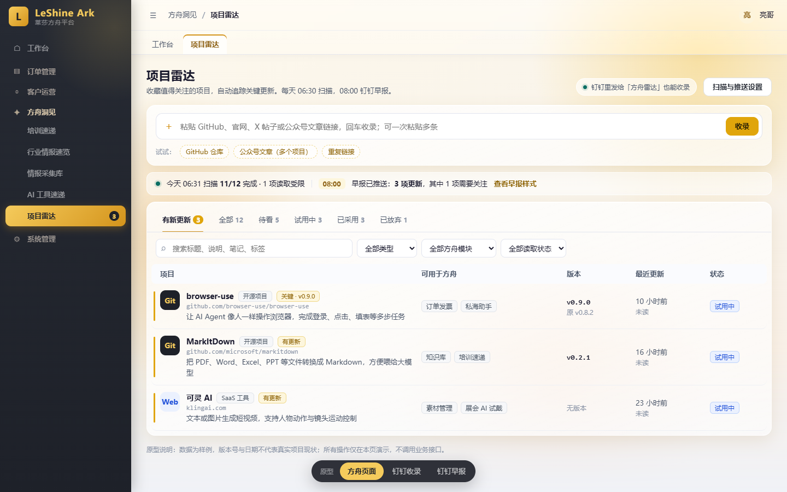

# 项目雷达 · 需求与功能设计

日期：2026-11-10　状态：一期代码候选（本地实现与隔离验证完成，未部署）；设计已经过一轮独立审查并修订（见 §11）。原型：[prototype/index.html](prototype/index.html)，纯前端演示，数据为样例，版本号与日期不代表真实项目现状。

> 实施说明：后端位于 `backend/app/project_radar/`，主站页面为 `/insight/project-radar`，迁移为 `257_project_radar`。实际表名按仓库命名法统一为 `ark_project_radar_*`，个人笔记 ORM/数据库字段为 `remark`，API 仍返回 `note`。二期 agent 兜底、GitHub Star、MCP 收录和工具速递联动不在本次范围。真实钉钉 Stream、GitHub/X 网络、20 条线索样本和生产迁移尚需部署前验收，不能以隔离测试替代。

## 0. 一句话

在 X 或公众号上看到值得关注的项目，**在钉钉里把链接发给「方舟雷达」机器人就算收藏完成**。方舟会自动读懂它，判断能用在方舟哪里。之后每天 06:30 扫描，08:00 只把**真正值得看的更新**合成一条钉钉早报推给你。



[详情抽屉](preview-detail.png) · [钉钉收录对话](preview-dingtalk-bot.png) · [钉钉早报](preview-dingtalk-digest.png)

本地打开原型：

```bash
python -m http.server 8765 --directory docs/requirements/2026-11-10-project-radar/prototype
```

然后访问 `http://localhost:8765`。底部切换条可在「方舟页面 / 钉钉收录 / 钉钉早报」三个视图之间切换。直接双击 html，部分浏览器会因本地文件限制而加载不全。

## 1. 需求补充：原始需求之外必须解决的 10 件事

原始需求只覆盖了「存」和「推」。真正落地时，下面这些不处理，工具两周后就会被弃用。

| # | 问题 | 不处理的后果 | 设计 |
|---|---|---|---|
| 1 | **你发的链接经常不是项目本身**。X 帖子、公众号文章只是线索，真正要追踪的是文中提到的仓库或产品官网 | 追踪的是一篇永远不会更新的文章，早报永远是空的 | 区分「来源」和「目标」：目标进入雷达，来源记为出处。详见 §4.2 |
| 2 | **版本号、日期让 AI 猜会出错** | 早报说「发布 v3.0」，实际没有，信任崩塌 | 事实字段只来自数据源，拿不到就显示「无版本」。AI 只写解读字段 |
| 3 | **更新噪音**：活跃仓库每天几十个提交，有的项目每天发版 | 天天被推送，很快被你静音 | 规则先分级，AI 再复核；提交不算更新；每个项目有推送频率上限。详见 §5 |
| 4 | **遗忘不只是找不到，更多是收了没看** | 变成另一个吃灰的书签夹 | 用试用状态区分待看、试用中、已采用、放弃；每周一早报附「沉睡提醒」 |
| 5 | **重复收录**：同一个项目在 X 和公众号各看到一次 | 列表重复，更新推两遍 | URL 归一，重复时只追加一条来源。多人收藏同一项目时各自独立，互不泄露。详见 §8 |
| 6 | **AI 写的内容你改过，下次扫描被覆盖** | 手工成果丢失 | 改过的字段加锁。AI 有明显不同的新结论时显示「AI 有新建议」，由你决定是否采纳 |
| 7 | **读不到内容**：X 登录墙、网站反爬、仓库被删 | 静默失败，以为在追踪，其实没有 | 读取状态显式可见，钉钉里直接说明原因。连续失败 3 天自动转 agent 尝试，仍失败才进早报「需要处理」（§2.1） |
| 8 | **系统挂了，和「今天没更新」看起来一样** | 漏掉关键更新还不知道 | 页面显示每日扫描健康度。扫描或推送失败时告警到运行与自动化中心。连续 7 天无推送，发一行「雷达运行正常」 |
| 9 | **服务端替你打开任意链接，是安全口子** | 可被利用去访问公司内网（SSRF） | 每一跳都校验公网地址，限制协议、端口、大小和跳转次数。详见 §9.4 |
| 10 | **方舟模块会变**（新模块上线、旧模块下线） | AI 推荐不出新模块，或推荐已下线的模块 | 方舟模块和项目类型都是字典表，运行时注入提示词（红线 7） |

## 2. 关于「用 agent 扫描」：建议改为固定程序扫描 + AI 只做解读

你的原话是「每天早上八点用 agent 扫描」。建议改成：**固定程序负责检测「有没有变化」，AI 只负责解读「变了什么、和方舟有什么关系」**。

| | Agent 每天逐个浏览 | 固定程序检测 + AI 解读（推荐） |
|---|---|---|
| 结果稳定性 | 每次浏览路径不同，可能漏看或误报 | 检测是确定性的，同样的输入得到同样的结果 |
| 成本 | 每天每个项目都要调用模型 | 只有真有新版本或 changelog 时才调用 AI，100 个项目每天约 3–10 次 |
| 速度 | 100 个项目可能要几十分钟 | 几分钟 |
| 部署 | 按规则需要部署到北京 Agent 宿主，单独运维 | 复用方舟现有调度器 |
| 你能感知的差别 | 无 | 无，早报内容一样，而且更准 |

扫描提前到 06:30，给慢网站和重试留出 90 分钟，08:00 准时推送，不需要补发。

### 2.1 agent 兜底（2026-11-10 确认采用）

固定程序处理不了一类网站：没有 changelog、没有版本号、内容靠 JS 加载，或者新功能藏在要点几下才能看到的地方。程序只能看出「页面变了」，分不清是新功能上线还是换了宣传图。这部分交给 agent 像人一样去浏览判断。

| 项目 | 谁来扫 | 频率 |
|---|---|---|
| GitHub 仓库、有 changelog / RSS 的网站（预计 80–90%） | 固定程序 | 每天 06:30 |
| 被标记为「agent 扫描」的网站 | agent | 每周一 06:00，结果进当天早报 |
| 连续 3 天读取失败的项目 | 自动转 agent 尝试一次；成功则标记为 agent 扫描，失败进「需要处理」 | 触发时 |
| 你临时想看 | 钉钉发「深度看 3」，或详情页点「让 agent 深度看」 | 立即执行，完成后单独回复 |

规则：

- **哪些项目走 agent**：收录时如果找不到任何追踪页（changelog、RSS、Release），系统会建议改为 agent 扫描；你也可以在详情页手动切换。
- **事实仍然不能编**：agent 报告的版本号、日期、更新内容必须附上原文出处（页面地址 + 原文片段）。方舟会重新抓取这个页面，核对片段确实存在才采信；核对不过的只当线索显示，标「未核实」，不进入版本字段，也不按「关键」推送。
- **成本有上限**：每次 agent 检查限定最多浏览 8 个页面、5 分钟；每周 agent 检查总数设上限（默认 20 次），超出的顺延到下周，并在早报里说明。
- **不会让人等**：agent 结果只在周一早报或「深度看」的回复里出现，不阻塞每天 08:00 的早报。

对你来说，两种方式的结果出现在同一份早报里，体验没有区别；详情页会标明这一项是「程序扫描」还是「agent 扫描」，以及上次 agent 检查的时间。agent 兜底排在二期（§10）。

## 3. 收录入口

按「每次收录需要的动作数」排序。

| 入口 | 场景 | 你的动作 | 优先级 | 说明 |
|---|---|---|---|---|
| **钉钉机器人单聊** | 手机上刷到 | 复制链接，发给「方舟雷达」 | P0 | 主入口。可一次发多条。链接后面写的话变成笔记，`#展会` 变成标签 |
| **方舟页面顶部输入框** | 电脑上 | 粘贴，回车 | P0 | 不弹窗，列表原位出现读取进度 |
| **AI 工具速递里一键收进雷达** | 看洞见日报时 | 点一下 | P1 | 复用洞见已有内容，两个模块打通 |
| **钉钉分享面板** | 在 X 或浏览器 App 里 | 分享 → 钉钉 → 方舟雷达 | P1，需真机验证 | 分享过来的链接卡片机器人能否收到需要真机验证；验证通过前，主入口仍是复制粘贴 |
| **GitHub Star 同步** | 在 GitHub 上看到 | 点 Star | P1 | 零额外动作。扫描时顺带拉取你的 Star 列表，新 Star 自动入雷达，状态为待看 |
| **Claude Code / Codex** | 开发时顺手 | 说「把这个收进雷达」 | P1 | 方舟 MCP 网关加 `project_radar_add` 工具，复用你的个人 token |
| **浏览器书签小工具** | 电脑浏览器 | 点一下书签栏 | P2 | 带上当前页面地址和选中的文字 |

不建议做：X 书签同步（需要付费开发者套餐，政策常变）、微信收藏同步（没有开放接口）。

## 4. 字段与收录流程

### 4.1 每个字段从哪里来

| 字段 | 来源 | AI 参与 | 你能改 | 拿不到时 |
|---|---|---|---|---|
| 标题 | 仓库名或页面标题 | 可润色为中文短标题，保留原名 | ✓ | 用域名 |
| 类型 | 字典「项目雷达类型」 | 从字典里选 | ✓ | 其他 |
| 一句话说明 | README 或页面正文 | 生成，≤40 字 | ✓ | 待补充 |
| 详细说明 | README、文档、页面 | 生成：能做什么、怎么用、限制、开源协议、部署要求 | ✓ | — |
| 可用于方舟 | 字典「方舟模块」 | 选 1–3 个，每个带一句理由和落地难度 | ✓ | 不推荐 |
| 版本号 | GitHub Release → tag → 包管理器 → 页面标注 | **不参与** | ✗ | 无版本 |
| 最近更新日期 | Release 发布时间 → changelog 日期 → 默认分支最近推送 → 页面变化日 | **不参与** | ✗ | 未知 |
| 最近更新内容 | Release notes、changelog、页面差异 | 生成中文摘要，1–3 条 | ✗ | — |
| Star、协议、语言 | GitHub API | 不参与 | ✗ | — |
| 来源 | 收录时的原始链接、渠道、你写的话 | 不参与 | 追加 | — |
| 状态、关注级别、标签、笔记 | 你 | — | ✓ | 待看、普通 |

外部时间（GitHub 的 `published_at` 等带 Z 或时区偏移）**先换算成北京时间再去掉时区**（红线 23）。测试必须覆盖「UTC 23:00 发布、北京时间已是次日」的用例。

### 4.2 收录流程（钉钉、页面、MCP 共用一条管线）

```text
收到输入（可能含多条链接 + 一段话）
 → 拆出链接；其余文字作为笔记，#词 作为标签
 → 逐条：安全校验（§9.4）→ URL 归一 → 查自己是否已收藏
     ├ 已收藏 → 追加来源，回复「已在你的雷达里」
     └ 未收藏 → 查全局目标库
         ├ 目标已存在（别人收藏过）→ 直接订阅，复用已有分析，秒回
         └ 新目标 → 判断类型
             ├ 项目本体（GitHub / 产品官网）→ 读取 → AI 分析 → 入库
             └ 线索（X 帖子 / 公众号 / 博客）→ 尽力抽取文中项目
                 ├ 有明确链接的候选 → 直接作为候选
                 ├ 只有名称的候选 → 搜索 + 校验 URL 真实存在且内容匹配；
                 │                  校验不过标「未确认」，不自动收录
                 ├ 1 个确认候选 → 直接收录，线索记为来源
                 ├ 多个 → 列出候选，你回复数字选择
                 └ 0 个 → 存为「文章」类型，不追踪更新，并提示你可补发项目链接
 → 钉钉回复结果卡片
```

线索解析的边界要说清楚，**一期是「尽力而为」**：

- X 帖子用公开嵌入接口读取正文和外链，需要走代理。仓库链接放在评论区，或者只发截图的帖子会解析失败。失败时机器人会直说，请你补发项目链接。
- 公众号文章的外链大多不可点，常常只写产品名；机房 IP 可能被要求验证。只有名称的候选必须经搜索校验，不能让 AI 直接猜 URL。搜索复用现有的 `AGENT_RUNTIME_BRAVE_SEARCH_API_KEY`。
- 验收时用 20 条真实样本（X 与公众号各 10 条）统计成功率，低于 60% 时把钉钉回执文案调整为优先引导补发链接。

钉钉回复分两段：**3 秒内**先回执「收到 2 个链接，正在读取」；分析完成后（目标 60 秒内）再发结果卡片。失败也一定回复原因。每条钉钉消息用消息 ID 做幂等，钉钉重复投递不会重复收录。收录任务存在数据库里（排队 / 读取中 / 待选择 / 完成 / 失败），后端重启不会丢。

## 5. 更新检测与降噪（核心）

### 5.1 什么算「更新」

| 信号 | 是否产生更新记录 | 是否调用 AI |
|---|---|---|
| GitHub 新 Release 或新 tag | ✓ | ✓，读 release notes |
| changelog 页或 RSS 出现新条目 | ✓ | ✓ |
| 追踪页面正文变化超过阈值（文本差异，不是哈希） | ✓ | ✓，读差异 |
| 默认分支有新提交 | ✗，只刷新「最近活跃」 | ✗ |
| star、fork、watcher 数变化 | ✗ | ✗ |
| 仓库被归档、删除或改名 | ✓，直接判为关键 | ✗ |

### 5.2 两层分级

**第一层：规则硬判**，不依赖 AI。

- 关键：主版本号变化（如 1.x → 2.x）；release notes 含 breaking、deprecat、security、CVE、不兼容、移除；仓库归档或删除。
- 普通：其他正式版本、changelog 新条目、页面明显变化。
- 噪音：预发布版本（alpha、beta、rc、nightly）。

**第二层：AI 复核**，只在第一层产生「关键」或「普通」时调用。AI 可以升一级或降一级，但必须写出理由。理由显示在详情页，便于你判断它准不准。抓到的 README 和网页正文一律视为不可信输入，提示词里隔离，防止内容里夹带的指令污染早报。

### 5.3 关注级别与推送规则

| 关注级别 | 推送内容 | 默认用于 |
|---|---|---|
| 重点 | 关键 + 普通 | 试用中的项目（状态改为试用中时自动切换，可改回） |
| 普通 | 只推关键 | 新收录的项目 |
| 已采用 | 只推破坏性变更和安全类更新 | 状态改为已采用时自动切换 |
| 静默 | 不推送，详情页仍记录 | 手动设置；状态改为放弃时自动切换，同时停止扫描 |

频率上限：同一项目 7 天内最多推一次普通更新；关键更新不受限。频繁发版的项目，后续版本会合并进下一次推送。

### 5.4 网站的变化检测

- 收录网站时，自动发现并登记 1–3 个**追踪页**：changelog 或 RSS 优先，其次是价格页和文档首页。你可以手动增删。**首页默认不追踪**，只做存活检测，因为轮播、日期和 A/B 测试会让它每天都变。
- 快照保存去噪后的正文（压缩存储，保留最近 5 版），先用文本差异判断变化幅度，超过阈值再交给 AI 总结变了什么。

### 5.5 每日时间线

```text
周一 06:00 agent 检查（二期）：对标记为 agent 扫描的项目逐个浏览，结果经出处核对后写入更新记录
06:30 扫描（办公室单活调度器；coalesce + misfire_grace_time，部署切换时错过触发也会补跑一次）
  GitHub：仓库信息 + Release + tag，带 ETag，未变化返回 304，不消耗配额
  网站：追踪页逐个检查
  GitHub Star 列表（若已开启）
  检测到变化 → 两层分级 → 写入更新记录
08:00 发早报（每人每天最多一条，数据库唯一约束保证不重复发）
  汇总「未推送」且符合关注级别和频率上限的更新 → 一条钉钉消息
  没有可推内容 → 不发。连续 7 天未推送 → 发一行「雷达运行正常，已扫描 N 项」
  扫描失败或推送失败 → 告警到运行与自动化中心，页面健康条变红
```

早报示例（原型中「钉钉早报」视图有完整样式）：

```text
方舟雷达 · 11月10日早报
3 项有更新，其中 1 项需要关注

【关键】browser-use v0.8.2 → v0.9.0
· 多标签页并行，长流程更稳
· 移除旧 Controller API，升级需改调用
→ 订单发票、私海助手：正在试用，升级前需改调用

【更新】MarkItDown v0.2.1：新增 EPUB；PDF 表格识别改进
【更新】可灵 AI（官网）：价格页新增团队版

【需要处理】ElevenLabs 连续 3 天读取失败
扫描 12/12 完成 ｜ 打开项目雷达 ›
```

周一的早报额外附「本周沉睡」：收录超过 14 天仍是待看状态的前 3 条。

## 6. 钉钉机器人交互

### 6.1 消息卡片按钉钉真实能力设计

- 机器人主动发消息使用单聊批量发送接口，模板只用 `sampleMarkdown` 和 `sampleActionCard`。**按钮只能是跳转链接**，没有彩色标签。原型已按这个限制绘制。
- 需要在钉钉里直接操作的事（改关注级别、选择候选），一律用**回复指令**，不做互动卡片回调。互动卡片复杂度高一个量级，一期不做。
- **「打开详情」不能让你再登录一次。** 卡片里的链接是短期签名深链接（24 小时有效，只能打开这一项的详情，且绑定你本人），在钉钉内置浏览器里免登录查看。改状态、改笔记这类写操作仍需要登录；或者二期做钉钉 H5 免登录后放开。详情页按主站响应式适配手机（红线 21）。

### 6.2 指令与对话状态

| 你发送 | 机器人做什么 |
|---|---|
| 一条或多条链接（可带文字、#标签） | 收录 |
| `1 3` / `全部` | 选择当前待选的候选项目 |
| 任意一段文字（当前有「待补充」项目时） | 作为该项目的补充说明，重新分析 |
| `静默 2` / `重点 2` / `放弃 2` | 修改上一张卡片里第 2 项的关注级别或状态（早报里每项带编号） |
| `深度看 2` | 让 agent 立即浏览第 2 项并单独回复结果（二期，受每周次数上限约束） |
| `最近` | 列出最近收录的 5 项 |
| `搜 关键词` | 按标题、说明、笔记、标签搜索，返回前 5 项 |
| `帮助` | 用法说明 |

对话状态：**每人同一时间最多一个待回复上下文**（待选择或待补充），30 分钟后失效。新发链接会结束旧上下文，并提示「上一个选择已取消」。没有上下文时，不带链接的文字只按指令解析，解析不了就回复帮助，不会误当成笔记。

### 6.3 接入方式

- 新建企业内部应用机器人「方舟雷达」，使用 **Stream 模式**。北京实例上运行轻量转发服务 `project-radar-bot`，维持长连接。收到消息后，它调用**北京本机方舟后端** `POST /api/project-radar/inbound/dingtalk`。这是机器对机器端点，用服务 token 鉴权，需要白名单注释（红线 3）。业务逻辑全部放在方舟后端。转发服务按 Agent 部署规则登记 `deploy/platforms.json`，单活运行。
  - 为什么选 Stream：不需要新开公网回调地址，也不用处理回调验签；北京已有 `dingtalk-monitor` 同类服务，运维方式一致。代价是多一个常驻进程。
  - 备选：HTTP 回调直接打到北京后端，少一个进程，但多一个公网入口。两种方式对你的使用体验没有差别。
- 身份：钉钉消息带发送人 userid，与 `users.dingtalk_id` 匹配。字段已存在，后台也已有「同步钉钉 ID」功能。未匹配上时，机器人提示联系管理员在用户管理里同步钉钉 ID，不另造绑定链接，避免链接被转发后绑错账号。没有 `project_radar:write` 权限的人会被拒绝。
- 回复：即时回执使用消息自带的会话回复地址；异步结果和每日早报使用单聊发送接口。**收录对话和早报在同一个聊天窗口里**，比工作通知更好找。

## 7. 页面设计（原型对照）

入口：方舟洞见 → 项目雷达，路径 `/insight/project-radar`。

1. **顶部收录栏**：粘贴后按回车即收录。列表顶部立刻出现读取进度行，完成后原位填充，不跳转、不弹窗。
2. **健康条**：今天的扫描结果（如「06:31 扫描 11/12 · 1 项读取受限」）和早报推送状态。失败时变红，可以点开查看原因。
3. **视图切换**：有新更新（有未读时作为默认）/ 全部 / 待看 / 试用中 / 已采用 / 已放弃，各带数量。
4. **筛选**：类型、方舟模块、读取状态、关键词。
5. **列表行**：标题、类型、一句话、方舟模块、版本、最近更新（相对时间，悬停显示精确北京时间）、状态。有未读更新的行左侧加金色竖条。
6. **详情抽屉**：AI 字段带「AI 生成」标识，可修改，改后加锁；分级理由；更新时间线；来源；笔记；状态与关注级别。关闭抽屉后才标记为已读。
7. **移出雷达**：需要二次确认。移出的是你的订阅，目标的分析和历史保留；没有人订阅的目标停止扫描。30 天内重新收录可以恢复你的笔记和状态。
8. **设置**：推送时间、无更新时是否发送、沉睡提醒、GitHub Star 同步，这些按人设置。扫描时间是全局的，只有管理员能改。

## 8. 数据模型（草案，实施时以 Alembic 迁移为准）

把「被追踪的东西」和「谁收藏了它」分成两张表。这样多人收藏同一项目时，各自的状态、笔记互不可见，也不会撞唯一约束；二期做团队共享时不需要迁移数据。

| 表 | 作用 | 关键字段 |
|---|---|---|
| `project_radar_target` | 被追踪的目标（全局唯一） | canonical_url（唯一）、kind（repo/website/article）、title、item_type、one_liner、description、ark_modules（JSON：模块 + 理由 + 难度）、version、last_updated_at、last_update_summary、read_state、consecutive_failures、last_error、last_scanned_at、scan_enabled、scan_mode（program/agent）、last_agent_check_at |
| `project_radar_tracked_page` | 网站的追踪页 | target_id、url、page_kind（changelog/rss/pricing/docs）、enabled |
| `project_radar_subscription` | 个人收藏 | (user_id, target_id) 唯一、status、watch_level、tags、note、overrides（你改过的字段及值，即锁定内容）、unread_update_id、last_pushed_at、removed_at |
| `project_radar_source` | 出处 | subscription_id、source_url、channel（dingtalk/web/mcp/github_star/insight）、raw_text、created_at |
| `project_radar_snapshot` | 快照 | target_id 或 tracked_page_id、captured_at、version、release_tag、etag、clean_text（压缩）、text_hash |
| `project_radar_update` | 检测到的更新 | target_id、detected_at、rule_level、ai_level、ai_reason、from_version、to_version、summary、ark_impact、raw_ref |
| `project_radar_agent_check` | agent 检查记录（二期） | target_id、trigger（weekly/failover/manual）、agent_run_id（关联 agent_runtime 的任务）、status、claims（JSON：agent 声称的版本/日期/更新 + 出处地址 + 原文片段）、verified_claims、pages_visited、started_at、finished_at |
| `project_radar_ingest_job` | 收录任务 | request_key（唯一，钉钉 msgId）、user_id、channel、raw_input、status、candidates、result、error |
| `project_radar_dialog` | 机器人对话上下文 | user_id（唯一）、kind（choose/supplement）、job_id 或 target_id、expires_at |
| `project_radar_digest` | 早报记录 | (user_id, digest_date) 唯一、item_count、status、dingtalk_ref、content |

AI 解读字段存在 target 上，所有人共享；你改过的版本存在自己订阅的 overrides 里。查重提示只说「已在**你的**雷达里」，不会透露别人的收藏。

## 9. 技术方案

### 9.1 模块边界

- 新建领域模块 `backend/app/project_radar/`（红线 1），包含 router、models、schemas、service。子 service 分为：ingest、resolve（线索解析）、scan、classify（两层分级）、digest、dingtalk_inbound。
- **抓取层复用洞见**：`insight/fetcher.py` 已有带代理的 HTML 和 RSS 抓取。实施时把它抽成共享工具，加上 §9.4 的安全校验，两个模块共用；不另写第二套。失败计数沿用洞见信源的 `consecutive_failures` / `last_error` 模式。
- **与「AI 工具速递」的边界**：速递是「外面新出了什么」，面向所有人，每天一份日报；雷达是「我关注的东西变了什么」，按人订阅。速递条目上加「收进雷达」按钮，两者在 08:00 和 08:35 分开推送，内容不重复。
- 前端：`views/insight/ProjectRadar.vue` + `composables/useProjectRadar.js`；navigation.js 新增一条入口（红线 10）；列表参照 ExpoLeads 标杆（红线 14）。
- AI 全部走 `app.ai.service.chat`。后台新增两个 preset：`project_radar_analyze`、`project_radar_update_classify`。类型与模块的值域运行时从字典注入 user message（红线 7）。

### 9.2 各环节运行位置

| 环节 | 运行位置 | 触发方式 | 外网访问 |
|---|---|---|---|
| 钉钉长连接转发 | 北京 `project-radar-bot` | 常驻 | 钉钉 |
| 收录入口与即时回执 | 北京方舟后端 | 转发服务调用本机接口 | — |
| 收录任务执行（读取 + AI 分析） | 北京方舟后端 | 写入任务后立即在后台线程执行（自建 SessionLocal，红线 4）；失败的任务由调度器每 5 分钟重试 | GitHub 直连或代理；X 走代理 |
| 每日扫描、早报 | 办公室单活调度器 | 06:30 / 08:00 | GitHub、网站；代理按抓取器类型配置 |
| agent 兜底检查（二期） | 北京 Agent 宿主（按 Agent 部署规则） | 调度器周一 06:00、失败转交或「深度看」时，以系统身份在 `agent_runtime` 创建任务 | 由 agent worker 的浏览器访问，同样受 §9.4 地址校验 |

agent 兜底**复用现有 `backend/app/agent_runtime` 受控 Agent 控制平面**，不另造一套：新增 profile `project_radar_deep_check`（scheduled 模式），由北京 worker 领取任务、浏览网页，按固定 JSON 结构交回「声称 + 出处」；方舟再重新抓取出处做核对（§2.1），只把核对通过的部分写入更新记录。**实施前需确认北京 worker 已具备浏览器能力**；不具备时，二期先做这项接入。

两台机器共用同一个数据库，收录在北京完成，扫描在办公室完成，状态都以数据库为准。代理配置项为 `PROJECT_RADAR_HTTP_PROXY`（GitHub、网站）和 `PROJECT_RADAR_X_PROXY`，统一走 Settings 管理。**实施前要分别在两台机器上实测访问 GitHub API 和 X 嵌入接口的稳定性。**

### 9.3 外部访问与成本

- GitHub：只读 token（`PROJECT_RADAR_GITHUB_TOKEN`），每小时 5000 次配额；ETag 命中返回 304，不计配额。100 个仓库每天约 300 次请求。
- 网站：直连抓取 + 正文提取；JS 渲染的页面降级用 firecrawl，只在直连失败时使用，有配额成本。
- AI：只在新收录、新 Release / changelog / 追踪页变化时调用；提交不触发。100 个项目每天估计 3–10 次。

### 9.4 抓取安全（SSRF）

所有由用户提交的 URL，以及解析出来的链接，由服务端抓取前都要过同一道校验：

- 每一跳重定向（包括 t.co 短链展开）都复用 `backend/app/mcp/public_web_tools.py` 中的 `_validate_public_url` 和 `_validate_peer`，拒绝内网、回环、链路本地和云厂商元数据地址；
- 只允许 http/https 和标准端口；最多跳转 5 次；单次响应最大 5MB；超时 15 秒；
- 校验失败时直接告诉你「该地址不允许访问」，不暴露内部细节。

### 9.5 权限

| 权限 | kind | 作用 |
|---|---|---|
| `project_radar:read` | 功能 | 查看本人订阅 |
| `project_radar:write` | 功能 | 收录、编辑本人订阅，钉钉收录 |
| `project_radar:admin` | 功能 | 维护字典、全局扫描设置、查看运行健康 |
| `project_radar:read_all` | data | 查看全部人的订阅（二期团队共享用） |

使用 `project_radar` 前缀，是为了和已有的「客户经营雷达」`customer_radar:*` 区分开。新权限按红线 8 三步走。

## 10. 分期

| 期 | 范围 | 你能感知的变化 |
|---|---|---|
| 一期 | Web 收录与管理；GitHub 与网站读取、AI 分析；X/公众号线索解析（尽力而为）；两层分级；每日扫描与早报（含健康告警、周一沉睡提醒）；钉钉机器人收录、指令与签名详情链接 | 发链接后收到卡片；每天 8 点收到早报 |
| 二期 | agent 兜底（周一检查、失败转交、「深度看」）；GitHub Star 同步、MCP 收录、AI 工具速递一键收录、钉钉分享面板（验证通过后）、钉钉 H5 免登录；团队共享与订阅按需开启 | 难读的网站也能追踪；点 Star 也算收藏 |

二期 agent 兜底的验收要点：agent 报告的版本或日期在出处页面上找不到原文时，不写入版本字段、不按关键推送；单次检查超过 8 个页面或 5 分钟会被中止；每周次数超限时顺延并在早报说明。

是否值得做 agent 兜底，以一期上线 2 周后的数据为准：统计找不到追踪页或连续读取失败的项目占比，低于 5% 时可以推迟。
| 三期 | 书签小工具；Gitee、Hugging Face、npm 适配；按模块聚合的「方舟可用技术地图」 | — |

## 11. 审查修订记录

2026-11-10 经独立 Agent 对抗性审查，采纳了 14 条意见：

- 补 SSRF 防护；
- 重做两层分级，提交不再触发 AI，并加推送频率上限；
- 拆分目标表与订阅表；
- 线索解析改为尽力而为，名称候选必须经搜索校验；
- 钉钉卡片按真实模板能力重画，签名深链接免登录查看；
- 定义对话状态和指令；
- 网站改为追踪页 + 文本差异；
- 补扫描健康度与幂等；
- 写清各环节运行位置；
- 复用洞见抓取层和现有钉钉 ID 同步；
- 权限改为 `project_radar` 前缀，并补 data 权限；
- 补「不用 agent」的理由；
- 补外部时间换算规则；
- 修正原型与文档的不一致。

## 12. 验收标准（一期）

1. 在钉钉发送 GitHub 仓库链接，3 秒内收到回执，60 秒内收到含一句话说明和方舟模块的卡片；方舟页面同步出现该项。点「打开详情」不需要登录。
2. 用 20 条真实 X / 公众号样本测试线索解析，统计成功率；只有名称的候选不会在未校验时自动收录。
3. 同一仓库用不同链接形式（带 `.git`、带 `?utm=`、子目录链接）收录两次，只有一条订阅、两条来源。另一位用户收藏同一仓库时，看不到前者的状态。
4. 版本号与更新日期和 GitHub Release 页面一致，北京时间跨日正确；没有 Release 的仓库显示「无版本」。
5. 人工修改「一句话说明」后，次日扫描不覆盖。
6. 只有提交或 star 变化的仓库不调用 AI，也不进早报；含 breaking 的 Release 进入「关键」分组。
7. 每人每天最多收到一条早报；扫描或推送失败时页面健康条变红，并在运行与自动化中心可见。
8. 提交 `http://127.0.0.1`、内网地址、会跳转到内网的短链，都被拒绝。
9. 未匹配钉钉 ID 的账号收到联系管理员的提示；没有权限的账号被拒绝。
10. 有待选候选时回复「1 3」只收录这两项；30 分钟后再回复数字，会提示上下文已失效。

## 13. 决策记录

| # | 问题 | 结论（2026-11-10 亮哥确认） |
|---|---|---|
| 1 | 个人用还是部门共享 | **个人使用**。一期只有亮哥本人订阅、只推送给本人；数据模型保留共享能力，团队订阅留在二期，按需再开 |
| 2 | 钉钉接入方式 | **Stream 长连接**，北京 `project-radar-bot` 转发（§6.3） |
| 3 | 新建机器人还是复用 | **新建「方舟雷达」机器人**。在钉钉开放平台创建应用的操作交给 Codex 在浏览器里完成 |
| 4 | 扫描方式 | **固定程序为主 + agent 兜底**。每日扫描由固定程序完成，AI 只做解读；程序读不了的网站由 agent 每周检查或按需检查，结果须经出处核对（§2.1），排在二期 |
