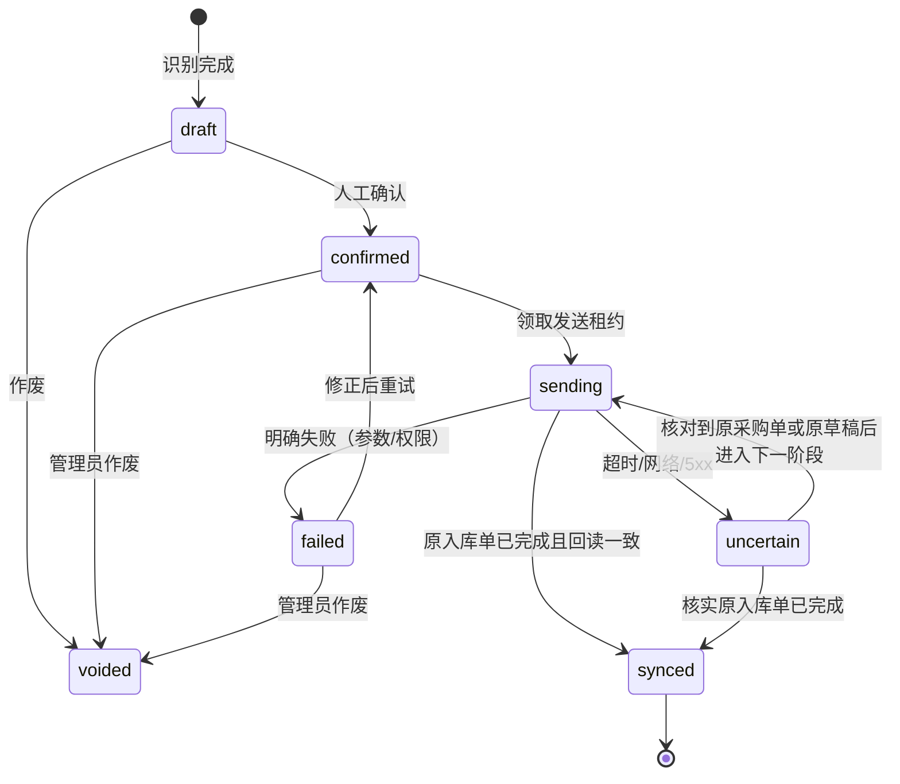

# 工厂手写发货单拍照识别入库：需求与设计

版本：v0.4，2026-11-18。状态：需求草案，已做两轮对抗性审查（见第 16 节）。v0.4 按亮哥更正改为「两类对应订单」（D5、D14–D17），并已补审一轮。尚未开发、未建迁移、未调用小满写接口。

## 1. 结论与范围

仓库收到工厂送货时，用手机拍下工厂手写的「送(销)货单」。系统识别每行的单号、工艺、长度、颜色、克重和数量，换算并匹配到系统 SKU，经人确认后生成方舟入库单并入库：

- **12 月 24 日切换前**：实物库存以小满为准。试点路线按同一供应商、仓库和币种的到货批次创建一张采购单及一张关联入库单。多个 SKU 在同一对单据中逐行关联。一件实测已通过，详见[P2 接口核验](p2-verification.md)。取得可核验的已完成入库凭据后再回写生产备货订单或记录发票生产单对应。
- **切换后**：同一功能改为过账到方舟本地库存账，并走本地生产单的验收入库；小满同步关闭。

识别用多模态大模型，走 `app.ai.service` 的 preset。匹配和换算由代码按数据库里的词表做确定性计算，大模型不直接决定 SKU。识别结果一律由人确认后才入库，不设「高置信度自动入库」。

不做：价格和成本核算、工厂对账、退货出库、本地 OCR 模型、小程序端。

## 2. 已定决策（2026-11-18 亮哥确认）

| 编号 | 决策 |
| --- | --- |
| D1 | 做成方舟入库功能：切换前同步小满，切换后关闭同步。不做两套界面 |
| D2 | 切换前入库只记小满，方舟本地库存账不记；切换时以小满盘点数据作期初，避免重复计算 |
| D3 | 试点采用一批一张采购订单、一张采购入库单。先核对采购单及明细 ID，再送入库，多个 SKU 同单 |
| D4 | 一件实测使用 SU0001、USD、默认仓库和牟亮亮。零单价被拒绝，USD 1 为本次验证单价，正式单价仍需确认 |
| D5 | 工厂回货对应的订单只有两类：生产备货订单（`ark_production_orders`）和订单发票里的生产单（`order_type = 'production'`）。对上生产备货订单时回写已入库数量 |
| D6 | 生产单分配：在未入库完成的明细里自动分配，加急明细优先，其余按生产单下单时间从早到晚；一行可拆到多条明细 |
| D7 | 对不上任何一类订单、且跨单也找不到该 SKU 的未完成备货单时，只入库 |
| D8 | 手机端做主站响应式全屏页，参考 `/shipping/scan`，不做小程序 |
| D9 | 识别用大模型，不自建本地 OCR |
| D10 | 工厂以后会在单据上注明等级（Q1 答复） |
| D11 | 单号对不上或没写时，按 SKU 跨单分配，规则同 D6（Q2 答复；范围由 D16 限定） |
| D12 | 回写生产备货订单只需入库权限 `factory_inbound:write`，不另要求 `production:write` |
| D13 | （作废，由 D15 取代）原「单号对上小满客户订单就只入库」 |
| D14 | 对上订单发票生产单时，只记录对应关系（入库行关联到发票明细，在入库模块可查到货进度），不改订单发票模块 |
| D15 | 订单发票里的库存单、预售单不做对应；单号只对上这两类时，视为「对不上」，按 D11 跨单分配 |
| D16 | 跨单分配只在生产备货订单里进行；发票生产单是给特定客户的货，只能按单号明确对应 |
| D17 | 发票号里的生产单号按规则从发票号提取，不改发票模块；重号时由人选择（单号即「月份 + 当月生产单序号」，已确认） |
| D18 | 核对页允许人工修改单号和等级（另可改长度、颜色、克重、数量），改后重新匹配、清空旧的选择与决定（2026-11-18 亮哥确认，原默认决定 A10） |

第 12 节另有一批「默认决定」，是起草时按最稳妥口径定的，亮哥可逐条否决。

## 3. 单据现状（来自 15 张真实样本）

样本在 `D:\发货单测试`（不进 Git；2026-11-11 至 11-15，同一工厂，单据编号 7085384–7085398）。2026-11-18 逐张人工读图，并只读查询方舟生产单与小满 SKU 镜像，要点如下。

### 3.1 表头被挪用

| 印刷的列名 | 实际写的内容 | 示例 |
| --- | --- | --- |
| 名称及规格 | 单号 + 工艺 | 「1017单 PU打孔」「628单 机织贴片」 |
| 单位 | 长度（英寸） | 18"、22" |
| 数量 | 颜色 | 5A-18B-62、878-18、1B、GC、Bombshell |
| 金额 | 克重 | 20g、2.5g、0.84g |
| 备注 | 数量 + 单位 | 120条、500片、300根 |

此外：

- 「—」表示同上一行。单号、工艺、长度、克重常常只在第一行写一次。
- 铁丝类有时把数量写进金额列（如「1100根」），要按单位判断数量，不能只认列位置。
- 有划掉的行；有一格写两条记录的（7085385 基本不按格子写）；有写到表格外合计栏的。
- 有不入库的行：「1001单色样」「库存改造型」「库存改PU打孔 1104单」「返401单」。
- 收货人另加的标注（圈号 ①②③、「11-10」这类日期、勾和括号）不是单据内容。
- 每张单右上角有红色印刷编号（如 7085391），手写月/日，没有年份。

### 3.2 单号与订单

「NNNN单」是一套生产单号流水，同时用在两处：生产备货订单的批次号 `batch_no`（942单 ↔ `#20260942`，983单 ↔ `#20260983`，1071单 ↔ `#20261071`，即「`#` + 4 位年份 + 补零到 4 位的单号」），以及订单发票里生产单的发票号（如「SC-1154」「生产单#1158」「Katie Pruneau生产单1026」）。两处都是手填自由文本，格式不统一，发票号还有重号（1113 出现在两张发票里）。

2026-11-18 方舟有约 9 张未完成的生产备货订单、141 张订单发票生产单。样本里的单号有的对得上（如 1017 ↔「SC-1017」、1026 ↔「Katie Pruneau生产单1026」），有的只对上库存单（1101 ↔「张笑浅色库存#1101」），有的两处都查不到（1109、628、1063 等）。

### 3.3 写法与小满不同

颜色是工厂简写，和小满 SKU 写法不同，但有规律：

| 工厂写法 | 小满写法 | 规律 |
| --- | --- | --- |
| 878-18 | #8TP8/18 | 「T」写得像「7」，省略 TP |
| 5A-18B-62 | #5ATP18B/62 | 「-」代替 TP 与 / |
| 5A760 | #5AT60 | 同上 |
| GC | Cookies Cream | 缩写 |
| Bombshell / Hollywood / Anna | 小满无 SKU | 定制色 |

工艺同样是简写：PU = Genius Weft，贴片 = Tape Hair，铁丝 = Keratin Tip（待核实）。单据**从不写 Super / Standard 等级**。

### 3.4 匹配验证

用「983单」（7085384，共 5 行）在生产单 `#20260983` 的 364 条明细里匹配：

- 2 行按长度和颜色唯一命中；
- 2 行同时命中 Super 和 Standard，靠到货数量刚好等于其中一条明细的下单数才分出来；
- 1 行两个等级的下单数都是 500 片，只能人工选。

结论：

- 在生产单明细范围内匹配可行，但「多个候选」是常态，确认页必须让人能快速点选。
- 对不上生产单的行只能在小满全部 SKU（约 1040 个）里匹配。样本单据没写等级，这类行无从判断等级，选错就会入错 SKU。按 D10，工厂以后会注明等级，系统据此过滤；没写等级的单据（含这 15 张样本）仍须每行人工选等级。

## 4. 用户流程

### 4.1 手机端（主路径）

入口 `/factory-inbound/scan`，全屏页面，交互参照 `/shipping/scan`：

1. **拍照**：一次一张送货单。前端压缩到长边 2560px 的 JPEG（约 1MB），上传后进入识别。
2. **识别中**：骨架屏加耗时提示（预期 20–60 秒）。可离开页面，稍后在「我的草稿」继续。不做假进度条。
3. **核对**：顶部显示单据编号、日期、照片（可放大对照）。按单号分组列出各行，每行显示识别原文（灰色）、换算后的规格、匹配状态和数量：
   - 绿色「已匹配」：唯一命中，默认勾选。
   - 黄色「待选择」：多个候选，点开选一个。候选显示完整产品名、等级；有生产单时另显示下单数和未入库数。
   - 红色「无法入库」：找不到 SKU、超量、小满无此产品、SKU 无法唯一确定等，写明原因和处理办法。
   - 灰色「不入库」：色样、改造、返修、划掉的行，默认不勾，可展开看原文。
   - 每行可修改识别值（长度、颜色、克重、数量），修改后重新匹配。
4. **确认入库**：勾选的行必须全部是绿色才能提交。提交前显示汇总（N 行、合计数量、回写哪几张生产单），再点一次确认。未勾选的行留在本单，之后可补录（第 9 节）。
5. **结果**：显示「已入库」「同步中」「结果待核对」（见 7.3）。成功后提示小满库存镜像的刷新时间（见 7.5）。

### 4.2 桌面端

「备货管理」下新增「工厂到货入库」列表：按日期、单据编号、状态、操作人筛选。详情页显示原图、识别原文、确认结果、生产单分配、小满入库单号和同步记录。管理员在此维护词表（6.3）、处理同步异常、改分配、作废和登记更正。

## 5. 识别

- 新建 AI preset `factory_delivery_ocr`，绑定支持图片输入的多模态模型；模型可在后台更换，不写死。
- 提示词只描述**版式规则**：每列实际含义、「—」同上、按单位识别数量、划线行、忽略收货人标注。
- 行类型（入库 / 色样 / 改造 / 返修 / 划掉）的值域放在配置表，运行时注入 user message，不写死在提示词里（红线 7）。工艺、颜色别名、单号列表也不进提示词，匹配阶段由代码查库。
- 输出固定 JSON：单据编号、月、日；行数组，每行含原文、单号、等级、工艺、长度、颜色、克重、数量、数量单位、行类型、是否继承上一行、模型自评疑点。工厂写等级的位置和写法尚未确定，提示词只要求「原样抄出等级字样」，由匹配阶段查等级词表（6.4）换算；等级同样适用「—」继承上一行。
- 后端校验 JSON 结构。字段缺失或解析失败时提示重拍或手工录入，不把半成品结果当成功。
- 识别在独立线程池后台执行（参照 `domestic_followup` 的 `jobs.py`），不占请求线程，超时 120 秒。识别状态落库；进程重启后，启动时把超时仍在「识别中」的草稿标为失败，允许重新识别（参照 `_recover_stale_ai`）。
- 原图存私有目录（新增 Settings 配置，参照 `AI_CHAT_STORAGE_ROOT`），不挂到公开 `/uploads`，读取时校验权限。上传、识别和存储由哪台生产实例承载，在 `deploy/platforms.json` 登记，开发时按 `AI_CHAT_STORAGE_ROOT` 的实际部署方式核实，避免请求落到没有图片的主机。

## 6. 换算与匹配

### 6.1 单号对应哪张订单

工厂回货对应的订单只有两类（D5）：

| 类型 | 来源 | 单号所在 | 到货后 |
| --- | --- | --- | --- |
| 生产备货订单 | `ark_production_orders` | `batch_no`，如 `#20260942` | 回写明细 `received_qty`（7.4） |
| 订单发票里的生产单 | `ark_invoices`，`order_type = 'production'`，`transaction_mode = 'legacy'` | 发票号里，如「SC-1154」「生产单#1158」「ly#1151生产单」「翟 1113 生产」 | 只记录对应关系，不改发票（D14） |

订单发票里的库存单（`stock`）和预售单（`presale`）不做对应（D15）。

**单号的含义（2026-11-18 亮哥确认）**：系统给生产单生成的默认发票号是 `SC-{月}{当月第几张生产单}`（`invoice/service.py` 的 `suggest_invoice_no`）。样本里的单号与之吻合：11 月 12–15 日的单据写的是 1101–1120（11 月的单）、1017–1072（10 月）、942–983（9 月）、628（6 月）；「1118单」对应 11 月 6 日的「1118生产单」。「NNNN单」就是「月份 + 当月生产单序号」，**号里没有年份**。生产备货订单的 `batch_no` 沿用同一编法，例如 1071单 ↔ 生产订单 `#20261071`（亮哥确认）。

**查找**：单号补零到 4 位，按下面的规则在两处查找，只看**最近 11 个月**内创建的单（避开去年同月的同号）：

- 生产备货订单：`batch_no` 去掉开头的 `#` 和 4 位年份后**完全相等**。格式不符合「`#` + 8 位数字」的不参与匹配，并在桌面端提示。
- 订单发票：先排除 `status = 'deleted'`，并去掉发票号里的 `~DEL~{id}` 后缀；再从发票号里取编号（D17）：系统默认号 `SC-NNNN` 直接取 NNNN；其他写法取紧邻「#」「生产单」「生产」的 3–4 位数字串，前后不能紧挨其他数字。库存单默认号 `{用户名}-KC-NNNN` 和旧格式 `INV{日期}-NNN` 不参与提取。

**结果**（只把可对应的两类单计入命中；库存单、预售单不算命中）：

1. **命中一张可用的生产备货订单**（`deleted_flag = 0`、`status = 0`、`transaction_mode = 'legacy'`）：先在这张单的明细里匹配，命中则按第 8 节在该单内分配并回写。该单里找不到匹配的产品时（常见原因是单号写错），标黄「生产单 #NNNN 中没有此产品」，由人选择只入库或改为跨单分配，系统不自动改道。
2. **命中一张可用的发票生产单**（`status` 不是 `cancelled`、`cancel_pending`，`commerce_status` 不是 `cancelled`）：在这张发票的明细里匹配，命中后记录对应关系（第 8 节）。发票里找不到匹配的产品时，标黄，由人选择只入库或重新选单。
3. **命中但不可用**：
   - 备货单已完成 / 已终止 / 已删除 / 已转本地：标黄写明原因，由人选择只入库或改为跨单分配。
   - 发票取消中（`cancel_pending`）：标黄「发票取消中」，不自动对应，由人选择只入库或稍后处理。
   - 发票已取消：标黄「发票已取消」，由人选择只入库或改为跨单分配（客户取消后的定制货能否计入备货单，见 15.2 第 9 条）。
   - 均不自动跨单，避免把尾货、补货记到别的单上。
4. **命中多张**（同号的备货单和发票，或发票重号，如 1113 出现在两张发票里）：标黄「待选择」，列出全部命中的单（类型、提取出的编号、日期；发票号原文只对有发票权限的人显示，见 11.1），由人选。选择结果记录选择人和候选范围。
5. **两类都没命中，或没写单号**（包括只对上库存单、预售单的情况）：在小满 SKU 镜像（`okki_product_skus` + `okki_products`，均为启用状态）里匹配，有等级时按等级过滤（D10）。SKU 确认后，按第 8 节**只在生产备货订单里**跨单分配（D16）；没有任何未完成备货单含该 SKU 时，只入库（D7）。只对上库存单或预售单时，核对页提示「单号对应库存单 / 预售单 XXX，不做对应」。

跨单分配的行在核对页标「跨单分配」，列出将回写的生产单和数量，与单号命中的行区分显示。每行有「回写 / 对应」开关（默认开），关掉后该行只入库。提交前的汇总里，跨单回写单独列一组，需再确认一次。

P0 用 15 张样本的单号逐个核对上述规则：统计命中哪类单、多张命中的比例、查不到的单号（如 1109、628、1063）原因。

### 6.2 明细到小满 SKU

订单发票的明细：

- 标准行自带 `product_id` 和 `sku_id`，直接采用（仍校验 SKU 和产品处于启用状态）。
- 定制行（生产单才有）`product_id`、`sku_id` 为空，只有 `custom_product_id`。通过 `ark_custom_products` 回填的小满产品和 SKU ID 解析；解析不到时标红「小满未建品」，不能提交，先在小满建品再补录。
- 配件行（`product_kind = 'accessory'`）不参与匹配。

生产备货订单的明细只有 `product_id` 和 `local_sku_id`，没有小满 `sku_id`，而采购入库每行必须同时传 `product_id` 和 `sku_id`。所以命中明细后，要按 `product_id` 在 `okki_product_skus` 里找启用的 SKU：

- 恰好一个：采用。
- 零个或多个：该行标红「SKU 无法唯一确定」，不能提交，由管理员处理。

入库行和分配记录都保存 `product_id`、`sku_id` 快照。

### 6.3 匹配规则

按等级（有则用）→ 长度 → 颜色（换算后）→ 克重 → 工艺逐级过滤候选。等级的使用有限制：

- 只有**本行明确写了等级、且在等级词表里精确命中**，才能用来把多个候选收窄为唯一命中。
- 等级是从上一行「—」继承来的，或词表里查不到：仍按无等级匹配，候选多时保持黄色，并显示等级原文和来源。写了等级但词表查不到时，标黄「未知等级写法 XX」，不静默忽略。

结果分三档：

- **唯一命中**。
- **多个候选**：通常只差等级。有生产单时，若到货数量恰好等于某条明细的未入库数量，把它排在第一位并标「数量吻合」，但**不自动选中**，仍要人点。
- **找不到**：列出最接近的若干条供参考，不允许提交。

已停用的 SKU 和产品不作为候选。

### 6.4 词表（会越用越准）

新增三张词表，由管理员维护，也在确认时沉淀：

- **工艺词表**：工厂词 → 产品名关键词（PU → Genius Weft）。
- **颜色别名表**：工厂写法 → 小满颜色（GC → Cookies Cream，878-18 → #8TP8/18）。
- **等级词表**：工厂写法 → 产品名开头的等级关键词（如 B3 → `Super Double Drawn`、B1 → `Standard Double Drawn`，对应关系待业务确认）。匹配时用该关键词对 `okki_products.name` 做前缀精确比较；镜像里是否有更可靠的等级字段，开发时核实。工厂开始注明等级后，按实际写法补录；词表为空时全部按无等级处理。

另有一条确定性换算规则，把「A-B-C」「ATB-C」「A7B-C」这类写法统一换成 `#ATPB/C`。规则算出的结果也要在 SKU 里命中才算数。

人在确认页手动选定候选、而该写法不在词表里时，询问「以后 GC 都按 Cookies Cream 处理？」。有 `factory_inbound:admin` 的人同意即写入；没有的记为待审核建议，由管理员审核。不静默学习。

## 7. 入库办理

### 7.1 办理路线

路线遵循 `docs/requirements/2026-10-27-commerce-dual-route-design.md`：该设计不做「一次全局切换」，而是按资源范围决定由哪条路线办理。所以本功能**按 SKU 判断**，不只看全局阶段：

- 推送小满前，对 record_list 里每个 (product_id, sku_id) 做与 `inventory/legacy_scope.require_legacy_outbound_scope` 同等的排除校验。已划入本地试点范围（route 不是 legacy 或 state 不是 active）的 SKU，不允许推入小满，该行标红。现有函数只拦截操作名含 `outbound` 的请求，需扩展到采购入库，或新增同等函数。
- 小满写入必须持有办理权凭证。现有 `invoice/legacy_sending` 的办理权和发送租约以发票为主体（`commerce_transition` 的 authority/claim 外键到 `ark_invoices`），`okki_client.push_outbound` 没有凭证会拒发。工厂入库没有发票，需要在 `commerce_transition` 里新增**不绑定发票的资源级办理权**（主体为本功能的入库单），复用其 epoch、租约和路线校验，不另造一套绕开门禁的发送通道。

| 阶段 | 正式入库事实 | 生产单回写 | 方舟本地库存账 |
| --- | --- | --- | --- |
| 切换前（legacy 范围） | 小满采购入库单 | 旧路线 `received_qty` | 不记 |
| 切换后（local 范围） | 方舟库存单据 `ark_stock_documents` | 本地生产单验收入库 `production/local_service.receive` | 记 |

切换后的本地路线（过账、本地生产单验收所需的完工和供货前置条件）在切换实施时另行细化，本期只要求数据模型和服务边界能接上。

### 7.2 小满采购入库单字段

| 字段 | 取值 |
| --- | --- |
| supplier_id | 部署配置保存当前租户已核验的工厂供应商 ID（SU0001）；未配置时拒绝提交 |
| currency | USD |
| invoice_warehouse_id | 部署配置保存当前租户已核验的默认仓 ID |
| status | 新建用 1（草稿），核对后按原 inbound_id 提交 2（完成） |
| handler | 确认人绑定的小满 user_id；未绑定则拒绝提交 |
| warehouse_invoice_time | 确认入库当天，北京时间 `beijing_today()` |
| serial_id | 批次预先确定的入库单号，创建后按编号和内部 ID 核对 |
| remark | `方舟入库单 FI2026xxxx-NNN；工厂单据 7085391；11-14`（方舟单号必须在） |
| record_list[] | 每个合并后的产品和 SKU 一条，包含 product_id、sku_id、inbound_count、经确认的正数 purchase_price、purchase_order_id、purchase_order_product_id |

同一 SKU 出现在多行且单价一致时，在小满采购单和入库单中分别合并为一行，方舟侧保留原始行和合并关系。采购行 ID 从采购单详情取得。USD 1 为本次试单单价，正式批次的单价来源待业务确认。

### 7.3 同步状态与防重复入库

一件实测验证了指定采购单号、指定入库单号、草稿按原 ID 转完成和精确回读。发送前冻结批次、两张单号和明细，按采购单、入库草稿、入库完成三个阶段保存意图和回执。结果不明时，按所在阶段的原编号与内部 ID 核对。一次未命中继续待核对，禁止自动补建。详见[接口核验](p2-verification.md)。

状态流转：

- 只有 `confirmed` 能发送。发送前写入 `sending` 并持有租约，避免两个请求同时发。
- `uncertain` 不能作废，必须先核清。
- 绑定采购单 ID 和采购行 ID，并记录小满返回的 `inbound_invoice_id`、`serial_id`。核对入库已完成、编号、仓库、SKU、数量、单价及采购关联后才允许回写；不一致标记待核对。
- 本轮实测完成入库后，采购单仍显示采购中、待安排数量 1。续办依据冻结的批次和入库单回读。
- 作废时释放该单全部 pending 预占（7.4）。

### 7.4 回写、对应与事务顺序

正式事实在小满，所以**先小满、后回写**。以下针对生产备货订单；发票生产单的对应关系走同样的 pending → applied / released 流程，但只改本功能自己的分配表，不写订单发票的任何表：

1. 确认时，按第 8 节算出分配方案，写入「预占分配」（pending）。别的入库单计算剩余数量时要扣掉 pending 预占，防止同一剩余数量被用两次。
2. 小满同步成功后，在一个本地事务里：锁定相关生产单明细，校验预占仍然有效，把数量加到 `received_qty`，同步更新明细和订单状态（参照 `update_item_status` 的订单级状态同步），分配改为 applied，写生产单审计。
3. 回写失败（如生产单在此期间被终止）：入库单状态为「已入库，待回写」，后台任务重试；仍失败则交管理员处理，不回滚小满。
4. 小满明确失败或单据作废：释放 pending 预占。

需要改两处现有代码：

- 现有 `stock/production_order_service.update_item_received` 是「设置绝对值、内部 commit、不加锁」，不能复用。新增一个按增量更新、不在内部 commit、带行锁和超量校验（计入 pending）的服务函数，沿用现有审计写法。
- 生产单页的手工「录入已入库数量」（`stock/router.py` 调 `update_item_received`）与本功能并存会互相覆盖。本功能上线后，legacy 明细的 `received_qty` 只保留一个写法：手工入口改为同样的增量 + 加锁 + 扣减 pending，并强制填写更正原因。

### 7.5 小满库存镜像

方舟的备货和可售查询读 `lsordertest.okki_inventory` 镜像。推送成功后镜像不会立刻变化，用户可能误以为没入成功而重拍。处理方式：

- 结果页明确提示「小满已入库；方舟库存显示将在下次同步后更新」，并给出入库单号。
- 不借本功能扩大宪法规定的 `okki_inventory` 写例外。若要立刻刷新，只能由同时具有 `stock:read` 和 `stock:write` 的用户，经现有 `stock.inventory_sync_service` 按 SKU 刷新。

### 7.6 切换前置条件（对切换方案的硬性要求）

`ensure_legacy_order` 在全局切到 local、或订单已是 local 时会拒绝旧路线写入；承接旧生产单时，`commerce_migration/production_service` 会严格比对 `received_qty` 与核验快照。跨切换日仍在途的入库单要么永远补不进生产单，要么破坏承接核验。因此：

- 切换（或某个 SKU 范围转为本地）前，本功能的 `confirmed`、`sending`、`uncertain`、「已入库待回写」和 pending 预占（含发票对应的 pending）必须全部清零，否则阻断切换。
- 本功能提供一个只读检查接口，供切换前置检查调用；验收中包含这一条。

## 8. 生产单分配

两种范围共用同一套规则：

| 范围 | 适用 |
| --- | --- |
| 单单分配 | 单号命中一张生产备货订单，且该单有此产品 |
| 跨单分配（D11、D16） | 单号对不上或没写；或单号命中但不可用 / 无此产品、由人改为跨单。只在生产备货订单里分配 |
| 发票对应（D14） | 单号命中一张发票生产单，且该发票有此产品。只记录对应，不回写 |

**发票对应**：

- 同一发票里同一 SKU 有多条明细时，按明细顺序依次填满。
- 可对应数量 = 明细数量 − 已生效（applied）对应 − 其他批次的待生效（pending）对应。超出部分**不记对应**，只入库，核对页提示「超出发票数量 N 件」，不拦截入库本身。
- 对应关系在小满同步成功后生效（applied），作废或失败时释放。
- 并发：只锁本功能自己的数据，按发票 ID 取 MySQL 命名锁（`GET_LOCK`）后重算，**不锁订单发票的任何表**，不与发票编辑、推单流程争锁。
- 对应记录不对发票明细加外键，保存快照（发票 ID、发票号、订单类型，明细的 product/sku/custom ID、数量）。详情页实时比对，发票明细被删除、发票改为库存单、数量变化或发票取消时，显示相应提示；已入库的事实不变。

以下规则适用于单单分配和跨单分配（均为生产备货订单）：

- **候选明细**：明细对应的小满 SKU（按 6.2 唯一解析）与确认 SKU 相同；明细 `status = 0`；订单 `status = 0`、`deleted_flag = 0`、`transaction_mode = 'legacy'`；`received_qty` + pending 预占 < `order_qty`。手工置为「已完成」的明细不再分配。明细的产品对应多个 SKU 时无法确定是否同一 SKU，不参与跨单分配，在桌面端提示。
- **排序**：`is_urgent = 1` 优先；同级按生产单 `created_at` 从早到晚，再按明细 ID。
- 依次填满，一行可拆到多条明细、多张生产单。
- **单单分配超量**：到货多于该单可分配数量时，该行标红「超出 N 件」，不能提交。由人改数量，或把超出部分拆成单独一行，按跨单分配处理。
- **跨单分配超量**：所有未完成生产单都分配满后仍有剩余，剩余数量记为「未分配余量」，核对页标出「其中 N 件暂不回写生产单」。不拦截，因为这符合 D7。
- **余量和失效预占在回写时重算**：小满同步成功、执行回写时（7.4 第 2 步），在锁内对跨单行重新计算：别的批次预占已释放而空出的数量，会分给本批的未分配余量；本批预占的明细已失效（如生产单被终止）时，按本节规则改分到其他明细。单单行的预占失效仍交管理员处理。最终仍分不出去的数量才只入库、不回写。
- 确认页显示分配预览，管理员可手动改分配（留痕）。提交时在锁内重新计算，与预览不一致（含加急标记、明细状态变化导致的排序变化）则要求重新确认。
- **加锁方式**：提交和回写时，用一条 `SELECT … FOR UPDATE ORDER BY id` 一次锁住「该 SKU 的全部 legacy 未完成明细」，再读 pending 预占重算；排序以锁内读到的 `is_urgent` 和状态为准。生产单页的手工录入入口（7.4）也锁同一批行，避免互相覆盖和死锁。

背景：生产单由购物车下单，购物车按「用户 + 产品」唯一，同一张生产单里同一 SKU 通常只有一条明细，且明细创建时间都等于订单创建时间。所以「加急优先、按下单时间」主要在跨单分配时起作用。

## 9. 重复单据、补录与作废

- 以「工厂 + 单据编号（红色印刷号）」识别同一张送货单。同一编号已有入库单时，拍照后直接跳到已有记录，不新建。编号识别不出时要求手工填写，并显示照片局部让人对照二次确认。
- **补录**：一张入库单可以分多批提交。第一次只提交了绿色行，之后（如在小满建好定制色产品后）可在同一张单里继续提交剩余行，每批生成一张小满入库单。全部行处理完（入库或标记不入库）后，单据为「已完成」。
- MySQL 不支持「未作废记录内唯一」这种部分唯一索引，用生成列（作废时为 NULL）加唯一索引实现。
- 作废：草稿由创建人或管理员作废；`confirmed`、`failed` 只能由管理员作废；`uncertain` 必须先核清。`synced` 的批次不提供一键撤销：小满已入库的修正在小满处理，方舟由管理员登记更正（写审计，并冲回对应的生产单回写）。

## 10. 数据模型（草案）

表名按命名宪法，所有列带中文 comment，时间字段用 `beijing_now()`：

| 表 | 用途 | 关键列 |
| --- | --- | --- |
| `ark_factory_inbound_notes` | 入库单（一张送货单一条） | 方舟单号、工厂、工厂单据编号、防重生成列、单据月日、图片相对路径、识别状态与时间、单据状态、创建人、版本 |
| `ark_factory_inbound_batches` | 提交批次（每批一张小满入库单） | 入库单 ID、确认人、确认时间、同步状态、办理权凭证、小满入库单 ID/编号、幂等键 |
| `ark_factory_inbound_lines` | 识别与确认行 | 行号、识别原文 JSON、确认后的单号/工艺/长度/颜色/克重/数量、行类型、匹配状态、product_id 与 sku_id 快照（切换后加本地 SKU）、生产单 ID、所属批次 |
| `ark_factory_inbound_allocations` | 订单对应与分配 | 行 ID、目标类型（备货单明细 / 发票明细）、目标明细 ID（不加外键）、目标快照（单号、类型、产品/SKU、数量）、数量、状态（pending/applied/released）、选择来源（自动 / 人选）与选择人；只有备货单明细会回写 |
| `ark_factory_inbound_sync_attempts` | 小满同步记录 | 批次 ID、请求摘要、响应、结果、错误、租约 |
| `ark_factory_inbound_process_aliases` | 工艺词表 | 工厂词、产品名关键词、启用、来源（规则/人工/审核） |
| `ark_factory_inbound_color_aliases` | 颜色别名表 | 工厂写法、目标颜色、启用、来源 |
| `ark_factory_inbound_grade_aliases` | 等级词表 | 工厂写法、产品名等级关键词、启用、来源 |
| `ark_factory_inbound_line_types` | 行类型值域 | 编码、名称、是否入库、启用 |

`ark_factory_inbound_lines` 另存：等级原文与来源（本行写明 / 继承 / 无）、是否回写生产单、未分配余量。

工厂暂只有一家，先作为配置项，表上保留字段。

## 11. 权限、接口与前端

### 11.1 权限

按红线 8 在 `seed_role_permissions` 新增：

- `factory_inbound:read`：查看列表和详情。
- `factory_inbound:write`：拍照、核对、确认入库自己的草稿。
- `factory_inbound:admin`：维护和审核词表、手动改分配、处理同步异常、作废与登记更正、处理他人草稿。

草稿归属创建人：修改行和确认只允许创建人或管理员，确认时后端校验。小满处理人取实际确认人。

**订单数据范围**：订单发票有按人划分的数据范围权限，仓库人员通常看不到全公司发票，而发票号原文常带客户名或业务员名（如「Katie Pruneau生产单1026」）。为不绕过权限，核对页的订单候选和对应结果只显示订单类型、提取出的编号（如 1026）和日期，不显示发票号原文、客户名和金额；有发票读取权限且在其数据范围内的人，可看到原文并点开发票详情。

**回写生产单只需 `factory_inbound:write`**（D12）：这是相对现有规则的一项权限放宽——生产单页手工录入已入库数量要求 `production:write`，而本功能确认入库即可回写，跨单分配时会改到任意未完成生产单。为控制风险：回写只能按第 8 节规则自动计算，不能由 write 用户任意指定生产单；手动改分配仍限 `factory_inbound:admin`；每次回写写入生产单审计（操作人、入库单号、数量）。

### 11.2 接口（`/api/factory-inbound`，统一信封）

| 方法 | 路径 | 权限 | 说明 |
| --- | --- | --- | --- |
| POST | `/notes` | write | 上传图片，创建草稿并提交识别任务 |
| GET | `/notes` | read | 列表 |
| GET | `/notes/{id}` | read | 详情（含识别状态，供轮询） |
| POST | `/notes/{id}/recognize` | write | 识别失败后重新识别 |
| PATCH | `/notes/{id}/lines/{line_id}` | write | 修改识别值或选择候选，返回重新匹配结果 |
| POST | `/notes/{id}/batches` | write | 确认入库一批（带版本号和幂等键） |
| POST | `/notes/{id}/void` | write / admin | 作废（权限按 9 节） |
| PATCH | `/notes/{id}/allocations` | admin | 手动改分配 |
| POST | `/batches/{id}/resolve` | admin | 核清 uncertain（已建补记 / 未建重发） |
| POST | `/batches/{id}/retry` | admin | failed 修正后重发 |
| POST | `/batches/{id}/corrections` | admin | 登记已入库批次的更正 |
| GET | `/notes/{id}/image` | read | 读原图（axios blob） |
| GET/POST/PATCH | `/aliases/...` | read / admin | 词表与待审核建议 |
| GET | `/transition-check` | admin | 切换前置检查：在途单据与 pending 预占 |

新领域模块 `backend/app/factory_inbound/`：router / models / schemas / service，子 service 拆为 recognition（AI 调用与解析）、matching（换算与候选）、allocation（分配与回写）、xiaoman_sync（办理权、推送与查重）。小满请求复用 `app.invoice.okki_client` 的令牌与请求封装，新增采购入库的 push / list / info 函数，经 7.1 的资源级办理权发送。

### 11.3 前端

- `navigation.js` 新增两条：手机端 `/factory-inbound/scan`（fullscreen，菜单在「备货管理」）、桌面列表 `/factory-inbound`。
- API 模块从 `api/clients.js` 取 client；按钮权限用 `v-permission`；图片读取走 blob。
- 页面按职责拆 composable（识别轮询、行编辑与匹配、批次提交）。颜色用 tokens.css。
- 手机核对页按 `DESIGN.md` 与 Emil 设计规范做；开发前加载 `emil-design-eng`，动效完工后按 STANDARDS.md 自查。

## 12. 默认决定（待亮哥确认，可否决）

| 编号 | 默认 | 理由 |
| --- | --- | --- |
| A1 | 第一版只支持个人账号登录使用，不做共用手机选操作人 | 小满处理人必须是真实绑定账号，共用账号本身没有绑定。需要时二期按 `/shipping/scan` 的选操作人模式补 |
| A2 | 先建采购单，再建入库草稿并按原 ID 转完成 | 回读和核对草稿后才提交库存变动 |
| A3 | 「多个候选」即使数量吻合也不自动选中 | 等级选错会入错 SKU，库存和后续发货都会错 |
| A4 | 色样、改造、返修行不入库，只列出备查 | 改造是库存内加工，不是新到货；返修性质未明 |
| A5 | 入库日期用确认当天，不用单据手写日期 | 单据没有年份，手写日期是工厂发货日 |
| A6 | 同一 SKU 多行在小满合并为一条明细 | 小满单据更清楚；方舟保留原始行 |
| A7 | 词表沉淀需管理员同意，不静默学习 | 防止一次误选污染以后的全部匹配 |
| A8 | 确认后不再加一道管理员复核 | 已逐行人工确认；草稿归属和二次确认已防误操作。若亮哥希望加，可按「有改动行或数量异常」触发复核 |

## 13. 验收标准

### 13.1 识别评估集

以 15 张样本建立评估集：先整理识别初稿，仓库逐张校对成标准答案。图片不进 Git，放私有目录；测试固件只存标准答案 JSON。

上线前用正式 preset 跑评估集，按「行」统计，目标（评估后校准）：

- 单号、数量、行类型识别正确率 ≥ 95%；长度、克重 ≥ 95%；颜色原文 ≥ 85%。
- 能对上生产单的行：唯一命中或正确候选排在首位 ≥ 85%。
- **对不上生产单的行**：单独统计唯一命中率；对写了等级的单据另计等级换算正确率 ≥ 95%。样本单据没写等级，此项需工厂开始注明等级后补样本再测，不作为 P1 放行条件。
- 不入库行（色样、改造、返修、划掉）无一被当作入库行。

### 13.2 功能验收

- 单号对上生产单：分配符合第 8 节规则，跨明细拆分正确，超量拦截；手工置完成的明细不被分配。
- 单号不存在或没写：全目录匹配后按 SKU 跨单分配；没有未完成生产单含该 SKU 时只入库；关掉「回写生产单」开关的行只入库；小满无 SKU、SKU 无法唯一确定的行被拦截。
- 单号命中已完成 / 已终止 / 已删除的生产单：标黄，不自动跨单。
- 单号对上发票生产单：在发票明细里匹配，记录对应关系，不改发票；超出发票数量时提示。
- 单号只对上库存单或预售单：视为对不上，按 SKU 跨单分配，核对页提示对上了哪张库存单 / 预售单。
- 单号命中多张单（如 1113）：要求人选择，记录选择人。
- 系统默认号 `SC-NNNN` 能被正确提取；`-KC-NNNN`、`INV…`、`~DEL~` 后缀不会被误当作生产单号；已删除发票不参与命中。
- 发票定制行通过回填的小满 ID 解析，未建品的标红；配件行不参与匹配。
- 对应后编辑发票（删明细、改数量、改为库存单、取消）：详情页给出提示，已入库事实不变，发票模块编辑不受影响。
- 发票取消中：不自动对应。
- 两人同时对应同一发票明细：可对应数量计入 pending，不超额。
- 核对页不显示发票客户名和金额。
- 跨单分配不会分到发票生产单上。
- 继承来的等级或未知等级写法不能让多候选变成唯一命中。
- 只有 `factory_inbound:write`、没有 `production:write` 的确认人可以按规则回写；无法手动改分配；生产单审计记录能查到入库单号和操作人。
- 跨单余量：别的批次作废释放预占后，本批回写时重算并补分配。
- 已划入本地范围的 SKU 不能推入小满。
- 同一单据编号再次拍照跳到已有记录；剩余行可补录为新批次。
- 两人同时确认同一生产单的剩余数量：只有一个成功，另一个要求重新确认。
- 本功能回写与生产单页手工录入并发：结果正确，无覆盖。
- 小满超时：进入 uncertain，按 7.3 选定方案核清，不出现两张小满入库单。
- 小满成功、回写失败：状态为「已入库，待回写」，重试成功后生产单数量和状态正确。
- failed 单据被管理员作废后，pending 预占释放。
- 未绑定小满账号的人无法提交；非创建人（非管理员）无法确认他人草稿；无 `factory_inbound:write` 的账号看不到入口，直接调接口返回 403。
- 切换前置检查能列出全部在途单据和预占。

### 13.3 测试

- 跨单分配用冻结的生产单快照固件（不依赖线上未完成生产单的实时状态），校验分配结果与第 8 节规则逐条一致，含加急排序、余量重算、预占失效重分配。
- 后端：单号补零匹配、换算规则、匹配分档、明细到 SKU 唯一解析、分配排序与拆分、超量、并发预占、范围排除、同步状态机（明确失败 / 超时 / 核实已建 / 核实未建）、回写幂等、作废释放；小满接口用 mock，**不对真实小满写入**。
- 时间（红线 23）：入库日期在「服务器非东八区」和「北京时间 00:00 跨日」两种情况下都正确。
- 前端：核对页状态显示、提交按钮可用条件、轮询取消与迟到响应不覆盖。
- 真实小满联调只在亮哥授权后进行。一件关联试单已验证两个指定单号、草稿转完成、回读和库存增量，详见[接口核验](p2-verification.md)。

## 14. 实施分期

| 期 | 内容 | 前置 |
| --- | --- | --- |
| P0 | 评估集标准答案 + 正式 preset 跑分；用样本单号核对发票号提取规则 | 仓库校对 15 张答案 |
| P1 | 识别、换算、匹配、核对页、草稿与作废（不入库） | P0 达标或明确接受差距 |
| P2 | 资源级办理权、小满采购入库同步、生产备货订单回写（含跨单分配）、发票生产单对应、手工入口改造、补录、同步异常处理、切换前置检查 | P1；小满接口实测（授权后） |
| P1.5 | 等级词表与等级识别：补带等级的样本，校准等级换算 | 工厂开始注明等级；不阻塞 P1、P2（词表为空时全部人工选等级） |
| P3 | 切换后本地路线：库存单据过账、本地生产单验收入库；发票生产单改用本地供货关联（`production/local_models` 的 `invoice_item_id`），停用本功能的发票对应；关闭小满同步 | 12 月 24 日切换方案 |

P1+P2 需在 12 月 24 日前上线才有意义，约 5 周。P2 的资源级办理权会改动 `commerce_transition`，要与正在进行的交易双路线工作协调，避免冲突。时间不够时，P2 可先只做「生成入库单 + 导出清单」，人工在小满录入。

## 15. 待确认问题与风险

### 15.1 已定案（2026-11-18）

- Q1 → D10：工厂以后在单据上注明等级。历史和过渡期未注明等级的单据，仍须每行人工选等级。
- Q2 → D11：单号对不上或没写时，按 SKU 跨单分配。

### 15.2 风险

1. **小满接口待确认**：重复使用同一单号的服务端行为、已完成入库撤销及其库存和金额影响未实测。本轮单价 0 已被拒绝，正数 USD 1 和采购关联通过，正式单价规则待定。
2. **供应商统一记在 SU0001**：已确认该编号为鄄城工厂。来货工厂以方舟入库单为准。
3. **工艺对应关系**（如「铁丝 = Keratin Tip」）需要业务确认；初版词表上线前请亮哥或仓库过一遍。
4. **定制色在小满没有 SKU**（Bombshell 等）：这类到货要先在小满建品，再在本单补录。量大时需要另定流程。
5. **`batch_no` 是自由文本**：格式不符的生产单无法按单号命中，需提示业务规范填写。
6. **识别耗时** 20–60 秒，仓库能否接受；不能接受时换更快的模型，或改为拍完一批后统一识别。
7. **发票号里的单号提取不准**（D17）：发票号是自由文本，写法多样且有重号；有的生产单号可能只出现在备注或根本没录。提取规则宁严勿宽：取不准就当作「待选择」或「对不上」，不会把发票生产单的货记到别的单上（跨单分配不触及发票生产单）。若长期提取不准，再考虑给订单发票加结构化的生产单号字段。
8. **与交易双路线工作的耦合**：资源级办理权和 SKU 范围校验依赖 `commerce_transition`，需与该项工作排期协调。
9. **客户取消后的定制货**：发票已取消时，核对页允许由人改为跨单分配，把货计入生产备货订单。这类货是否可以当备货用，需业务确认；不确定时选「只入库」。

## 16. 审查记录

2026-11-18 由独立 Agent 做第一轮对抗性审查，提出 15 条意见。逐条核实后全部采纳，主要修订：

- 全目录匹配的等级风险列为 Q1，补充放行指标（3.4、13.1、15.1）。
- 路线改为按 SKU 资源范围判断，新增资源级办理权，复用现有发送门禁（7.1）。核实：`okki_client.push_outbound` 无凭证拒发，`require_legacy_outbound_scope` 只拦截操作名含 outbound 的请求。
- 切换前置条件改为硬性要求（7.6）。核实：`ensure_legacy_order` 在 local 下拒绝写入，`commerce_migration/production_service` 承接时比对 `received_qty`。
- 防重复入库按实测结果分三种方案，不再依赖「按备注查无此单」（7.3）。
- 指出 D6 在单张生产单内基本不起作用，列为 Q2（第 8 节）。核实：购物车按用户 + 产品唯一。
- 手工录入已入库数量的入口并入同一写法（7.4）；补充明细到小满 SKU 的唯一解析（6.2）；补全作废与预占释放（7.3、9）；补录批次（9）；草稿归属（11.1）；库存镜像提示（7.5）；识别任务重启恢复与图片存储实例（5）；行类型值域入库（5）；候选排除手工完成的明细（8）；单号补零精确匹配（6.1）。

第 2 轮审查（只看 v0.3 改动部分）提出 8 条，核实后全部采纳：单号命中但不可分配时不自动跨单（6.1）；每行「回写生产单」开关与跨单二次确认（6.1）；继承或未知等级不能收窄为唯一命中（6.3）；补等级词表和匹配目标（6.4、第 10 节）；跨单余量与失效预占在回写时锁内重算（第 8 节）；回写权限（11.1，后经亮哥改为 D12）；等级放到独立里程碑 P1.5，跨单用例改用快照固件（13、14）；跨单候选一次性加锁（第 8 节）。同时修正 13.2 与 D11 的冲突。核实：`batch_no` 唯一约束（`stock/models.py`），手工录入已入库数量要求 `production:write`（`stock/router.py`）。

按规则审查到此为止。审查建议的「回写另需 `production:write`」经亮哥决定不采纳，改为 D12（入库权限即可回写，权限放宽已在 11.1 登记）。之后亮哥更正对应逻辑：工厂回货只对应生产备货订单和订单发票生产单两类，库存单、预售单不对应（D5、D13 作废、D14–D17，v0.4）。应亮哥要求补审 v0.4，提出 8 条，核实后采纳：系统默认号格式与单号含义（6.1，核实 `invoice/service.py` 的 `suggest_invoice_no`；审查认为 `SC-NNNN` 不是工厂号，核实后判断恰好相反、SC 号就是单号，已经亮哥确认）；定制行与配件行（6.2，核实 `InvoiceItem.product_id` 对定制行为空）；只对上库存单 / 预售单改为按「对不上」跨单分配（D15）；对应记录不加外键、存快照（第 8 节、第 10 节）；排除已删除发票和 `~DEL~` 后缀、定义取消中状态（6.1）；不显示发票客户名（11.1）；发票对应的超量、pending 与锁（第 8 节）；发票对应限 legacy、切换检查计入、P3 改用本地供货关联，单号查找限最近 11 个月（6.1、7.6、14）。
