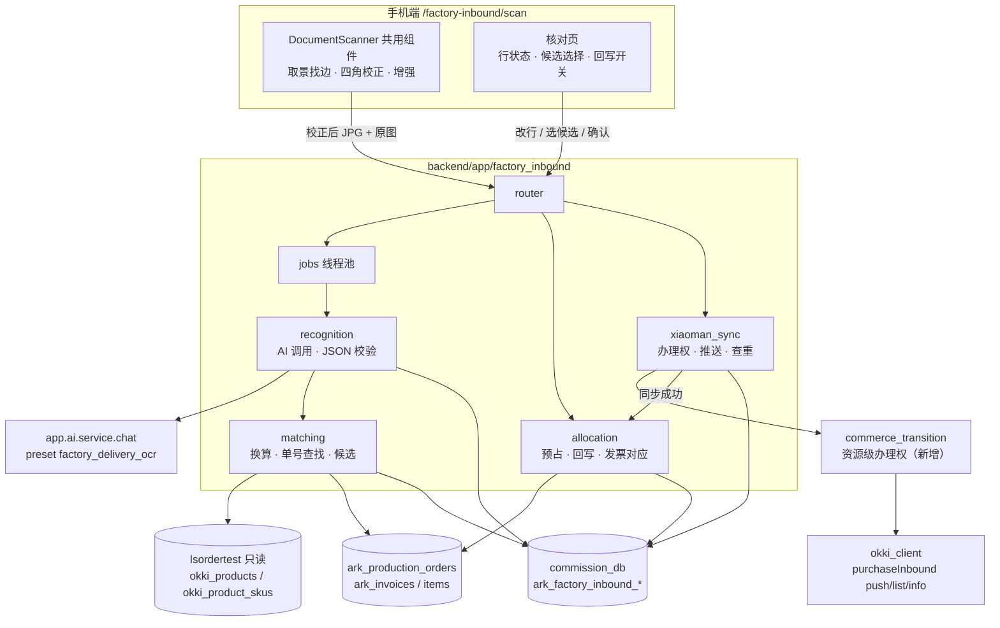
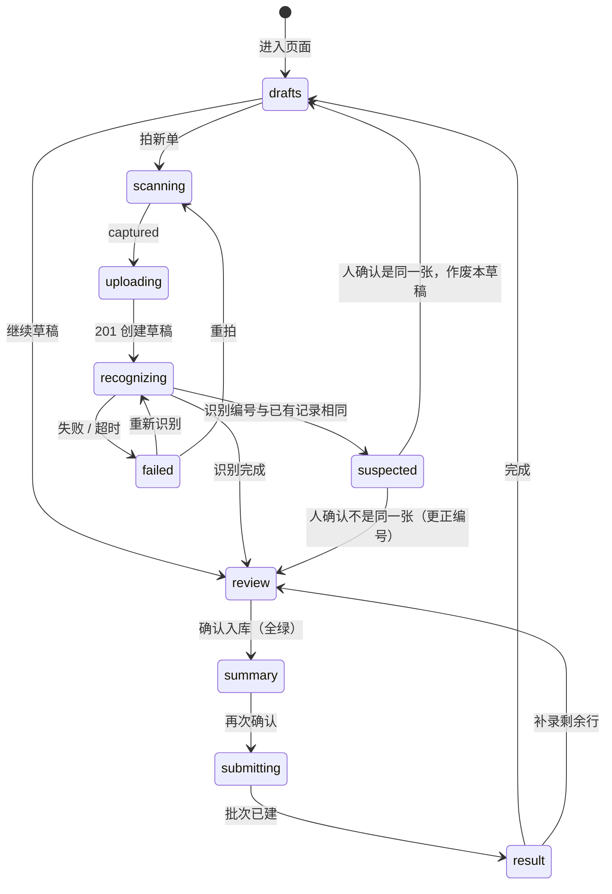
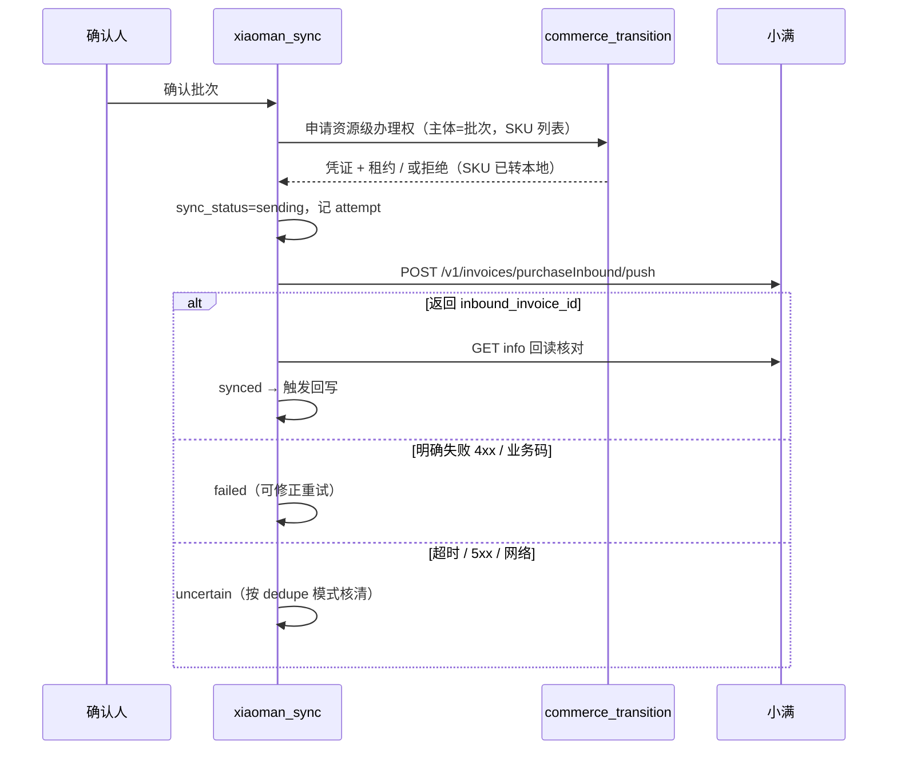

# 工厂发货单识别入库：设计开发文档

版本：v0.3，2026-11-18（已过两轮对抗性审查，均已核实采纳，见第 16 节）。依据 [需求与设计 v0.4](README.md)（业务决策 D1–D17 以该文为准，本文不重复论证）。高保真原型见 [prototype/index.html](prototype/index.html)。

原型打开方式：原型直接引用 `frontend/src/views/document-scan/` 的真实扫描模块和 `frontend/src/styles/tokens.css`，须在**仓库根目录**起静态服务（只绑定本机）：`python -m http.server 8767 --bind 127.0.0.1`，再打开 `http://127.0.0.1:8767/docs/requirements/2026-11-18-factory-delivery-inbound/prototype/index.html`（本机 `.claude/launch.json` 已加 `factory-inbound-prototype`，该文件不进 Git）。拍照与校正是真实算法；识别结果、订单与同步为示例数据。

状态：开发设计稿，未开发、未建迁移。实施前须先完成 README 第 14 节 P0（15 张样本标准答案）与第 15.2 节的小满接口实测。

## 1. 范围

本文覆盖 P1（识别、匹配、核对，不入库）与 P2（小满同步、生产备货订单回写、发票生产单对应）。P3（切换后本地路线）只在数据模型和服务边界上预留，不展开。

| 期 | 交付物 | 上线开关 |
| --- | --- | --- |
| P1 | 拍照扫描、识别、匹配、核对页、草稿与作废、桌面列表与详情、词表维护 | `FACTORY_INBOUND_ENABLED`；确认入库按钮在 P1 隐藏 |
| P2 | 批次确认、小满采购入库同步、生产备货订单回写、发票对应、同步异常处理、补录、切换前置检查 | `FACTORY_INBOUND_SYNC_ENABLED`（默认关，实测并授权后开） |

## 2. 架构总览



关键约束：

- 匹配与分配是确定性代码，大模型只产出识别 JSON。
- 小满写入只经 `commerce_transition` 的办理权凭证发出（README 7.1），不新增绕开门禁的通道。
- 发票只读：本模块不写 `ark_invoices` / `ark_invoice_items` 任何列，也不锁它们（README 第 8 节）。
- 跨库只读 `lsordertest`，不触及宪法规定的三条写例外。

## 3. 文档扫描集成

### 3.1 现状

`/document-scan`（`frontend/src/views/document-scan/`，提交 `8bd7f240`，Codex，待部署）已实现：浏览器后摄实时找边（Web Worker，135ms 采样）、选择照片、系统相机回退、四角拖动、透视校正、原图 / 增强 / 黑白三种效果、JPG 导出。算法是纯 ES 模块，无 Vue 依赖：

| 文件 | 职责 |
| --- | --- |
| `documentEdges.js` | `detectDocument(pixels)` 找边 |
| `documentEdgeWorker.js` | Worker 包装 |
| `documentImage.js` | 读图、透视校正 `rectifyDocument`、效果 `renderScan`、导出 `scanBlob`（长边上限 2600） |
| `documentQuad.js` | 四边形工具 |
| `ScanCorners.vue` | 四角拖动 |
| `DocumentScan.vue` | 页面流程（ready → camera → crop → result）与相机生命周期 |

### 3.2 抽成共用组件

把流程和算法移到 `frontend/src/components/document-scanner/`，`/document-scan` 与本功能都用同一组件，不复制代码：

```
frontend/src/components/document-scanner/
├── DocumentScanner.vue      # 由 DocumentScan.vue 的流程提取，props 控制结尾动作
├── ScanCorners.vue          # 原样迁移
├── documentEdges.js         # 原样迁移
├── documentEdgeWorker.js    # 原样迁移（new URL 相对路径不变）
├── documentImage.js         # 原样迁移
└── documentQuad.js          # 原样迁移
frontend/src/views/document-scan/DocumentScan.vue   # 变为薄壳：<DocumentScanner finish="download" />
```

`DocumentScanner` 接口：

| 名称 | 类型 | 说明 |
| --- | --- | --- |
| prop `finish` | `'download' \| 'emit'` | `download` 保留现有「保存 JPG」；`emit` 显示「使用这张」并抛事件 |
| prop `defaultEffect` | `'original' \| 'enhanced' \| 'mono'` | 本功能用 `enhanced`（局部白平衡 + 提高反差，对蓝色圆珠笔字迹最友好）；黑白可能丢浅色笔迹，不作默认 |
| prop `finishLabel` | string | 如「识别这张」 |
| emit `captured` | `{ scan: Blob, original: Blob, corners, effect }` | `scan` 为校正后 JPG（质量 0.90）；`original` 为原图压到长边 2560、质量 0.85。两张合计超过上传上限时，先降原图质量再降尺寸，仍超限则只传校正图并提示 |
| emit `cancel` | — | 用户放弃 |

迁移注意（红线 18）：先全局 grep 旧路径（`views/document-scan/document*.js`、`ScanCorners`），同步改 `frontend/tests/documentScan.test.mjs` 的 import；保持 `documentScanRoute.js` 与导航条目不变（`requestAuthRace.test.mjs`、`customerImageInvite.test.mjs` 也引用它）。扫描页已在 main（提交 `8bd7f240`），但仍是待部署状态；提取前与其作者确认没有在途修改。提取后 `documentScan.test.mjs` 与上述引用测试全部通过，并在 390px 下复测取景、校正、导出，才接入本功能。

`documentImage.js` 唯一要改的是 `scanBlob(canvas, quality = 0.94)` 增加可选质量参数，默认值不变，现有调用不受影响；原图上传用 0.85。

### 3.3 为什么上传两张

- 校正后图片送识别：去背景、拉平透视、纸面变白，识别更稳。
- 原图留档：校正或增强出错时，核对页和桌面详情可切换对照，也可「用原图重新识别」。

## 4. 前端

### 4.1 路由（`navigation.js`）

```js
{
  path: '/factory-inbound/scan', name: 'FactoryInboundScan', title: '工厂到货拍照',
  component: () => import('@/views/factory-inbound/FactoryInboundScan.vue'),
  permission: 'factory_inbound:write', fullscreen: true,
  menu: { group: 'stock', title: '工厂到货拍照', icon: Camera, order: <实施时取>, permission: 'factory_inbound:write' },
},
{
  path: '/factory-inbound', name: 'FactoryInboundList', title: '工厂到货入库',
  component: () => import('@/views/factory-inbound/FactoryInboundList.vue'),
  permission: 'factory_inbound:read',
  menu: { group: 'stock', title: '工厂到货入库', icon: Box, order: <实施时取>, permission: 'factory_inbound:read' },
},
```

### 4.2 文件

```
frontend/src/api/factoryInbound.js                 # 从 api/clients.js 取 client 并登记（红线 11）
frontend/src/views/factory-inbound/
├── FactoryInboundScan.vue        # 手机全屏页：拍照 → 识别中 → 核对 → 结果（只做编排）
├── FactoryInboundList.vue        # 桌面列表（标记照 DictManagement，编排照 ExpoLeads，红线 14）
├── components/
│   ├── InboundReviewLine.vue     # 核对行：原文、换算规格、状态、数量、开关
│   ├── CandidateSheet.vue        # 底部抽屉：SKU 候选 / 订单候选
│   ├── InboundSummarySheet.vue   # 提交前汇总与二次确认
│   ├── InboundDetailDrawer.vue   # 桌面详情（原图对照、批次、同步记录、分配）
│   └── AliasManageDialog.vue     # 词表维护（admin）
└── composables/
    ├── useInboundRecognition.js  # 上传、轮询（2s→5s 退避，上限 150s）、离页取消、迟到响应丢弃
    ├── useInboundReview.js       # 行编辑、候选选择、回写开关、提交可用条件
    └── useInboundBatches.js      # 批次提交（幂等键）、同步状态轮询
```

### 4.3 手机页状态



- 首屏是「我的草稿」+ 大号「拍新单」按钮：仓库常连续收多张单，草稿列表让中断后能接着做。
- 识别中显示骨架屏和一句耗时提示，可离开；不做假进度条。
- 核对页按单号分组；组头显示命中的订单：类型、**提取出的编号**（如 1026）、日期。发票号原文常带客户名或业务员名（如「Katie Pruneau生产单1026」），只对有发票读取权限且在其数据范围内的人显示原文；其余人只看编号。快照里照存原文，但**所有返回快照的接口**（候选、分配、详情、编辑日志、同步记录）在 service 层统一按发票权限脱敏。重号时，无权限的人看到的候选可能无法区分（类型、编号、日期都相同），此时补充不敏感的区分信息（明细行数、合计件数）；仍无法区分则标「需有发票权限的人选择」，该行不能由仓库人员确认。
- 行的四种状态色取 tokens：绿 `--tag-success-*`、黄 `--tag-warning-*`、红 `--tag-danger-*`、灰 `--tag-neutral-*`。
- 每行有「本次入库」勾选框：绿行默认勾选；黄、红、灰行默认不勾，黄行选定后自动勾选。只有**勾选的行**参与提交，勾选的行必须全是绿色（README 4.1）；未勾选的行留在本单，之后补录。
- 已提交过的行（有 `batch_id`）折叠为只读的「已入库」区，不能再勾选。
- 底部固定操作栏：左侧「已勾选 N 行 · 合计 X」，右侧主按钮「确认入库」；勾选为 0 时不可用。还有黄行时显示「还有 N 行待选择」，点击滚动到第一行。

### 4.4 登录回跳

`frontend/src/api/request.js` 的 401 处理只对白名单路径带 `redirect` 回跳（扫描页、换汇结算、client-desk）。手机上会话过期后要能回到拍照页，需把 `/factory-inbound/scan` 加入同一判断，并补回归测试。

### 4.5 动效（按 Emil 规则与 DESIGN.md Motion）

| 位置 | 做法 | 理由 |
| --- | --- | --- |
| 按钮按下 | `transform: scale(0.97)`，160ms ease-out；触屏和减少动态下不位移（沿用 GlassButton） | 按下反馈 |
| 候选抽屉 | `translateY(100%) → 0`，240ms `cubic-bezier(0.32,0.72,0,1)`；关闭 180ms | 偶发操作，抽屉曲线；退出比进入快 |
| 行状态变化（黄 → 绿） | 只过渡背景色和边框色，150ms ease | 高频操作，不做位移和缩放 |
| 列表 | 不做交错入场 | DESIGN.md：业务列表不延迟显示 |
| 识别完成切到核对页 | 淡入 120ms | 与主站页面切换一致 |
| `prefers-reduced-motion` | 抽屉改为淡入 | 保留理解所需的透明度变化，去掉位移 |

完工后按 `~/.claude/skills/review-animations/STANDARDS.md` 逐条自查（宪法 13.5）。

## 5. 后端模块

```
backend/app/factory_inbound/
├── __init__.py
├── router.py              # /api/factory-inbound，统一信封，require_permission
├── schemas.py             # 请求 / 响应、识别 JSON（RecognitionResult）
├── models.py              # 第 6 节各表
├── service.py             # facade：编排各子 service，router 只调这里
├── recognition_service.py # 存图、调 AI、校验 JSON、写行；重启恢复
├── matching_service.py    # 换算规则、词表、单号查找、候选分档
├── allocation_service.py  # 分配计算、预占、回写、发票对应、重算
├── xiaoman_sync_service.py# 办理权、payload、推送、查重、回读
├── storage.py             # 私有目录读写、路径校验（拒绝穿越 / 链接）
├── jobs.py                # 识别线程池（参照 domestic_followup/jobs.py，上限 3）
└── scheduler.py           # 待回写重试、uncertain 提醒（注册到 schedulers/，保持单活）
```

另需改动：

| 文件 | 改动 |
| --- | --- |
| `app/routers.py` | 注册 router |
| `app/auth/service.py` | `seed_role_permissions` 加三个权限码（红线 8） |
| `app/bootstrap/seed_ai.py` | 种子 preset `factory_delivery_ocr`（缺失才建，不覆盖后台已改配置） |
| `app/core/config.py` | 第 12 节配置项 |
| `app/invoice/okki_client.py` | 新增 `push_purchase_inbound` / `list_purchase_inbound` / `get_purchase_inbound`，经办理权凭证发送 |
| `app/commerce_transition/` | 新增资源级办理权（见 10.2），需与交易双路线负责人协调 |
| `app/inventory/legacy_scope.py` | 采购入库纳入 SKU 范围排除校验 |
| `app/stock/production_order_service.py` | 新增 `apply_received_increment`（增量、行锁、不 commit、计入预占、同步订单状态）；手工录入入口改走同一写法并要求更正原因 |

## 6. 数据模型

迁移按 AGENTS.md 取号（revision ID ≤32 字符，建前查全部分支最新编号），只在隔离库验证。表名、列注释按 `docs/database.md` 命名宪法；时间列默认 `beijing_now()`。下表只列关键列。

### 6.1 `ark_factory_inbound_notes`（入库单）

| 列 | 类型 | 说明 |
| --- | --- | --- |
| id | BIGINT PK | |
| inbound_no | VARCHAR(32) UNIQUE | 方舟入库单号 `FI{yyyyMMdd}-{NNN}`，北京日期 |
| factory_code | VARCHAR(32) | 工厂（暂为配置值） |
| recognized_delivery_no | VARCHAR(32) NULL | 识别出的单据编号（非唯一，仅供查重和人工确认） |
| delivery_no | VARCHAR(32) NULL | **人工确认后**的单据编号；参与唯一键；可更正（二次确认 + 编辑日志） |
| duplicate_suspected_note_id | BIGINT NULL | 识别编号与已有记录相同时的疑似重复对象，待人确认 |
| delivery_key | VARCHAR(80) GENERATED | `IF(status='voided' OR delivery_no IS NULL, NULL, CONCAT(factory_code,':',delivery_no))`，UNIQUE，实现「未作废内唯一」 |
| duplicate_of_note_id | BIGINT NULL | 人确认是同一张单后指向已有记录，本草稿作废 |
| delivery_month / delivery_day | TINYINT NULL | 手写月日 |
| scan_path | VARCHAR(255) | 校正图相对路径 |
| original_path | VARCHAR(255) NULL | 原图相对路径；超上传上限时可为空 |
| recognition_status | VARCHAR(16) | queued / running / done / failed |
| recognition_attempt_id | CHAR(32) | 每次识别生成；worker 认领与写结果都校验它，旧任务的迟到结果丢弃 |
| recognition_queued_at | DATETIME NULL | 入队时间 |
| recognition_started_at / finished_at | DATETIME NULL | 重启恢复用 |
| recognition_error | VARCHAR(255) NULL | |
| recognition_raw | JSON NULL | 模型原始 JSON（截断存储） |
| status | VARCHAR(16) | draft / partial / completed / voided；有 sending、uncertain 或 synced 批次的入库单不能整单作废（只能对未提交行作废或登记更正） |
| created_by | INT | 草稿归属 |
| version | INT | 乐观锁 |

### 6.2 `ark_factory_inbound_lines`

| 列 | 说明 |
| --- | --- |
| note_id, line_no | 行号按识别顺序 |
| raw | JSON：识别原文与模型疑点 |
| line_type | 关联 `ark_factory_inbound_line_types.code` |
| order_ref_raw / order_ref | 单号原文 / 补零后 4 位 |
| grade_raw, grade_source | 等级原文；`explicit` / `inherited` / `none` |
| process_raw, length_in, color_raw, color_norm, weight_g, quantity, quantity_unit | 识别与换算结果；`length_in`、`weight_g` 为 DECIMAL |
| match_status | matched / choose / confirm / decide / blocked / skipped；`confirm` = 规则换算命中、待人确认 |
| route_decision | NULL / `order` / `cross` / `inbound_only` / `reselect`：人对 `decide` 行的选择 |
| decided_by, decided_at, decision_candidates | 选择人、时间、当时的候选范围（订单 ID 与类型，JSON） |
| selected | 是否勾选本次入库；只有 `matched` 的行可为真 |

状态转换（服务端执行）：`choose` 选定 SKU、`confirm` 确认换算、`decide` 作出决定后重新计算，结果为 `matched` 时自动 `selected = true`。**任何字段修改触发重新匹配时，清空** `route_decision`、`decided_*`、`decision_candidates`、已选 SKU 与订单，再按新值分档。
| block_reason | VARCHAR(64) NULL，如 `xiaoman_no_sku`、`sku_ambiguous`、`over_quantity` |
| product_id, sku_id, custom_product_id | 确认后的快照 |
| order_kind, order_id | `production_order` / `invoice` / NULL；命中的订单 |
| writeback_enabled | 回写 / 对应开关 |
| unallocated_qty | 跨单未分配余量 |
| batch_id | 提交后所属批次 |
| created_by, created_at, updated_by, updated_at | 审计四件套；人工修改另写入 `ark_factory_inbound_line_edit_logs` |

### 6.3 `ark_factory_inbound_batches`

`note_id`、`batch_no`（`{inbound_no}-{n}`）、`confirmed_by`、`confirmed_at`、`idempotency_key`（UNIQUE）、`route`（legacy / local）、`sync_status`（confirmed / sending / drafted / synced / failed / uncertain / voided）、`authority_ref`（办理权凭证）、`lease_until`、`xiaoman_inbound_id`、`xiaoman_serial_id`、`writeback_status`（none / pending / done / failed）、`version`。

### 6.4 `ark_factory_inbound_allocations`

`line_id`、`target_kind`（production_item / invoice_item）、`target_id`（不加外键）、`target_snapshot` JSON（单号原文、订单类型、产品 / SKU / 定制 ID、明细数量）、`quantity`、`status`（pending / applied / released）、`select_source`（auto / manual）、`selected_by`、`candidate_ids` JSON（人选时的候选范围）。索引：`(target_kind, target_id, status)` 供剩余量计算。

### 6.5 其他

| 表 | 关键列 |
| --- | --- |
| `ark_factory_inbound_sync_logs` | batch_id、attempt_no、request_digest、request_body（脱敏）、response_code、response_body（截断）、outcome、error、started_at / finished_at |
| `ark_factory_inbound_process_aliases` | factory_term（UNIQUE）、name_keyword、enabled、source（seed / manual / reviewed） |
| `ark_factory_inbound_color_aliases` | factory_term（UNIQUE）、target_color、enabled、source |
| `ark_factory_inbound_grade_aliases` | factory_term（UNIQUE）、name_prefix、enabled、source |
| `ark_factory_inbound_alias_suggestions` | kind、factory_term、target、suggested_by、status（pending / accepted / rejected）、reviewed_by |
| `ark_factory_inbound_line_types` | code、label、is_inbound、enabled |
| `ark_factory_inbound_line_edit_logs` | line_id、字段、旧值、新值、操作人、时间 |

## 7. 识别

### 7.1 Preset

`factory_delivery_ocr`：支持图片输入的多模态模型；`max_tokens` ≥ 4096；system prompt 只写版式规则（README 第 5 节）。行类型值域每次从 `ark_factory_inbound_line_types` 读出，作为 user message 的一段注入（红线 7）。

### 7.2 输出 JSON（Pydantic 校验）

```json
{
  "delivery_no": "7085384",
  "month": 11, "day": 11,
  "lines": [
    {
      "row": 1, "raw": "983单 PU 22\" 4# 20g 90条",
      "order_ref": "983", "grade": null, "process": "PU",
      "length": "22", "color": "4#", "weight": "20g",
      "quantity": 90, "unit": "条", "line_type": "inbound",
      "inherited": [], "doubts": []
    },
    {
      "row": 2, "raw": "— — P2-8 — 180条",
      "order_ref": "983", "grade": null, "process": "PU",
      "length": "22", "color": "P2-8", "weight": "20g",
      "quantity": 180, "unit": "条", "line_type": "inbound",
      "inherited": ["order_ref", "process", "length", "weight"], "doubts": []
    }
  ]
}
```

`inherited` 记录哪些字段来自「—」继承，用于等级来源判断（README 6.3）和核对页提示。

### 7.3 执行与恢复

1. `POST /notes` 存图后立即返回草稿，响应发出后经 `jobs.submit` 排队（不占 Starlette 线程池）。
2. 任务内自建 `SessionLocal()`（宪法允许的线程池场景），调用 `chat(...)`，超时 120 秒。
3. 结果写行并触发匹配；失败写 `recognition_error`，`except` 至少 `logger.warning` + `print(flush=True)`（红线 6）。
4. 入队时生成 `recognition_attempt_id`，置 `queued` 并记 `recognition_queued_at`。worker 开始时用条件更新认领：`UPDATE … SET status='running', started_at=now WHERE id=? AND attempt_id=? AND status='queued'`，影响 0 行就放弃；写结果时同样带 `attempt_id` 条件，不匹配就丢弃，避免旧任务的迟到结果覆盖新结果。
5. 超时只按 worker **实际开始时间**算：`running` 超过 10 分钟标为 `failed`（启动时和读取详情时惰性回收）。`queued` 超过 30 分钟（进程重启丢失队列）同样标失败，允许重识别。
6. 已有未作废批次的入库单不能整单重新识别（会改写已提交的行）；只允许对未提交行重识别并追加，不覆盖。
7. 前端轮询到 150 秒仍在 `queued` / `running`，不判失败，提示「仍在排队识别，可以先离开，稍后在我的草稿继续」。

## 8. 匹配

### 8.1 换算流水线

```
raw 字段
 → 清洗（全角转半角、去空格、统一 ' " ″ 为英寸）
 → 长度：取数字 → length_in
 → 克重：取数字 → weight_g（"2.5g" / "2.5" 均可）
 → 颜色：
     1. 颜色别名表精确命中 → target
     2. 规则：去掉 "#"；"7" 夹在两个色号之间且原写法无 "T" 时视为 "T"；
        A-B-C / ATB-C / A7B-C → "#ATPB/C"；A-B → "#ATB"（待样本校准）
     3. 单色号 → "#X"
 → 工艺：工艺词表 → 产品名关键词
 → 等级：等级词表 → 产品名前缀（仅 explicit 且精确命中才参与收窄）
```

规则换算的结果必须在候选 SKU 里存在才算命中，否则按原文再查一次别名表，仍无则「找不到」。

**改变字符含义的规则换算，命中最多给黄色（`confirm`）**：「7 视为 T」、多段改写（A-B-C → #ATPB/C）可能把本身含 7 的真实色号换成另一个存在的 SKU。所以由这类规则得到的命中，即使唯一，也标黄并注明「按规则换算：878-18 → #8TP8/18」，由人确认。纯格式归一化（补 #、全半角、空格、4# → #4）不改变含义，唯一命中可直接判绿。确认时询问是否沉淀为颜色别名（A7），沉淀后再遇到同一写法才能直接判绿。别名表精确命中和原文精确命中可直接判绿。

### 8.2 单号查找（README 6.1）

单号是「月份 + 当月序号」，序号满 100 后进三位（`suggest_invoice_no` 注释：「NN 用两位零填充，超 99 自然进三位」），工厂手写也不补前导零，所以同一串数字可能有多种合法解释：1158 既可能是 11 月第 58 单，也可能是 1 月第 158 单；9100 是 9 月第 100 单。解析返回**全部合法解释**（月份 1–12；3 位序号只在 ≥100 时成立），每种解释都去查，命中多张就走「待选择」，不静默取一个。

```python
def parse_ref(text):
    out = set()
    for m_len in (1, 2):
        if len(text) <= m_len: continue
        month, seq = int(text[:m_len]), text[m_len:]
        if not 1 <= month <= 12 or len(seq) not in (2, 3): continue
        if len(seq) == 3 and int(seq) < 100: continue
        out.add((month, int(seq)))
    return out                    # "983"->{(9,83)}  "1158"->{(11,58),(1,158)}  "9100"->{(9,100)}
refs = parse_ref(order_ref)
since = beijing_today() - timedelta(days=335)  # 约 11 个月

# 生产备货订单
po = select ProductionOrder where batch_no REGEXP '^#[0-9]{8,9}$'
         and parse_ref(batch_no[5:].lstrip('0')) & refs and created_at >= since

# 发票（排除已删除；去 ~DEL~ 后缀）
for inv in invoices(created_at >= since, status != 'deleted'):
    no = strip_del_suffix(inv.invoice_no)
    if re.fullmatch(r'SC-(\d{4,5})', no): ref_of = m[1]
    elif re.search(r'-KC-\d{4,5}$|^INV\d{8}-\d+$', no): continue
    else: ref_of = first match of r'(?:#|生产单|生产)\s*(\d{3,5})(?!\d)' or r'(?<!\d)(\d{3,5})(?=\s*生产)'
    if ref_of and not re.fullmatch(r'20\d{2}', ref_of) and parse_ref(ref_of) & refs: hits.append(inv)   # 排除 4 位年份
```

发票的提取结果按 `invoice_id` 缓存在内存（随发票 `updated_at` 失效），避免每行全表扫描；141 张生产单量级下直接查询也可接受。命中归类见 README 6.1 结果 1–5。

### 8.3 候选与分档

范围：命中订单的明细（生产备货订单经 6.2 解析 SKU；发票明细自带 SKU，定制行经 `ark_custom_products` 回填 ID）；或全目录（`okki_products` + `okki_product_skus` 启用）。

逐级过滤后：

- 全目录范围 0 个 → `blocked(not_found)`，返回最接近的 3 条参考。
- **订单范围 0 个**（单号命中但单内没有此产品）→ `decide`（黄），由人选择只入库、改为跨单或重新选单（README 6.1 结果 1、2）。命中但不可用的订单（已完成、已终止、取消中、已取消）同样是 `decide`。
- 1 个 → `matched`（改变含义的规则换算命中为 `confirm`，见 8.1）；订单范围唯一命中但该明细已无可分配 / 可对应余量 → `decide`，提示「订单 NNNN 的这个产品已入满」；多个 → `choose`。有订单明细时按「到货数量 = 未入库数量」标记 `qty_match`，只排序不自动选（A3）。

## 9. 分配与回写

### 9.1 确认时（同一事务）

要点：先按幂等键返回已有批次；剩余量一律用**加锁读**（MySQL 默认 REPEATABLE READ，普通读看不到他人刚提交的预占）；锁全部是**行锁**，随 commit 释放，不用命名锁（连接池会在 commit 后归还连接，`RELEASE_LOCK` 可能落到别的连接上，锁泄漏）。

```python
def confirm_batch(db, note_id, body, user):          # router 用 get_db 的 Session，不另开 db.begin()
    existing = select batch where idempotency_key = body.key
    if existing: return existing                       # 网络重试：同键返回原批次（200）
    note = select note where id=? for update; check version
    lines = select lines where id in body.line_ids for update
    if any(l.batch_id and batch_of(l).sync_status != 'voided' for l in lines): raise 409
    if any(l.match_status != 'matched' for l in lines): raise 409
    # 1) 发票：直接锁 ark_invoices 行（同库），按 id 升序
    select id from ark_invoices where id in (发票 ids) order by id for update
    # 2) 备货单明细：按 product_id 汇总后一条语句加锁
    items = select ProductionOrderItem join ProductionOrder
            where product_id in pids and item.status=0 and order.status=0
              and order.deleted_flag=0 and order.transaction_mode='legacy'
            order by item.id for update
    pend = select allocations where target in (items + 发票明细) and status='pending' for update
    计算（全在内存）：
        发票：remaining = qty - applied - pending；超出部分不记对应
        单单：只取 order_id = line.order_id 的明细；超量 → 409 带新预览
        跨单：sort (is_urgent desc, order.created_at, item.id) 填满；剩余 → unallocated_qty
    if digest(结果 + 各行 decision_candidates) != body.preview_digest: raise 409(新预览)
    batch = insert batch(sync_status='confirmed', idempotency_key=body.key)
    insert allocations(status='pending'); update lines set batch_id = batch.id
    db.commit()
```

- 锁 `ark_invoices` 行只用于本模块内部串行化发票对应，不修改发票任何列；锁持有时间是本事务的几十毫秒，对发票编辑和推单的影响可忽略。若担心与发票长事务互等，可改为本模块自建的 `ark_factory_inbound_invoice_locks(invoice_id PK)` 锁行表，效果相同。
- InnoDB 对 join + `IN` 的加锁顺序取决于扫描路径，不保证按 `ORDER BY`。所以不承诺「不死锁」，而是遇到 MySQL 1213 死锁时整笔事务有限次重试（3 次，随机退避），仍失败返回 409「请重试」。
- 生产明细没有 `sku_id`（只有 `product_id`），按 6.2 先把 product_id 唯一解析到 SKU，「同一 SKU」即同一 product_id 且解析结果相同。
- 手工录入已入库数量的入口（7.4）用同一条加锁语句锁住对应明细。
- 批次作废或失败后作废：释放 pending 分配，并清空相关行的 `batch_id`，这些行回到可编辑、可再提交状态。

### 9.2 同步成功后（回写事务）

1. 用 9.1 同样的单条加锁语句，重新锁住涉及的备货单明细和相关 pending 分配。
2. 跨单行重算：已释放的预占可补给 `unallocated_qty`；失效明细的预占改分到其他明细。
3. `apply_received_increment(item, qty, audit={inbound_no, batch_no, actor})`，同步明细与订单状态。
4. 分配置为 `applied`，批次 `writeback_status = done`。
5. 失败：`writeback_status = failed`，scheduler 每 10 分钟重试，3 次后提醒管理员；不回滚小满。

## 10. 小满同步

### 10.1 发送流程



### 10.2 资源级办理权（需协调）

现有 `legacy_sending` 的办理权以发票为主体。新增最小能力：`authorize_resource(db, subject_kind='factory_inbound_batch', subject_id, sku_keys)`，复用 epoch、租约与 legacy 路线校验，对 `sku_keys` 执行与 `require_legacy_outbound_scope` 等价的排除。具体表结构由交易双路线负责人确定；本模块只依赖这个函数的返回（凭证或拒绝原因）。

### 10.3 防重复模式（实测后配置）

`FACTORY_INBOUND_DEDUPE_MODE`：

| 值 | 前提（P2 实测） | uncertain 核清 |
| --- | --- | --- |
| `serial` | push 接受方舟指定 `serial_id`，info / list 可按 serial 精确查 | 租约过期后精确查询；明确不存在才回 confirmed |
| `draft` | 先 `status=1` 建草稿，存在转完成接口 | 查本单号草稿：唯一则转完成；无则重建 |
| `manual` | 两者都不行 | 系统不重发；管理员在小满核对后二选一，二次确认并审计 |

默认 `manual`，实测通过再改。

### 10.4 Payload

```json
{
  "supplier_id": "<SU0001 解析得到>",
  "currency": "USD",
  "invoice_warehouse_id": "<默认仓库 ID>",
  "status": 2,
  "handler": ["<确认人绑定的小满 user_id>"],
  "warehouse_invoice_time": "2026-11-18",
  "remark": "方舟入库单 FI20261118-003-1；工厂单据 7085384；11-11",
  "record_list": [
    { "product_id": 0, "sku_id": 0, "inbound_count": 90, "purchase_price": 0 }
  ]
}
```

同一 SKU 合并为一条；请求体脱敏后存入 `sync_logs`。`DEDUPE_MODE=draft` 时 `status` 先传 1。

**draft 模式的状态**：草稿建成后批次为 `drafted`（不是 `synced`），**不回写、不生效对应**；转完成并回读确认 status=已完成后，才置 `synced` 并触发 9.2 回写。超时核清时区分「草稿已建」（继续转完成）和「已完成」（补记）。

## 11. 接口契约（节选）

统一信封 `{"code","message","data"}`；全部 `Depends(require_permission(...))`。

**POST `/api/factory-inbound/notes`**（write，multipart：`scan` 必填、`original` 可选）

```json
{ "code": 201, "data": { "id": 128, "inbound_no": "FI20261118-003", "recognition_status": "pending" } }
```

重复单据编号在识别完成后才可知。识别任务先在**独立事务**里提交识别行和 `recognized_delivery_no`（非唯一列），再查已有未作废记录：

- **无疑似重复**：核对页顶部显示识别出的编号，由人确认（可更正）；确认或首次提交批次时写入 `delivery_no`。
- **疑似重复**：写 `duplicate_suspected_note_id`，核对页并排显示两张照片和两条记录摘要，由人选择「是同一张，作废本草稿」或「不是，编号识别错了，更正编号」。**系统不自动作废**，避免识别错一位就把真单据作废。
- 写 `delivery_no` 撞唯一约束（两台手机同时拍同一张）：回滚后用新事务查到对方记录的 id，转为疑似重复处理；识别行已在前一个事务落库，不会丢失。
- 已有记录属于别人时，只显示单号、状态和创建人，提示「请联系创建人或管理员处理」，不跳进无权编辑的草稿。
- 编号识别不出：要求手工填写，显示照片右上角局部供对照，二次确认后再查重。
- `delivery_no` 更正：创建人或 admin，二次确认并写编辑日志；有已同步批次时只允许 admin。

已有 sending、uncertain、drafted 或 synced 批次的入库单不能整单作废，避免作废后同一张单再入库一次。

**GET `/notes/{id}`**（read）返回识别状态、行（含候选摘要、订单命中摘要，不含客户名）、批次。

**PATCH `/notes/{id}/lines/{line_id}`**（write，创建人或 admin）

可改字段：单号、等级、长度、颜色、克重、数量（D18，亮哥已确认）。任何修改都重新匹配（并清空旧的选择与决定，见 6.2），重新计算分配与超量。服务端拒绝修改已在未作废批次里的行（409）。

```json
{ "version": 7, "patch": { "color_raw": "P2-8", "quantity": 180 }, "select": { "sku_id": 0, "order": { "kind": "production_order", "id": 14 } } }
```

返回该行重新匹配后的结果和新 `version`。

**POST `/notes/{id}/batches`**（write）

```json
{ "version": 9, "idempotency_key": "c6f1…", "line_ids": [1, 2, 3], "preview_digest": "sha256:…" }
```

- 200：批次已建；409：预览已变化（返回新预览）；403：非创建人或 SKU 被路线拒绝；422：未绑定小满账号等。

其余端点见 README 11.2。

## 12. 配置（`core/config.py` Settings）

| 键 | 默认 | 说明 |
| --- | --- | --- |
| `FACTORY_INBOUND_ENABLED` | false | 功能总开关 |
| `FACTORY_INBOUND_SYNC_ENABLED` | false | P2 同步开关 |
| `FACTORY_INBOUND_STORAGE_ROOT` | `D:\WORKSOURCE\factory-inbound` | 私有图片目录，部署实例在 `deploy/platforms.json` 登记 |
| `FACTORY_INBOUND_SUPPLIER_NO` | `SU0001` | 小满供应商编号 |
| `FACTORY_INBOUND_FACTORY_CODE` | `juancheng` | 工厂标识 |
| `FACTORY_INBOUND_DEDUPE_MODE` | `manual` | 10.3 |
| `FACTORY_INBOUND_ORDER_LOOKBACK_DAYS` | 335 | 单号查找窗口 |
| `FACTORY_INBOUND_MAX_UPLOAD_BYTES` | 6 MB | 两张图合计上限；后端校验，前端预压缩 |

**部署**：图片存在办公室主机（与回款、设计图片相同的私有存储方式）。照 receipts 的写法，**整个 `^/api/factory-inbound(?:/|$)` 前缀**都转到办公室（读图、重识别等端点同样需要图片文件），成对新增 `deploy/nginx/factory-inbound-cloud.conf`（经 8002 转发）与 `factory-inbound-office.conf`；两处 `client_max_body_size` 都设为上传上限 + 1 MB（7m）。在 `deploy/platforms.json` 登记存储目录与承载实例。上线前在两个公网入口和办公室内网各验证一次上传。

**会话过期**：上传前先调一次轻量会话检查；校正好但未上传的图片暂存到 IndexedDB（读写包 try/catch，失败不影响主流程），登录回来后提示「继续上传上次的照片」。核对页把 `?note=<id>` 写进 URL，回跳后回到原草稿。

不直读 `os.environ`；不含密钥。

## 13. 测试

| 文件 | 覆盖 |
| --- | --- |
| `backend/tests/test_factory_inbound_matching.py` | 颜色规则（878-18、5A-18B-62、5A760、GC）、别名优先级、长度 / 克重解析、单号多解释解析（983、1158 → 11 月 58 / 1 月 158、9100、11100）、提取（SC-1154、SC-11100、ly#1151生产单、翟 1113 生产、「生产单2026」不当单号、`-KC-`、`INV`、`~DEL~`）、改变含义的规则换算只给黄色而格式归一化可判绿、重新匹配清空旧决定、等级来源限制 |
| `backend/tests/test_factory_inbound_allocation.py` | 单单 / 跨单 / 发票对应、加急排序、超量、余量重算、预占失效重分配；隔离 MySQL 双会话：并发预占、发票行锁串行化、死锁后重试成功、手工录入同锁；同幂等键重放返回原批次；未作废批次里的行再提交 / 修改返回 409；批次作废后可重新提交 |
| `backend/tests/test_factory_inbound_sync.py` | 三种 dedupe 模式状态机、凭证拒绝、回读不一致、作废释放；小满全 mock |
| `backend/tests/test_factory_inbound_api.py` | 权限（read / write / admin、草稿归属）、信封、幂等键、409 预览变化；无发票权限时订单候选、分配快照、详情、编辑日志、同步记录都不返回发票号原文 |
| `backend/tests/test_factory_inbound_dedupe.py` | 疑似重复不自动作废、人确认后作废、编号更正、并发同单撞唯一键后识别行不丢、他人草稿只读提示、有已同步批次不能整单作废 |
| `backend/tests/test_factory_inbound_time.py` | 入库日期与单号日期：服务器非东八区、北京 00:00 跨日（红线 23） |
| `backend/tests/test_factory_inbound_recognition.py` | JSON 校验、行类型注入、attempt_id 认领与迟到结果丢弃、排队超时与运行超时分别回收、有批次时禁止整单重识别 |
| `frontend/tests/documentScanner.test.mjs` | 迁移后原扫描用例全过；`finish="emit"` 抛出两张 Blob |
| `frontend/tests/factoryInbound.test.mjs` | 逐行勾选与提交可用条件、已入库行只读、轮询超时提示、迟到响应丢弃、候选抽屉键盘可达、401 回跳拍照页 |
| 评估集脚本 `scripts/factory_inbound_eval.py` | 用 15 张标准答案跑正式 preset，输出各字段正确率（README 13.1） |

写入型测试只用隔离库。

## 14. 任务拆分

| # | 任务 | 主要文件 | 依赖 |
| --- | --- | --- | --- |
| 0 | 仓库校对 15 张标准答案；跑评估脚本 | `scripts/factory_inbound_eval.py`、私有固件 | 无 |
| 1 | 扫描组件抽取与回归 | `components/document-scanner/*`、`views/document-scan/DocumentScan.vue`、测试 | 与扫描负责人协调 |
| 2 | 模块骨架、表、迁移、权限、配置、preset 种子 | `factory_inbound/models.py`、迁移、`auth/service.py`、`seed_ai.py`、`config.py` | 无 |
| 3 | 识别链路与存储 | `recognition_service.py`、`storage.py`、`jobs.py` | 2 |
| 4 | 匹配与词表 | `matching_service.py`、词表种子 | 2、0（校准规则） |
| 5 | 手机核对页与桌面列表（P1 不显示确认入库） | `views/factory-inbound/*`、`api/factoryInbound.js`、`navigation.js` | 1、3、4 |
| 6 | 分配与回写、手工录入改造 | `allocation_service.py`、`production_order_service.py`、`stock/router.py` | 4 |
| 7 | 资源级办理权与范围校验 | `commerce_transition/*`、`legacy_scope.py` | 与双路线负责人协调 |
| 8 | 小满同步与核清 | `xiaoman_sync_service.py`、`okki_client.py`、`scheduler.py` | 7；接口实测授权 |
| 9 | 补录、作废、更正、切换前置检查 | `service.py`、`router.py` | 6、8 |
| 10 | 文档同步 | `docs/api-reference.md`、`docs/database.md`、`docs/module-notes.md`、`docs/handoff.md` | 各任务 |

P1 = 0–5；P2 = 6–9。任务 1、2、7 可并行；7 与 8 的接口需在开发前与双路线负责人对齐。

## 15. 开放项

- 小满接口三项实测（README 15.2 第 1 条），决定 `DEDUPE_MODE`。
- 资源级办理权的表结构与归属（10.2）。
- 文档扫描组件提取由谁执行（3.2）。
- 颜色「A-B」两段写法的换算规则需样本校准（8.1）。

## 16. 审查记录

2026-11-18 独立 Agent 对抗性审查（设计文档 + 原型）提出 12 条，逐条核实后采纳：订单候选只显示提取编号、原文仅对有发票权限的人显示（4.3，README 6.1 同步）；确认事务改为整批一次性加锁、pending 加锁读、命名锁持有到提交之后（9.1，核实 `core/database.py` 未设隔离级别）；重复单据改为识别编号先写非唯一列、撞唯一键转跳转、有已提交批次禁止整单作废（6.1、11）；上传补 nginx location、大小上限与 `scanBlob` 质量参数（3.2、12，核实 `deploy/nginx/receipt-cloud.conf`）；单内找不到产品改为 `decide` 黄色并记录选择（6.2、8.3）；逐行勾选，未勾选的黄 / 红行不阻断提交（4.3）；已提交行只读、再提交返回 409（4.3、9.1）；识别入队即 running、轮询超时不判失败（7.3）；规则换算命中最多黄色、单号支持满 100 进三位（8.1、8.2，核实 `suggest_invoice_no` 注释）；登录回跳白名单（4.4，核实 `api/request.js`）；表名改 `_logs`、审计四件套、draft 模式 status=1（6、10.4）。原型同步修正。单号与等级允许人工修改，亮哥已确认（D18）。

第 2 轮（只看第 1 轮改动部分）提出 8 条，核实后采纳：幂等键先于已提交检查、事务内回填 `batch_id`、作废后可再提交（9.1）；改用 `ark_invoices` 行锁替代命名锁，死锁有限次重试（9.1，核实 `core/database.py` 连接池 pool_size=10）；疑似重复由人确认、不自动作废，`delivery_no` 人工确认并可更正（6.1、11）；识别 `attempt_id` 认领与按实际开始时间回收（6.1、7.3）；draft 模式增加 `drafted`，转完成后才回写（10.4）；单号多解释解析、格式归一化可判绿、`confirm` 状态与重新匹配清空决定、入满判 `decide`（6.2、8.1–8.3）；快照统一脱敏与重号区分（4.3）；整个前缀转办公室并补 office 配置、会话过期暂存（12，核实 `deploy/nginx/receipt-office.conf`）。按规则审查到此为止。
