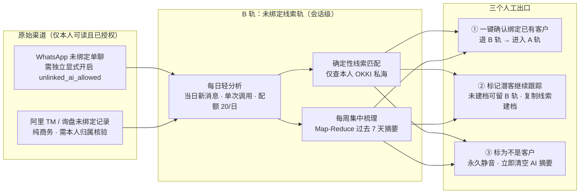

# 私海助理 B 轨：未绑定会话日分析与周梳理（补充设计稿）

> 版本：v0.1 · 2026-11-25 · 状态：历史提案。TM 授权与实施依据见 [终稿 §2.2](2026-11-25-private-sea-unlinked-track/design.md#22-阿里-tm)。
> 适用范围：`/client-desk` 私海助理增补 B 轨（未绑定线索轨），覆盖 WhatsApp 与阿里国际站（TM / 询盘）两类渠道。
> 上位文档：
> - [私海助理设计文档（v0.2）](2026-11-04-private-sea-assistant-design.md)
> - [私海助理「今日建议」补齐方案](2026-11-16-private-sea-today-recommendation/README.md)
> - [阿里询盘与 TM 文件推送接口设计](2026-11-05-alibaba-feed-integration/design.md)

---

## 0. 核心目标与定位

当前私海助理（下称 **A 轨：已绑定私海轨**）以 OKKI 客户 `company_id` 为主键，必须先完成“会话 ↔ 客户”人工绑定才进入 AI 分析。实际推进中存在两个现实缺口：

1. **绑定冷启动阻力大**：业务员在看到 AI 价值前，缺乏动力手动处理上百条未关联会话（如 11-16 Rina 103 条 WA 会话关联数为 0）。
2. **未成交潜客尚未建档**：阿里 TM 询盘与新进 WhatsApp 客户在成交前，大量尚未在 OKKI / 方舟建档，按现有强依赖 `company_id` 的设计（[models.py](../../backend/app/client_desk/models.py)、[business_service.py](../../backend/app/alibaba_feed/business_service.py)），这批最需要快速推进的早期线索无法获得 AI 辅助。

本方案新增 **B 轨（未绑定线索轨）**，坚持**“先给价值、顺手绑定；未建档也能持续跟踪复盘”**，同时严格与 A 轨解耦：

- **每日轻分析**：针对当日新增/新活跃的未绑定 WhatsApp 与阿里 TM 会话，做一轮低成本单次 AI 梳理，输出“是否像业务客户、聊到哪、有无遗漏/下一步、提取的客户线索”，并用线索反查本人私海给出“疑似老客一键绑定”提示。
- **每周集中梳理**：每周基于过去 7 天已沉淀的未绑定轻摘要（Map-Reduce 两阶段，不拼接 7 天原始聊天），生成一份《本周未绑定线索复盘》，集中揪出**遗漏任务、高意向未建档潜客突破点、高概率待绑定老客、批量可清理非客户**。
- **不污染 A 轨**：B 轨独立建模、独立配额、独立开关，不改写 `ark_client_desk_suggestions` 的 `company_id` 约束，不干扰 R1～R8 规则与 D7（15% 留出组）实验，也不在方舟自动伪造 OKKI 客户。

---

## 1. 双轨分工与流转关系



| 维度 | A 轨：已绑定私海（现有） | B 轨：未绑定线索（新增） |
|---|---|---|
| 主键对象 | OKKI 客户 `company_id` | 渠道会话 `(channel, source_account_uid, thread_key)` |
| 面向场景 | 已建档老客、稳定复购、长期经营 | ① 未及时绑定的私海客；② 未成交、尚未在 OKKI 建档的 TM / WA 新客 |
| 上下文范围 | 订单 + 背调 + 历史沟通 + 手工跟进 | 仅该会话近期消息 + 渠道基础资料（无订单/背调） |
| AI 形态 | `desk_v2` 多步只读工具 + 5 块画像 + 标签 + 建议 | 单次调用、无工具循环、轻 Schema（≤1200 token） |
| 每日配额 | 40 客/人/日（既有） | 20 会话/人/日（独立配置，不挤占 A 轨） |
| 周度复盘 | 无 | 每周一次 Map-Reduce 集中梳理 |
| 数据归属 | 个人状态隔离，分级共享 | **严格仅账号/记录本人可见**，不共享给他人或主管 |

---

## 2. 权限与授权闸门（核心差异化边界）

WhatsApp 与阿里 TM 存在本质差异：**TM 100% 是商务询盘，WhatsApp 可能混杂亲友/同事私聊**。因此两渠道采用差异化闸门，均严守最小数据与撤权即隐原则。

### 2.1 WhatsApp 未绑定会话闸门（防私聊外发）

在 [whatsapp/models.py](../../backend/app/whatsapp/models.py) 的 `ark_whatsapp_accounts` 新增布尔字段 `unlinked_ai_allowed`（默认 `0` / `False`，注释“持有人明确允许对未绑定活跃单聊做线索初筛”）：

1. **必须同时满足全部 5 项**：
   - 仅限**账号持有人本人**（`account.ark_user_id == uid`，**禁止**通过 `WhatsAppBodyGrant` 共享他人的未绑定会话）；
   - `consent_state == 'active'`、`crm_shared == True`、`ai_egress_allowed == True`；
   - **`unlinked_ai_allowed == True`**（需账号持有人在设置中主动勾选，UI 明确提示“建议仅工作专号开启；公私混用号请保持关闭，仅手动关联后分析”）。
2. **前置硬排除清单（不入队、不外发）**：
   - 群聊（`is_group == True`）、平台系统号及本人自聊（复用 [link_service.py](../../backend/app/client_desk/link_service.py#L123-L142) `non_customer_reason`）；
   - 已在 `ark_client_desk_wa_links` 中标为 `linked`、`imported` 或 `ignored` 的会话；
   - 已撤回消息（`deleted_at IS NOT NULL`）；
   - **内部员工号码排除**（比对 `ark_whatsapp_accounts.phone_number` 及配置中的公司内部号，避免同事工作沟通被外发）；
   - 公私混用账号关闭 `unlinked_ai_allowed` 时，仍允许业务员在界面上**单条手动点「AI 识别这条会话」**，按显式单次授权处理。
3. **“不是客户”即刻清空**：
   - 业务员点击「不是客户」时，写入 `ark_client_desk_wa_links(link_type='ignored')`，同时将 B 轨线程标为 `ignored`，并**物理清空该线程在 `ark_client_desk_unlinked_runs` 中的摘要、线索、下一步和草稿正文**，且永不再进入日分析或周梳理。

### 2.2 阿里 TM / 询盘未绑定记录闸门（开放未建档潜客）

现有 [alibaba_feed/business_service.py](../../backend/app/alibaba_feed/business_service.py#L101) 要求 `link is not None` 才放行 AI。B 轨新增独立的只读入口（不改动 A 轨 `select_for_analysis` 的 `manual_only_v1` 约束）：

1. **必须同时满足全部 5 项**：
   - 来源账号 `consent_state == 'authorized'`、`crm_shared == True`、`private_feed_enabled == True`、`ai_egress_allowed == True`；
   - 记录为当前合格快照：`is_current == True`、`outcome != 'quarantined'`、`detail_scraped == True`、`scrape_status == 'success'`；
   - **本人归属核验通过**：复用 `_owner_evidence(db, source, item, uid)`（`ArkUserExternalBinding` 唯一绑定或已人工确认的 `owner_aliases` 精确匹配）；
   - 未在 `ark_alibaba_feed_links` 中关联到客户，且未在 B 轨标为 `ignored`；
   - 未受 `legacy_identity_blocked` 阻断。
2. **与 A 轨 `manual_only_v1` 彻底隔离**：
   - B 轨对 TM 的日分析与周梳理**不写入** `ark_client_desk_states` 或 `ark_client_desk_suggestions`，不触发 A 轨规则冷却、复核或自动完成；
   - 当记录的 `mapping_version`、`collection_generation` 或 `consent_version` 变更时，B 轨展示与周报读取门禁同步失效隐藏。

---

## 3. “当日新增”触发口径与防误判规则

为避免把历史旧消息当成今日新增（尤其是阿里 TM v1 仅含日期精度的历史包），两渠道采用明确增量水位：

| 渠道 | 纳入当日轻分析的条件 | 水位字段（记录于线程表） |
|---|---|---|
| **WhatsApp** | 未绑定、未忽略的活跃单聊，存在未撤回文本消息满足 `COALESCE(sent_at, received_at)` 落在今日（北京时间 `biz_date`），且最大消息 ID > `last_analyzed_watermark` | `last_msg_id` + `last_msg_at` |
| **阿里 TM / 询盘** | 未绑定、未忽略、本人归属的 `is_current=True` 记录，满足：①（v1.1）`ark_alibaba_feed_messages` 中有未撤回新消息的 `observed_at` 落在今日且 `message_id` 晚于水位；或 ②（v1）`snapshot_hash` 相对上次已分析快照发生变化且有效消息条数增加（绝不因旧包重传而重复触发） | `item_id` + `snapshot_hash` + `message_count` |

- **精度透明标注**：阿里 TM 记录若 `window_result == 'uncertain'` 或末条消息无时分秒，分析输入与前端卡片均显式标注 `快照时间精度不足`，避免 AI 误报“今日超期未回”。
- **排队优先级**（在每人每日 20 条上限内）：
  1. 末条消息为买家/客户发出、我方尚未回复的会话（最高优先）；
  2. 已被业务员标记为 `prospect`（未建档潜客）且今日有新消息的会话；
  3. 当日消息条数更多或最近一条消息时间更近的会话。

---

## 4. 精简表结构（遵循命名宪法与红线 5 / 23）

全部归属 `backend/app/client_desk/`，所有时间字段均为北京时间 naive `DATETIME`（`beijing_now()` / `beijing_today()`），用户外键与 `ark_users.id` 类型完全一致（MySQL `INTEGER UNSIGNED`），新表均带表注释、列中文注释及审计四件套。

### 4.1 现有表微调（1 列）

| 表 | 新增列 | 类型 | 默认值 | 说明 |
|---|---|---|---|---|
| `ark_whatsapp_accounts` | `unlinked_ai_allowed` | `BOOLEAN NOT NULL` | `0` | 持有人明确允许对未绑定活跃单聊做线索初筛 |

### 4.2 新增 3 张 B 轨表

#### 1) `ark_client_desk_unlinked_threads`（未绑定线索会话状态表）
每个“业务员 × 渠道 × 来源账号 × 逻辑会话”一行，承载生命周期状态、水位及未建档潜客的轻量跟进计划。

| 字段 | 类型 | 约束/说明 |
|---|---|---|
| `id` | `BIGINT` PK | 主键 |
| `user_id` | `INT UNSIGNED` FK | 归属业务员（`ark_users.id`） |
| `channel` | `VARCHAR(24)` | `whatsapp` / `alibaba_tm` / `alibaba_inquiry` |
| `source_account_uid` | `VARCHAR(80)` | WA `account_uid` 或阿里 `source_account_uid` |
| `thread_key` | `VARCHAR(160)` | WA `conversation_uid`；阿里 v1.1 `conversation_id` 或 v1 `{record_type}:{inquiry_id}` |
| `status` | `VARCHAR(24)` | `active`（待处理）/ `prospect`（未建档潜客跟踪中）/ `linked`（已绑定转 A 轨）/ `ignored`（不是客户） |
| `linked_company_id` | `BIGINT NULL` | 转为 `linked` 时记录目标 OKKI 公司 ID（仅留痕） |
| `display_name` | `VARCHAR(160) NULL` | 联系人/买家展示名（冗余展示用） |
| `contact_hint` | `VARCHAR(160) NULL` | 脱敏号码或买家国家/邮箱摘要 |
| `next_followup_date` | `DATE NULL` | 业务员为未建档潜客设置的下次跟进日 |
| `next_followup_remark` | `TEXT NULL` | 业务员填写的下次跟进说明/承诺事项 |
| `remark` | `TEXT NULL` | 个人备注 |
| `last_message_at` | `DATETIME NULL` | 最近一条有效消息北京时间 |
| `last_direction` | `VARCHAR(16) NULL` | `inbound` / `outbound` / `unknown` |
| `last_analyzed_at` | `DATETIME NULL` | 最近一次 B 轨日分析完成时间 |
| `last_analyzed_watermark` | `VARCHAR(128) NULL` | 已分析消息水位（防重复分析） |
| `source_dependencies` | `JSON NULL` | 最新授权/映射版本依赖（撤权即隐校验用） |
| 审计四件套 | `created_by` / `updated_by` / `created_at` / `updated_at` | 标准审计列 |

- 唯一约束：`uq_cd_unlinked_thread (user_id, channel, source_account_uid, thread_key)`
- 索引：`ix_cd_unlinked_user_status (user_id, status, last_message_at)`、`ix_cd_unlinked_due (user_id, status, next_followup_date)`

#### 2) `ark_client_desk_unlinked_runs`（未绑定线索日分析与队列记录表）
兼作 B 轨异步执行队列（沿用 A 轨 `SKIP LOCKED` + 租约 + `ambiguous` 不自动重试机制）。

| 字段 | 类型 | 约束/说明 |
|---|---|---|
| `id` | `BIGINT` PK | 主键 |
| `thread_id` | `BIGINT` FK | 关联 `ark_client_desk_unlinked_threads.id` |
| `user_id` | `INT UNSIGNED` FK | 归属业务员 |
| `biz_date` | `DATE` | 北京业务日 |
| `trigger_type` | `VARCHAR(16)` | `daily`（例行扫描）/ `manual`（手工单条触发） |
| `status` | `VARCHAR(24)` | `queued` / `running` / `succeeded` / `skipped_non_lead` / `ambiguous` / `failed` / `wiped`（标非客户后清空） |
| `lease_token` / `lease_expires_at` / `call_started_at` / `attempts` | 同 A 轨 | 租约与防重发控制 |
| `protocol_version` / `pack_hash` / `source_dependencies` / `token_usage` / `error_code` | 同 A 轨 | 可追溯与无正文诊断 |
| `is_business_lead` | `BOOLEAN NULL` | 是否判断为有效外贸业务线索 |
| `intent_stage` | `VARCHAR(32) NULL` | 意向阶段代码（字典注入） |
| `urgency` | `VARCHAR(16) NULL` | `high` / `medium` / `low` |
| `one_line_summary` | `VARCHAR(200) NULL` | 一句话前情摘要 |
| `missing_or_next_action` | `TEXT NULL` | 疑似遗漏问题/承诺及建议下一步 |
| `breakthrough_angle` | `VARCHAR(200) NULL` | 沟通突破点/顾虑切入角度 |
| `draft_message` | `TEXT NULL` | 简短回复草稿（占位符约束同 A 轨） |
| `extracted_clues` | `JSON NULL` | 提取线索 `{company, contact, country, email, products[]}`（用于反查私海匹配） |
| `cites` | `JSON NULL` | 证据引用键列表 |
| `needs_review` | `BOOLEAN NOT NULL DEFAULT 0` | 含报价/交期/库存风险标记 |
| `quality_feedback` / `feedback_at` | `VARCHAR(16)` / `DATETIME` | `useful` / `useless` 反馈 |
| `remark` + 审计四件套 | 标准字段 | — |

- 唯一约束：`uq_cd_unlinked_run_day (thread_id, biz_date, trigger_type)`（同一线程当日例行最多 1 轮）
- 索引：`ix_cd_unlinked_run_queue (status, lease_expires_at)`、`ix_cd_unlinked_run_user_date (user_id, biz_date)`

#### 3) `ark_client_desk_unlinked_reviews`（未绑定线索每周集中梳理报告表）
每人每周（按北京自然周周一 `week_start_date` 标识）一份 Map-Reduce 复盘报告。

| 字段 | 类型 | 约束/说明 |
|---|---|---|
| `id` | `BIGINT` PK | 主键 |
| `user_id` | `INT UNSIGNED` FK | 归属业务员 |
| `week_start_date` | `DATE` | 北京周起算日（周一） |
| `window_start` / `window_end` | `DATETIME` | 覆盖时间窗（过去 7 天） |
| `status` | `VARCHAR(24)` | `queued` / `running` / `succeeded` / `ambiguous` / `failed` |
| `lease_token` / `lease_expires_at` / `call_started_at` / `attempts` | 同 A 轨 | 租约控制 |
| `included_thread_ids` | `JSON` | 本次纳入汇总的线程 ID 与对应 `run_id` 快照 |
| `source_dependencies` | `JSON` | 纳入线程的来源授权集合（任一渠道撤权时自动裁剪对应条目） |
| `protocol_version` / `token_usage` / `error_code` | 同 A 轨 | 运行诊断 |
| `overview_md` | `TEXT NULL` | 150 字以内本周总览 |
| `missed_tasks` | `JSON NULL` | 疑似遗漏任务清单（每项含 `thread_id`、`title`、`evidence`、`suggested_action`） |
| `breakthrough_leads` | `JSON NULL` | 高意向未建档潜客突破点清单（含 `thread_id`、`concern`、`angle`、`draft_hint`） |
| `likely_existing_customers` | `JSON NULL` | 疑似老客建议优先绑定清单（含 `thread_id`、`why`、`matched_company_ids`） |
| `cleanup_candidates` | `JSON NULL` | 低意向/非客户批量清理建议 |
| `opened_at` / `report_send_status` | `DATETIME` / `VARCHAR(24)` | 打开与钉钉周报发送回执 |
| `remark` + 审计四件套 | 标准字段 | — |

- 唯一约束：`uq_cd_unlinked_review_week (user_id, week_start_date)`

> 迁移编号说明：当前最新迁移为 `280_domestic_recharge_allocate.py`（建迁移前仍按 `AGENTS.md` 查全分支最新编号确认）。

---

## 5. Prompt 协议与校验设计

全部走 `app.ai.service.chat`（`snapshot_mode="metadata"`，DeepSeek JSON 模式、关闭推理，复用供应商白名单）。**所有枚举值域从 DB 字典或代码常量运行时注入 user message，不写死在 system prompt（红线 7）。**

### 5.1 每日轻分析协议：`unlinked_daily_v1.md`

- **输入上限**：≤ 10,000 字符（仅取该会话最近 25 条有效消息 + 渠道元信息 + 运行时注入的 `intent_stages`、`urgencies`）。所有外部消息内容严格包裹在转义后的 `<external_data>...</external_data>` 围栏内。
- **输出上限**：`max_tokens = 1200`（单次调用，不启工具循环）。
- **RESULT_JSON 结构**：

```json
{
  "is_business_lead": true,
  "intent_stage": "quoting",
  "urgency": "high",
  "one_line_summary": "买家询 22 寸 #60 天才片 50 片价格与到货周期，疑似有稳定沙龙采购需求",
  "missing_or_next_action": "客户昨天追问运费与交期我方尚未答复，建议先确认现货并附实拍视频",
  "breakthrough_angle": "客户更在意色差和交期而非最低价，可先发同批实拍图降低顾虑",
  "draft_message": "Hi Sarah, thanks for your patience! For 22\" #60, current lead time is [交期] and shipping to US is around [运费]...",
  "extracted_clues": {
    "company": "Glow Studio",
    "contact": "Sarah",
    "country": "US",
    "email": null,
    "products": ["天才片 22\" #60"]
  },
  "cites": ["M-91022", "M-91025"]
}
```

- **硬校验（复用 `validator.py` 核心安全边界）**：
  - `is_business_lead == false` 时允许 `draft_message` 为空并落 `skipped_non_lead`，界面默认折叠，不推提醒；
  - `cites` 必须全部出自本包消息键（`M-` 或 `AF-`）；
  - 同样执行外部链接、未知联系方式、银行/收款账号、底价敏感词硬拦截，以及报价/交期 `needs_review` 风险提示。

### 5.2 每周集中梳理协议：`unlinked_weekly_v1.md`（Map-Reduce）

- **输入组装**：拉取过去 7 个北京日内，该业务员仍处于 `status IN ('active', 'prospect')`、已通过授权复核、且 `is_business_lead != False` 的最近 ≤ 40 条线程摘要（每条仅传 `thread_id`、`channel`、`display_name`、`last_message_at`、`last_direction`、`intent_stage`、`one_line_summary`、`missing_or_next_action`、`extracted_clues`、以及服务端确定性算出的 `matched_private_customers` 名称与历史单数）。总输入严格 ≤ 16,000 字符。
- **输出上限**：`max_tokens = 3000`。
- **RESULT_JSON 结构**：

```json
{
  "overview_md": "本周共跟进 14 位未绑定联系人（TM 9、WA 5），其中 3 位存在未闭环承诺，2 位疑似私海老客建议优先绑定。",
  "missed_tasks": [
    {
      "thread_id": "1024",
      "title": "未回复 22 寸 #60 运费与交期",
      "evidence": "11-23 客户追问后至今 48h 未回",
      "suggested_action": "今天先确认现货并回一条带实拍图的报价"
    }
  ],
  "breakthrough_leads": [
    {
      "thread_id": "1031",
      "concern": "担心起订量高与色差",
      "angle": "TM 未成交新客，可推小批量样品试单方案降低首单门槛",
      "draft_hint": "强调可先发 2 束试色样品，运费走快捷渠道"
    }
  ],
  "likely_existing_customers": [
    {
      "thread_id": "1018",
      "why": "提到上次买的 20 寸贴发补货，号码后 7 位与私海客户 Velvet Crown 匹配",
      "matched_company_id": "589012"
    }
  ],
  "cleanup_candidates": [
    {
      "thread_id": "1040",
      "reason": "货代对账沟通，非买家客户"
    }
  ]
}
```

- **硬校验**：所有输出的 `thread_id` 必须属于本次输入的合法集合，`matched_company_id` 必须属于输入里服务端给出的本人私海候选集合，防止模型编造绑定关系。

---

## 6. 确定性候选匹配（“强化绑定意识”的引擎）

匹配逻辑**完全由后端代码确定性执行，绝不自动写入绑定**，只在卡片与周报中给出“建议一键确认”按钮：

1. **强线索匹配（高置信）**：
   - WA `contact_phone` 清洗后后 7～10 位精确命中本人私海 `customer_contacts.tel`；
   - TM 买家邮箱或 `extracted_clues.email` 精确命中本人私海 `customer_contacts.email`。
2. **弱线索匹配（中置信）**：
   - 会话名 / TM 买家公司名 / `extracted_clues.company` 经 `casefold` 规范化后，与本人私海 `company_name` 或 `contact_name` 高度匹配（最多返回 Top 2）。
3. **点击「确认绑定」后的原子联动**：
   - WA 调用现有 `link_service.save_link`，TM 调用现有 `alibaba_feed/business_service.create_link`；
   - 同事务将 `ark_client_desk_unlinked_threads.status` 置为 `linked`、`linked_company_id = company_id`；
   - 立即从 B 轨列表与待办计数中消失，前端提示“已绑定至 XXX，已接入订单与背调上下文”并提供「立即打开档案 / 重新分析」入口。

---

## 7. 接口、调度与前端入口

### 7.1 后端接口（挂载 `/api/client-desk/unlinked/*`，统一 `ok()` 信封）

复用现有权限 `client_desk:read` / `client_desk:write`，不新增权限码：

| 方法 | 路径 | 权限 | 说明 |
|---|---|---|---|
| GET | `/unlinked/threads` | `client_desk:read` | 未绑定线索列表：按 `channel`（全部/WA/TM）、`status`（待处理/未建档潜客/已忽略）、`only_unreplied` 筛选；返回每条最新日分析摘要 + 实时计算的私海候选匹配 |
| GET | `/unlinked/threads/{id}` | `client_desk:read` | 单条线索详情 + 近期原文预览（仍过实时来源授权检查） |
| POST | `/unlinked/threads/{id}/analyze` | `client_desk:write` | 手动单条分析（服务未开自动初筛的公私混用 WA 号，每条每日 ≤ 2 次） |
| PATCH | `/unlinked/threads/{id}` | `client_desk:write` | 切换 `prospect`（未建档潜客跟踪）、设置 `next_followup_date` / `next_followup_remark` / `remark` |
| POST | `/unlinked/threads/{id}/bind` | `client_desk:write` | 一键绑定到指定本人私海 `company_id`（内部委托 WA/TM 原有关联服务） |
| POST | `/unlinked/threads/{id}/ignore` | `client_desk:write` | 标为“不是客户”并立即清空该线程 AI 摘要（支持撤销） |
| GET | `/unlinked/weekly-reviews` | `client_desk:read` | 查看最近 4 周的集中梳理报告（读取时过滤已绑定/已忽略/失权线程） |
| POST | `/unlinked/weekly-reviews/generate` | `client_desk:write` | 允许业务员手动触发补跑本周梳理（每周限 2 次，幂等） |

### 7.2 调度与 Settings 配置

在 [app/core/config.py](../../backend/app/core/config.py) 新增开关（默认全关）：
- `CLIENT_DESK_UNLINKED_ENABLED: bool = False`
- `CLIENT_DESK_UNLINKED_DAILY_QUOTA: int = 20`
- `CLIENT_DESK_UNLINKED_WEEKLY_REPORT_ENABLED: bool = False`
- `CLIENT_DESK_UNLINKED_PRESET_NAME: str = "client_desk_daily"`（可独立切换更轻模型预设）

在 [app/schedulers/registry.py](../../backend/app/schedulers/registry.py) 注册 3 个轻任务（办公室单活 Scheduler，均 `timezone="Asia/Shanghai"`）：
- `client_desk_unlinked_scan`：每日 19:30 或次日 06:45（紧跟 A 轨扫描后），扫描昨日/当日新增未绑定 WA 与 TM 会话写入队列；
- `client_desk_unlinked_worker`：每 2 分钟消费 `ark_client_desk_unlinked_runs`（并发 2，独立于 A 轨，防止拖慢早报）；
- `client_desk_unlinked_weekly`：每周五 17:00（或周一 08:25，可配置）执行 Map-Reduce 汇总并按开关推送一条精简钉钉周复盘卡片。

### 7.3 前端入口改造（复用现有 `/client-desk`，不新开菜单）

1. **顶部 Tab 升级**（[ClientDesk.vue](../../frontend/src/views/client_desk/ClientDesk.vue)）：
   - 将原「未关联会话」Tab 升级为 **「未绑定线索」**，并展示实时角标（`待处理 / 待回复数`）。
2. **「未绑定线索」页面内分 3 个子视图**：
   - **今日/待处理线索**（默认）：按渠道标签（`TM 询盘` / `WhatsApp`）和紧急度展示卡片。每张卡片直接呈现：
     - 一句话前情 + 遗漏/下一步 + 沟通突破点；
     - 若命中疑似私海客户，高亮横条：**`疑似私海客户：Velvet Crown（6 单 $8,420）→ [一键绑定]`**；
     - 底部三按钮：**`[一键绑定 / 搜私海]`、`[未建档先跟踪]`、`[不是客户]`**（另带「复制线索去 OKKI 建档」与草稿复制）。
   - **未建档潜客**：集中展示所有 `status=prospect` 的 TM 未成交 / 新进 WA 潜客，按 `next_followup_date` 排序，让业务员不建 OKKI 档案也能不漏跟。
   - **每周集中梳理**：展示《本周未绑定线索复盘》的 4 张行动清单（遗漏任务 / 高意向突破点 / 疑似老客集中绑定 / 批量清理非客户），每条自带直达操作按钮（点击“绑定”或“不是客户”即时划掉）。
3. **A 轨钉钉早报轻联动**：
   - 早报末尾原“另有 N 个未关联会话待回复”升级为：**“今日另有 N 条未绑定新线索（含 M 条高意向/待回复），点此顺手处理与绑定 →”**，不增加早报条目数。

---

## 8. 试点验证指标与分期落地

### 分期建议
1. **阶段 B1（优先，约 1～1.5 周）**：仅上线 **阿里 TM 未绑定日分析 + 候选匹配一键绑定 + 未建档潜客跟踪**（无 WA 私人聊天隐私风险，直接解决 TM 未成交未建档的刚需）。
2. **阶段 B2（约 1 周）**：上线 **每周集中梳理（Map-Reduce）** 视图与周报。
3. **阶段 B3（视试点意愿开启）**：上线 **WhatsApp `unlinked_ai_allowed` 显式授权开关 + 未绑定活跃单聊日分析**，先在工作专号试点业务员上试跑两周。

### 试点验收指标（跑满 2 周）
| 指标 | 口径 | 目标线 |
|---|---|---|
| 绑定转化率提升 | 开启 B 轨后 2 周内，未绑定活跃会话被人工绑定的比例 vs 开启前基线 | 明显提升（≥ 30% 活跃商业会话完成绑定或转潜客） |
| 遗漏任务找回率 | 周梳理列出的 `missed_tasks` 中，被业务员标记有用或采取跟进/绑定的占比 | ≥ 40% |
| 非客户误报干扰率 | 被标“不是客户”的会话中，AI 误判为 `is_business_lead=true` 的占比 | ≤ 20% |
| 失败率与成本 | B 轨日分析失败率 ≤ 5%；单人每日新增 token 成本可控在 A 轨的 30% 以内 | 达标 |

---

## 9. 待你确认的 4 个产品决策

| 编号 | 决策点 | 推荐方案 | 备选 |
|---|---|---|---|
| **U-D1** | 每日扫描时间点 | **次日 06:45 扫昨日新增**（跟 A 轨早报节奏对齐，早上一起处理）+ 白天支持单条手动触发 | 当日 19:30 晚间汇总推一次 |
| **U-D2** | 每周集中梳理时间 | **周一 08:25**（开周会/安排本周跟进前看最容易落地） | 周五 17:00 下班前复盘 |
| **U-D3** | WhatsApp 未绑定授权粒度 | **账号级独立开关 `unlinked_ai_allowed`（默认关）**，专号开启自动扫，混用号保持手动单条触发 | 复用现有 `ai_egress_allowed`（不推荐，易引起私聊外发顾虑） |
| **U-D4** | 实施优先级排序 | 先做前面评估的 **P0 + P1（修通生产 4000 token + 最后一公里信息曝光）**，再按 **B1（TM 未绑定）→ B2（周梳理）→ B3（WA 未绑定）** 推进 | 直接并行启动 B1 |
