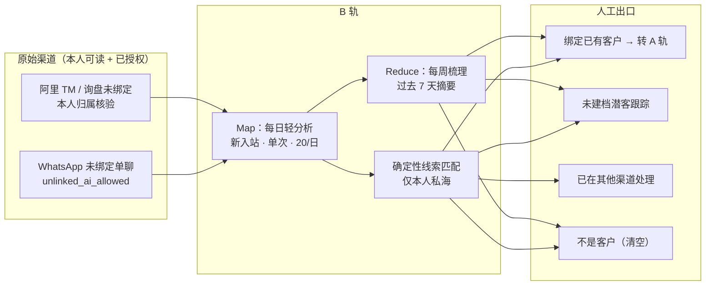

# 私海助理 B 轨（未绑定线索）终稿设计

> 版本：v1.1 · 2026-11-25（v1.0 经对抗性审查后修订）· 状态：**设计终稿，待亮哥确认 §11 的决策后进入开发**
> 主线：[Gemini 补充设计稿 v0.1](../2026-11-25-private-sea-unlinked-track-design.md)（下称「原稿」）
> 补充：Claude 独立评估、亮哥的两点补充（§0.2）、独立审查修订（§12）
> 上位文档：[私海助理设计 v0.2](../2026-11-04-private-sea-assistant-design.md)、[今日建议补齐方案](../2026-11-16-private-sea-today-recommendation/README.md)
> 原型：[prototype/index.html](prototype/index.html)（静态，示例数据，无后端）

---

## 0. 变化概览

### 0.1 采用原稿的部分（主线）

- 双轨：A 轨（已绑定，`company_id`）不动；B 轨（未绑定，会话级）独立建模、独立配额、独立开关。
- B 轨人工出口：绑定已有客户、未建档潜客跟踪、已在其他渠道处理、不是客户。
- 3 张新表 + 1 列：`ark_client_desk_unlinked_threads` / `_runs` / `_reviews`，`ark_whatsapp_accounts.unlinked_ai_allowed`。
- WhatsApp 账号级授权闸门；TM 走归属核验，不依赖 `company_id`。
- 确定性候选匹配，绝不自动写绑定。
- 前端不新开菜单，「未关联会话」升级为「未绑定线索」，下设三个子视图。

### 0.2 亮哥的两点补充（已纳入）

1. 绑定前先对「当日新增」的未绑定记录跑一轮 AI，培养业务员的绑定意识；已绑定部分仍走 A 轨。
2. 未成交 TM 客户必须分析，即使在方舟里没有建档、无法绑定。见验收 V-03、V-04。

### 0.3 Claude 的补充

| 编号 | 补充 | 处理 |
|---|---|---|
| S1 | 原稿称「Map-Reduce」，实际是一次汇总调用。准确口径：每日轻分析是 Map，周一次调用是 Reduce | §5.2 |
| S2 | TM 的全局开关 `ALIBABA_FEED_AUTOMATION_ENABLED = False`，且唯一读取点在 A 轨资格判定。开启它会改变 A 轨 | §7.1、U-D5 |
| S3 | 「已在其他渠道处理」对 B 轨同样必要 | §4.3 |
| S4 | 采纳不建承诺表；设置跟进日期时必须同时写跟进说明 | §4.3、§6.1 |
| S5 | `talking_points` 已入库但前端未渲染（已核对），先露出 | §7.3 |
| S6 | `state_dto()` 没返回 `recheck_date` / `recheck_condition`（已核对） | §7.3、P0 |

---

## 1. 分工与流转

| 维度 | A 轨：已绑定私海 | B 轨：未绑定线索 |
|---|---|---|
| 主键 | OKKI 客户 `company_id` | 会话 `(channel, source_account_uid, thread_key)` |
| 场景 | 已建档老客 | ① 未绑定的私海客；② 未成交、未建档的 TM / WA 新客 |
| 上下文 | 订单、背调、历史沟通、手工跟进 | 会话近期消息与渠道资料 |
| AI 形态 | `desk_v2` 多步只读 | 单次调用，轻 Schema |
| 配额 | 40 客/人/日 | 20 会话/人/日（独立配置） |
| 周度 | 无 | 每周一次梳理 |
| 数据归属 | 个人状态隔离，分级共享 | 严格仅本人可见 |

---

## 2. 权限与授权闸门

### 2.1 WhatsApp

- 原稿 5 项闸门采用：仅账号持有人、`consent_state=active`、`crm_shared=true`、`ai_egress_allowed=true`、`unlinked_ai_allowed=true`。
- 前置排除（统一在 B 轨筛选中实现，不依赖 `non_customer_reason`）：
  - 群聊：`chat_id` 以群后缀结尾的一律排除；
  - 自聊与内部号：会话对方号码等于账号 `phone_number`，或等于配置项 `CLIENT_DESK_INTERNAL_WA_NUMBERS` 中的号码，一律排除；
  - 平台通知号（`0@s.whatsapp.net`）排除；
  - 撤回消息（`deleted_at` 非空）不计入。
- 说明：现有 `non_customer_reason` 只对 `provider="baileys"` 生效，而 WhatsApp 账号默认 provider 为 `whatsapp-web.js`。因此 B 轨不能复用它做自聊排除，必须按上面的号码规则独立判断。

### 2.2 阿里 TM

- 按已选定的 U-D5，TM 收录要求当前试点本人具有私海权限、试点已启用且单独确认 `unlinked_ai_allowed`、来源同意并共享 CRM、当前快照确属本人且尚未绑定。快照须 `detail_scraped=true` 且 `scrape_status=success`。
- 管理员授权后会立即同步已有的合格线索并按每日配额入队。撤权或停用试点立即阻断 B 轨。现有 A 轨的 `private_feed_enabled`、`ai_egress_allowed` 和 `ALIBABA_FEED_AUTOMATION_ENABLED` 继续按 A 轨授权管理。
- 手动触发的分析不计入每日自动配额。

### 2.3 撤权、失效与清空的语义（统一定义）

| 场景 | 行为 | 方式 |
|---|---|---|
| 来源撤权、映射版本变化、`is_current` 失效 | **隐藏**：卡片与周报读取时过滤，显示「授权已变更，需重新分析」；不删数据 | 读时过滤 + 写入门禁 |
| 撤回消息、TM 修订 | **失效**：相关 `runs` 标 `stale`，摘要不再展示；下次有新内容时重算 | 标记失效 |
| 业务员点「不是客户」 | **清空**：见 §4.4，物理删除内容字段 | 物理清空 |

---

## 3. 「当日新增」与水位（修订）

### 3.1 水位字段（按实际类型）

| 渠道 | 水位 | 类型 | 说明 |
|---|---|---|---|
| WhatsApp | `last_msg_id` | `BIGINT` | 消息自增 ID，数值比较 |
| TM v1.1 | `last_src_order`、`last_revision` | `BIGINT` 元组 | 按 `(source_order, message_revision)` 比较。`message_id` 是字符串且无序，不用于比较 |
| TM v1 | `snapshot_hash`、`message_count` | `VARCHAR(64)`、`INT` | hash 变化且有效条数增加才触发 |

### 3.2 候选条件（不用日历口径）

候选只看**是否有比水位更新的入站消息**，不看「今天 / 昨天」：

- 存在入站（`direction=inbound`）未撤回消息，且晚于水位；
- 对于 TM v1，`snapshot_hash` 变化且条数增加；旧包重传不触发。

`biz_date` 仅记录运行当天的北京日期，用于配额与审计，不参与候选判定。这样消除了「今日 / 昨日」三处矛盾（审查 #8）。

### 3.3 「已在其他渠道处理」

- 点击后：水位推进到当前最新消息，线程从待处理列表移出，记录 `handled_at`。
- 之后只有**新的入站消息**会让线程重新出现（与 V-05、V-06 一致）。
- 本人在其他渠道的回复不会触发（因为只看入站）。

### 3.4 精度与排队

- 精度标注：`window_result == 'uncertain'` 或末条无时分秒，界面显示「快照时间精度不足」。
- 排队优先级（每人每日 20 条以内）：① 客户发出、我方未回；② 已标为潜客且有新入站；③ 消息更多或更近。

---

## 4. 数据模型

### 4.1 现有表微调

| 表 | 新增列 | 类型 | 默认 | 说明 |
|---|---|---|---|---|
| `ark_whatsapp_accounts` | `unlinked_ai_allowed` | `BOOLEAN NOT NULL` | `0` | 持有人允许对未绑定单聊做线索初筛 |

### 4.2 新增表

**`ark_client_desk_unlinked_threads`** 在原稿字段基础上补充：

| 字段 | 类型 | 说明 |
|---|---|---|
| `last_msg_id` | `BIGINT NULL` | WA 水位 |
| `last_src_order` / `last_revision` | `BIGINT NULL` | TM v1.1 水位 |
| `snapshot_hash` / `message_count` | `VARCHAR(64) NULL` / `INT NULL` | TM v1 水位 |
| `handled_at` | `DATETIME NULL` | 最近一次「已在其他渠道处理」 |
| `contact_id` | `BIGINT NULL` | 若命中 `ark_customer_contacts`，仅作留痕，不作为绑定依据 |
| `status` | `VARCHAR(24)` | `active` / `prospect` / `linked` / `ignored`；转换见 §4.5 |

其余字段（`user_id`、`channel`、`source_account_uid`、`thread_key`、`display_name`、`contact_hint`、`next_followup_date`、`next_followup_remark`、`remark`、`last_message_at`、`last_direction`、`last_analyzed_at`、`source_dependencies`、审计四件套）采用原稿定义。

唯一约束：`uq_cd_unlinked_thread (user_id, channel, source_account_uid, thread_key)`。

**`ark_client_desk_unlinked_runs`** 采用原稿定义，补充：

- `status` 增加 `stale`（撤回或修订使内容失效）与 `discarded_stale`（写回时线程已不合法，结果丢弃）。
- 唯一约束：`uq_cd_unlinked_run_day (thread_id, biz_date, trigger_type)`。

**`ark_client_desk_unlinked_reviews`** 采用原稿定义。`window_start` / `window_end` 明确为「上一个完整自然周（周一 00:00 至周日 24:00 北京时间）」，周一 08:25 生成。

### 4.3 FK 类型（修正）

`ark_users.id` 实际为有符号 `Integer`（`auth/models.py`），不是原稿写的 UNSIGNED。**新表的 `user_id` 必须与线上 `ark_users.id` 的实际列类型完全一致**，迁移前按红线 5 核对线上列定义。

### 4.4 「不是客户」清空范围（修正）

点击后在同一事务内：

1. 线程：`status=ignored`；清空 `display_name`、`contact_hint`、`remark`、`next_followup_remark`；`next_followup_date` 置空。
2. 所有该线程的 `runs`：清空 `one_line_summary`、`missing_or_next_action`、`breakthrough_angle`、`draft_message`、`extracted_clues`、`cites`，状态改为 `wiped`。
3. 所有包含该线程的 `reviews`：从 `missed_tasks`、`breakthrough_leads`、`likely_existing_customers`、`cleanup_candidates` 中删除对应条目，并将 `overview_md` 置空（下次生成时重算）。
4. 撤销：`POST /unlinked/threads/{id}/restore` 恢复为 `active`，但已清空内容不恢复，需要重新分析。

### 4.5 状态机

| 从 | 动作 | 到 | 备注 |
|---|---|---|---|
| `active` | 未建档先跟踪 | `prospect` | 必须有跟进说明 |
| `active` | 确认绑定 | `linked` | 同事务调用关联服务 |
| `active` | 已在其他渠道处理 | `active`（水位推进，移出列表） | 见 §3.3 |
| `active` / `prospect` | 不是客户 | `ignored` | 见 §4.4 |
| `prospect` | 确认绑定 | `linked` | |
| `ignored` | 撤销 | `active` | 内容不恢复 |
| `linked` | 解除关联 | `active` | 原 A 轨关联解除后，线程重新进入 B 轨 |

`linked` 不是终态。这解决了审查 #7 的死状态问题。

### 4.6 写回门禁（修正）

在途运行完成写回时，同一事务内对线程行 `SELECT ... FOR UPDATE`，校验：

- `status` 仍为 `active` 或 `prospect`；
- `source_dependencies` 与运行开始时一致，授权仍有效；
- 水位未被撤回或修订推翻。

不满足则写入 `discarded_stale`，不写内容。

---

## 5. Prompt 与校验

### 5.1 每日轻分析 `unlinked_daily_v1.md`（Map）

- 输入 ≤ 10,000 字符，取最近 25 条有效消息；外部内容全部放入转义后的 `<external_data>` 围栏。
- **独立预设 `client_desk_unlinked`**：`max_tokens` 在预设中配置（`chat()` 只接收预设名，不接收 `max_tokens`）。B 轨与 A 轨不共用预设，调整 B 轨的预设不影响 A 轨。`CLIENT_DESK_UNLINKED_PRESET_NAME` 默认指向该预设。
- 枚举值从字典运行时注入 user message（红线 7）。
- 校验：`cites` 必须出自本包；`is_business_lead=false` 落 `skipped_non_lead`；外部链接、未知联系方式、收款账号硬拒绝；报价、交期打 `needs_review`。

### 5.2 每周梳理 `unlinked_weekly_v1.md`（Reduce）

- 每日轻分析已为每条线程产出摘要，周梳理只做一次汇总，不读取原始聊天。
- 输入：上一完整自然周内有运行结果的线程摘要，≤ 40 条，总量 ≤ 16,000 字符。每条包含服务端算出的私海候选名称与历史单数。
- `max_tokens` 在预设中配置（同 §5.1）。
- 校验：`thread_id` 必须属于输入集合；`matched_company_id` 必须属于服务端候选集合；不合法条目丢弃并记录。

---

## 6. 确定性匹配与绑定

### 6.1 线索来源（修正）

- 强线索：
  - WA：会话号码归一化后，与本人私海客户的 `ark_customer_contact_points`（`point_type='phone'`）的 `normalized_value` 精确匹配。
  - TM：买家邮箱与 `point_type='email'` 的 `normalized_value` 精确匹配。
- 弱线索：公司名或联系人名经 `casefold` 后与私海 `display_name` 高度匹配，最多 Top 2。
- 号码后缀匹配只在国家码一致时使用，不做纯 7 位后缀匹配。
- 「本人私海」的口径与 A 轨一致：归属来自 `private_scope` 的 OKKI 归属 + 发票 overlay（实现前核对具体函数名）。

### 6.2 确认绑定

点击后同一事务完成：线程 `status=linked`，`linked_company_id` 留痕，调用原有关联服务写入关联。卡片从待处理与计数中移除，并提示「已绑定至 XXX」与「打开档案 / 重新分析」。

系统从不自动绑定。

### 6.3 承诺事项的显示

- 卡片显示 `next_followup_remark`（承诺内容）与 `next_followup_date`（到期日）。
- 到期前一天与到期当天进入早报「待兑现」行。
- 完成后清空日期即可，不设「承诺完成」状态。

---

## 7. 接口、调度与前端

### 7.1 前置条件

| 条件 | 说明 | 不满足时 |
|---|---|---|
| 11-16「今日建议」修复发布，`client_desk_daily` 预设 1800 → 4000 | A 轨截断问题 | 不启动 B 轨（B 轨使用独立预设，不受此改动影响，但 A 轨仍有问题） |
| TM feed 对试点账号可用 | 需要 U-D5 的决定 | B1 不上线；B3 不受影响 |

### 7.2 接口

前缀 `/api/client-desk/unlinked/*`，复用 `client_desk:read` / `client_desk:write`，不新增权限码。

| 方法 | 路径 | 说明 |
|---|---|---|
| GET | `/unlinked/threads` | 列表，按渠道与状态筛选 |
| GET | `/unlinked/threads/{id}` | 详情（仍过实时授权检查） |
| POST | `/unlinked/threads/{id}/analyze` | 手动单条分析，每条每日 ≤ 2 次 |
| PATCH | `/unlinked/threads/{id}` | 设置潜客跟进（日期与说明必须同时存在） |
| POST | `/unlinked/threads/{id}/bind` | 确认绑定 |
| POST | `/unlinked/threads/{id}/handled` | 已在其他渠道处理 |
| POST | `/unlinked/threads/{id}/ignore` | 不是客户（清空，§4.4） |
| POST | `/unlinked/threads/{id}/restore` | 撤销不是客户（§4.5） |
| GET | `/unlinked/weekly-reviews` | 最近 4 周报告（读时过滤失效线程） |
| POST | `/unlinked/weekly-reviews/generate` | 手动补跑，每周 ≤ 2 次，幂等 |

### 7.3 A 轨同步露出

- `OverviewTab` 渲染 `talking_points`（≤ 3 条），前置 `opportunity` 摘要。
- `state_dto()` 返回 `recheck_date` 与 `recheck_condition`，卡片显示「待确认：…（复核 MM-DD）」。
- 早报每条补回 `check_before_reply` 与跟进说明。

### 7.4 前端三个子视图

1. **待处理线索**（默认）：卡片含渠道、当地时间、前情、遗漏与下一步、切入点、草稿；疑似私海客户横条；按钮为 `确认绑定`、`未建档先跟踪`、`已在其他渠道处理`、`不是客户`。
2. **未建档潜客**：按 `next_followup_date` 排序，显示承诺事项。
3. **每周梳理**：四张行动清单，每条带直达按钮。

**当地时间**：优先取 `ark_customer_contacts.timezone`（IANA 名称，已存在）；没有则按国家代码推算主要时区。纯展示，存储与调度仍为北京时间（红线 23）。

### 7.5 调度与配置

默认全部关闭：

- `CLIENT_DESK_UNLINKED_ENABLED`（默认 False）
- `CLIENT_DESK_UNLINKED_DAILY_QUOTA = 20`
- `CLIENT_DESK_UNLINKED_WEEKLY_REPORT_ENABLED`（默认 False）
- `CLIENT_DESK_UNLINKED_PRESET_NAME = "client_desk_unlinked"`
- `CLIENT_DESK_INTERNAL_WA_NUMBERS`（内部号清单）
- `CLIENT_DESK_UNLINKED_TM_ENABLED`（默认 False，见 U-D5）

调度：`client_desk_unlinked_scan`（TM）每日 06:45；`client_desk_unlinked_wa_scan`（WhatsApp）每天 7–22 点每小时第 15 分；`client_desk_unlinked_worker` 每 2 分钟，并发 2；`client_desk_unlinked_weekly` 每周一 08:25。

---

## 8. 分期

| 阶段 | 内容 | 前置 |
|---|---|---|
| B1（1～1.5 周） | TM 未绑定分析 + 确认绑定 + 未建档潜客 | U-D5 决定后 |
| B2（约 1 周） | 周梳理视图与周报 | B1 稳定 |
| B3（视意愿） | WhatsApp 未绑定开关与分析，工作专号试点两周 | U-D3 |
| S（并行） | §9 的「最后一公里」改动 | 不依赖 B 轨 |

---

## 9. 优先级

| 优先级 | 事项 | 理由 |
|---|---|---|
| P0-1 | 发布 11-16 今日建议修复，A 轨预设 1800 → 4000，复测批次失败率 | 阻塞项 |
| P0-2 | 埋点分开：展示、打开、复制、反馈 | 否则有用率失真 |
| P0-3 | 未关联会话角标、待回复标识、预填联系人名、候选匹配 | Rina 103 条冷启动 |
| P0-4 | `state_dto` 返回 `recheck_*`（S6） | 零迁移，R3 可解释 |
| P1-1 | 卡片与早报露出原因、跟进说明、复核条件、超期时长 | 零迁移 |
| P1-2 | 抽屉渲染 `talking_points` 与 `opportunity`（S5） | 已算出未展示 |
| P1-3 | 「记一笔」增加跟进说明 | 对应 S4 |
| P1-4 | 抽屉增加「全部动态」合并时间轴 | 后端已支持合并 |
| P1-5 | 当地时间与 A 轨「已在其他渠道处理」 | 低成本 |
| P2 | R9 发货签收规则 | 依赖手机录物流单上线 |
| P2 | R5 复购规则 | 先校准口径 |
| 暂缓 | 全局对话式业绩助手 | 权限口径复杂，非刚需 |
| 不做 | 商机拖拽看板、赢单庆祝、待办四象限 | 与已有能力重叠 |

---

## 10. 验收

### 10.1 指标（跑满 2 周）

| 指标 | 目标线 |
|---|---|
| 未绑定活跃会话的绑定或转潜客比例，相对开启前基线 | 提升 ≥ 30% |
| 周梳理遗漏任务被标为有用或已跟进的比例 | ≥ 40% |
| 被标为「不是客户」的会话中，AI 判为业务线索的比例 | ≤ 20% |
| B 轨失败率 | ≤ 5% |
| B 轨 token 成本占 A 轨 | ≤ 30% |

### 10.2 验收用例

| 编号 | 用例 | 通过判据 |
|---|---|---|
| V-01 | 当日新增的未绑定 WhatsApp 会话 | 只进 B 轨，不进 A 轨规则与留出组 |
| V-02 | 已绑定客户的新消息 | 只走 A 轨，B 轨无记录 |
| V-03 | 未建档 TM 询盘（无 `company_id`） | 进入日分析，显示潜客状态，无 OKKI 写入 |
| V-04 | 未成交 TM 客户无档案且无法绑定 | 仍生成日分析与周梳理条目 |
| V-05 | 「已在其他渠道处理」后无新入站 | 次日不再分析，不出现在列表 |
| V-06 | 新入站消息到达 | 线程重新进入日分析 |
| V-07 | 设置跟进日期但不填说明 | 后端拒绝（日期与说明缺一不可） |
| V-08 | 撤回 TM 授权或关闭 `unlinked_ai_allowed` | 卡片与周报条目立即隐藏 |
| V-09 | 周梳理的 `matched_company_id` 不在候选集合 | 该条被丢弃并记录 |
| V-10 | 服务器非东八区，北京时间 00:00 跨日 | 配额与 `biz_date` 按北京时间 |
| V-11 | 在途运行完成时线程已标「不是客户」 | 写回为 `discarded_stale`，无内容写入 |
| V-12 | 在途运行完成时授权已撤销 | 同上 |
| V-13 | 本人在 WhatsApp 中发出的消息 | 不触发 B 轨分析 |
| V-14 | 群聊会话 | 不进入 B 轨 |
| V-15 | 自聊会话（provider 为 `whatsapp-web.js`） | 不进入 B 轨（回归 §2.1 的独立判断） |
| V-16 | TM `message_id` 字符串顺序与 `source_order` 不一致 | 水位按 `(source_order, message_revision)` 正确推进，无漏报 |
| V-17 | 撤回一条已分析的消息 | 对应 `runs` 标 `stale`，摘要不再展示 |
| V-18 | 点「不是客户」后 | `reviews` 中该线程条目被删除，`overview_md` 置空 |
| V-19 | 点「不是客户」后撤销 | 线程回到 `active`，内容不恢复，需重新分析 |
| V-20 | 解除已绑定关联 | 线程回到 B 轨 `active` |
| V-21 | 客户手机号国家码不同但后 7 位相同 | 不命中强线索 |

---

## 11. 待亮哥确认的决策

| 编号 | 决策 | 采用 | 备选 |
|---|---|---|---|
| U-D1 | 每日扫描时间 | 06:45 运行，候选按水位选取（不看日历） | 19:30 运行 |
| U-D2 | 周梳理时间 | 周一 08:25，覆盖上一完整自然周 | 周五 17:00 |
| U-D3 | WhatsApp 授权粒度 | 账号级 `unlinked_ai_allowed`，默认关 | 复用 `ai_egress_allowed` |
| U-D4 | 实施顺序 | P0 → P1 → B1 → B2 → B3 | 并行启动 B1 |
| **U-D5** | TM 是否依赖全局 feed 开关 | **新增 `CLIENT_DESK_UNLINKED_TM_ENABLED`，B 轨独立读取试点账号的 feed 数据，不改 `ALIBABA_FEED_AUTOMATION_ENABLED`**。这样 A 轨行为不变 | 打开全局开关，接受 A 轨同步变化 |

U-D5 已选择独立试点开关。

---

## 12. 审查修订记录（v1.0 → v1.1）

独立审查共 16 条，全部接受，处理如下：

| # | 问题 | 处理位置 |
|---|---|---|
| 1 | 水位类型与比较口径错误 | §3.1 |
| 2 | 「不是客户」清空不完整 | §4.4 |
| 3 | 在途写回无状态校验 | §4.6、V-11、V-12 |
| 4 | 匹配字段不存在 | §6.1 |
| 5 | 自聊排除对非 baileys 账号失效 | §2.1、V-15 |
| 6 | 「已在其他渠道处理」副作用与 V-05 矛盾 | §3.3 |
| 7 | 状态机死状态 | §4.5、V-19、V-20 |
| 8 | 日口径三处矛盾 | §3.2、U-D1、U-D2 |
| 9 | 水位字段表中不存在 | §4.2 |
| 10 | `max_tokens` 无代码承载，预设共用 | §5.1 独立预设 |
| 11 | 全局开关影响 A 轨 | §7.5、U-D5 |
| 12 | 撤回与修订未覆盖 | §2.2、V-17 |
| 13 | FK 类型不符 | §4.3 |
| 14 | 字段名不准 | §2.2 |
| 15 | 缺负向用例 | §10.2 V-11 至 V-21 |
| 16 | 手机后缀匹配与口径不一致 | §6.1、V-21 |

**审查者的核对结论**（已核对属实）：S2、S5、S6；早报缺 `check_before_reply`。

---

## 13. 不在本稿范围

- 阿里 TM 与邮件的采集通道（由 Alibaba Feed 设计负责）。
- 运单绑定率的提升（由手机录物流单负责）。
- 任何写入 OKKI 的操作。
- 任何自动发送或代回复。
